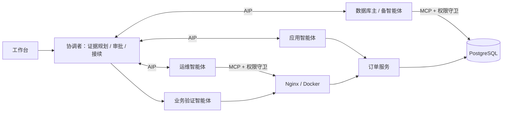

# Incident Pilot · 跨系统故障诊断与协同恢复

让应用、数据库、运维智能体在各自权限范围内协作：收集证据、审批高风险操作、执行修复，并用完整订单流程确认业务恢复。

**当前定位：强基线。** 后续改动以本版本为参照，保留同条件对照和原始结果。能力与实测口径见[基线说明](docs/BASELINE.md)，开发协作见[COLLABORATION.md](COLLABORATION.md)。



## 开始使用

| 目的 | 入口 |
| --- | --- |
| 队友用自己的账号接手 | [开发者指南](docs/开发者接手指南_20261018.md) |
| 安装环境、启动、验证、停止 | [本地操作](docs/本地开发环境与操作_20261018.md) |
| 独立 Docker 项目部署 | [部署清单与资源隔离](deploy/ISOLATED.md) |
| 七身份梧桐接入 | [NEW7](deploy/NEW7.md) · [自己的平台配置](docs/自有账号平台配置_20261018.md) |
| 云端运维 | [服务器手册](deploy/SERVER.md) |
| 阅读设计与实验 | [文档索引](docs/README.md) · [实验记录索引](evidence/README.md) |

Windows 原生开发模式要求 Python 3.12 x64、项目 `.venv` 和 PowerShell 7.4+。首次按[环境说明](docs/本地开发环境与操作_20261018.md)准备后，在仓库根目录运行：

```powershell
pwsh -NoProfile -File deploy/local-up.ps1 -Install
```

工作台地址：`http://127.0.0.1:8766`。后续启动省略 `-Install`。该命令会启动本地数据库、订单服务和参与者；停止与资源检查见[停机操作](docs/windows_local_shutdown_20261019.md)。模型为显式可选项，本地开发不需要共享平台身份。

## 当前对照结果

完整 60 格本地实验：5 场景 × 4 方法 × 3 重复。严格通过数为 **M0 15/15、M2v2 15/15、MR 12/15、M1 9/15**。M2v2/M0 的逐配对总耗时比中位数为 **1.275452**，加权观察成本为 **90/126**，M2v2 无关高权限尝试为 **0**。

总耗时包含最终 30 秒验证窗口；结果限定于本机这五个故障家族，不能当作新故障泛化或云端性能结论。[完整报告与原始结果](evidence/p5-local60-r3-20261020/README.md)。

## 目录与开发

- `incident/`：协调、参与者、协议契约与传输。
- `acps_mcp_bridge/`、`domains/`：MCP 桥接、权限和幂等操作。
- `business/`、`demo-ui/`：订单业务与工作台界面。
- `deploy/`、`ops/`、`tools/`：部署、巡检和开发工具。
- `eval/`、`tests/`：实验执行器与测试；[测试环境说明](docs/test_environment_20261019.md)。
- `docs/`：设计和操作；`evidence/`：原始实验记录；`deliverables/`：报告材料。
- `vendor/`、`third-party/`：上游源码、来源及许可证；[第三方说明](THIRD_PARTY.md)。

运行目录、环境、真实证书与私钥由 `.gitignore` 排除。评审精简包与完整开发仓库分别维护，本机位置和版本关系见[仓库边界](docs/REPOSITORY.md)。
