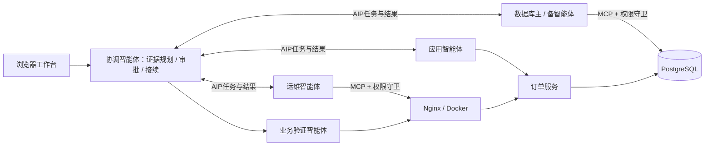

# Incident Pilot · 跨系统故障诊断与协同恢复

## 2026年10月30日材料协作

[打开协作资料入口](协作资料/README.md)：扩充文稿、现有材料、原始证据、视频与配音资料。

让应用、数据库、运维智能体在各自权限范围内协作：收集证据、审批高风险操作、执行修复，并用完整订单流程验证恢复。



## 一条命令启动

要求：**Python 3.10+、Docker Engine / Docker Desktop（Linux 容器）及 Compose v2**；建议至少 2 核、4 GB 内存、10 GB 可用磁盘。首次构建需要联网下载镜像和依赖。Windows 使用 PowerShell 7；也支持已安装 Docker 的 WSL `Ubuntu-22.04`。

仅在 WSL 内安装 Docker 时，演示期间保持该发行版的终端打开；WSL 退出会使容器停止。使用 Docker Desktop 时保持其运行。

在代码包根目录运行，任选当前系统的一行：

```bash
# Linux
bash deploy/up.sh
```
```powershell
# Windows
pwsh -NoProfile -File deploy/up.ps1
```

打开 **http://127.0.0.1:18766**。看到五个参与者已连接即启动完成；订单入口为 http://127.0.0.1:18088/ready。启动器自动生成本机随机密码，不需模型、API key 或梧桐证书。端口冲突时，首次启动前复制 [.env.example](.env.example) 为 `.env` 并改四个端口。

## 注入故障，看自动修复

保持工作台打开，在另一个终端运行：

```bash
# Linux：把本项目订单入口切到旧版，然后自动诊断与恢复
bash deploy/up.sh demo
```
```powershell
# Windows：同一演示
pwsh -NoProfile -File deploy/up.ps1 -Action demo
```

终端先确认真实入口变成 `v1`，工作台随后显示观察证据、`ops.route_rollback` 与业务验证。最终应显示 `completed`，终端打印 **PASS：30 秒 / 10 个完整创建—查询—取消流程**。结果保存在 `artifacts/review/`；失败原样保留。高风险操作仍需工作台审批，本演示只做固定旧路由恢复。

停止并保留数据：Linux `bash deploy/up.sh down`；Windows `pwsh -File deploy/up.ps1 -Action down`。排障把 `down` 换为 `logs`；不要用 Docker 的全局清理命令。

## 接入梧桐平台

默认演示使用真实业务和 **本地 AIP stdio 通信**，五个参与者以独立进程运行；它不连接梧桐、不上报访问量，也不是多主机隔离验收。演示工作台容器内的运维工具需要本机 Docker socket。

正式接入时，在 [Registry](https://wt.ioa.pub/registry/) 登记自己的七个身份，取得客户端证书、私钥和信任链；复制 [身份样例](integration/seven-identities.example.json)，填写各角色 `aic`、`endpoint`、`cert`、`key` 与 `trust_bundle` 的本机绝对路径。按 [梧桐接入步骤](docs/WUTONG.md) 生成独立六域容器和协调者配置，同一个身份同一时间只运行一份消费者。

## 强基线与开发

当前强基线的 60 格本地对照中，M0 与 M2v2 均为 15/15；逐配对总耗时比中位数为 1.275452。总耗时含最终验证窗口，适用范围为该批五个故障家族。团队开发从 `main` 建分支，结果口径见 [基线说明](docs/BASELINE.md)。

[开发、测试与目录说明](docs/DEVELOPMENT.md) · [第三方来源和许可证](THIRD_PARTY.md) · [MulanPSL-2.0](LICENSE)

本仓库包含开发源码与原始证据；导出的评审代码包仅含源码、测试、部署脚本、配置样例和必要说明。实验原始记录、图表、云部署验收与过程文档独立存放在同批交付的“佐证”包中。默认演示采用证据规则调度；M2v2 模型实验能力保留在 `incident/coordinator/` 与 `eval/`，不把无模型演示当作模型效果证明。
