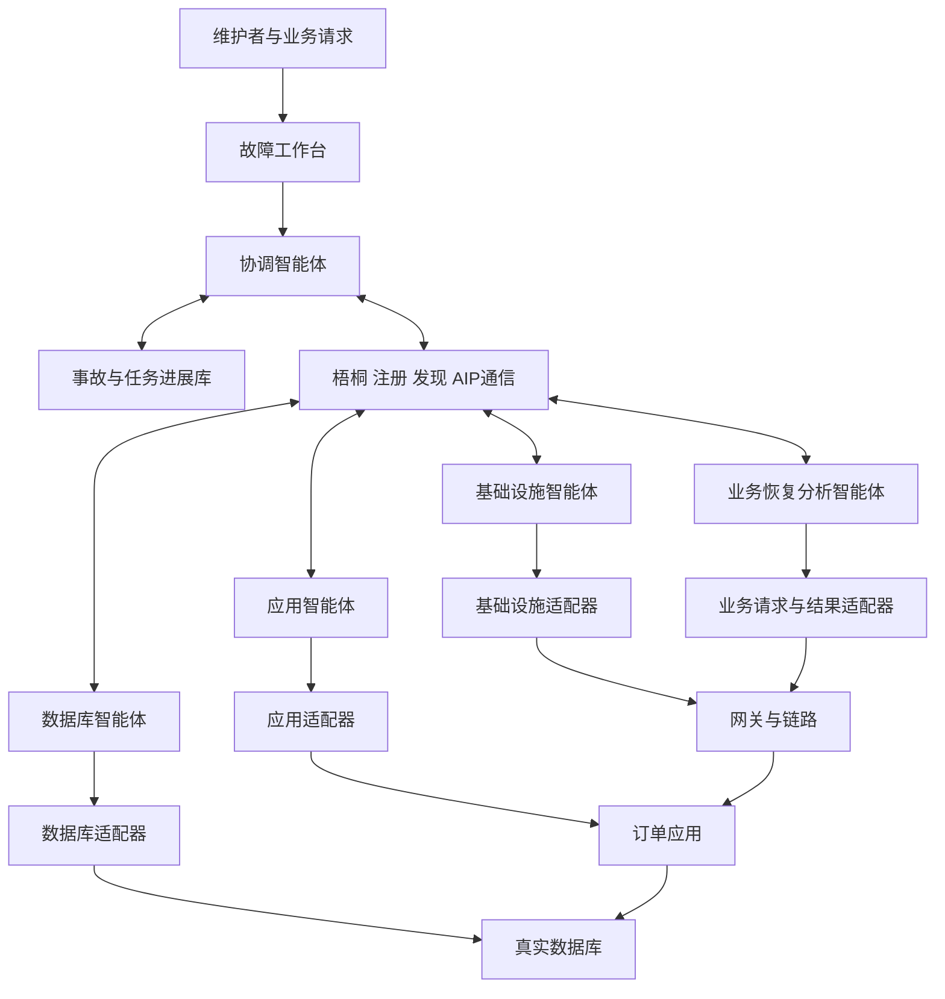
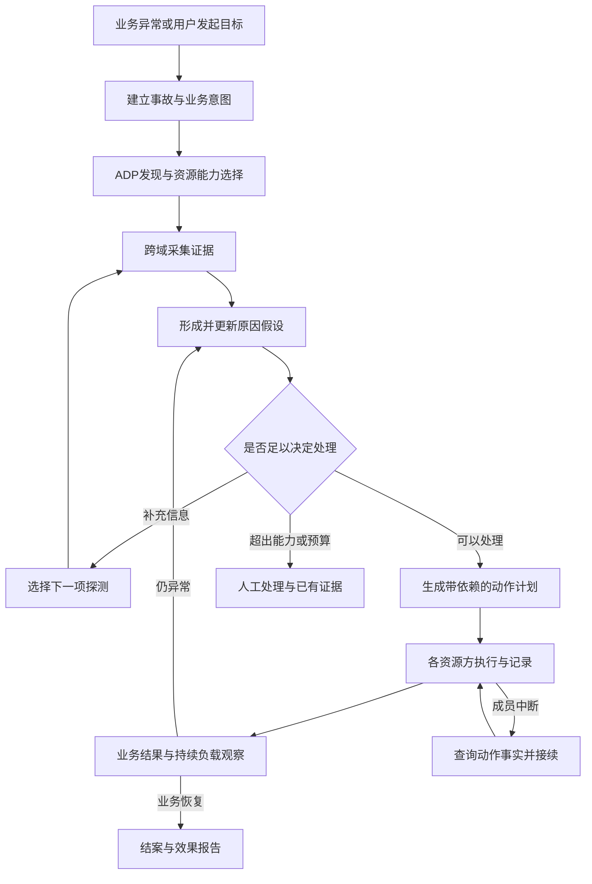

# 跨系统故障协作应用完整架构与业务设计

本方案以冻结的四智能体 v0.2.0 为起点，规划一套面向中小团队的跨系统故障诊断与协同恢复应用。用户提出“恢复订单提交，并处理结果不明确的请求”，系统通过梧桐发现相关参与者，交换各资源域的证据，调整排查与恢复计划，最终从实际业务结果判断恢复情况。

完整版包含五类智能体、应用与数据库及网关三个资源域、两节点部署、持续读写的订单业务，以及第二套开源业务的接入。核心研发集中在两项机制：根据证据选择下一项探测并调整任务图；根据资源与能力选择成员并携带进展接续任务。

配套设计：[故障场景与评测设计](</D:/AI + 开源/incident-pilot/docs/故障场景与评测设计.md>)；[分阶段开发计划与评分映射](</D:/AI + 开源/incident-pilot/docs/分阶段开发计划与评分映射.md>)。

## 一 目标用户与实际问题

目标用户是维护预约、报名、订单等自托管服务的小团队。服务已经运行，但故障信息分散在网关、应用、数据库和部署记录中，维护者需要切换工具、联系不同负责人，再判断操作顺序。一个外部超时可能来自完全不同的原因；修好一处之后，还可能留下另一处故障或结果未知的业务请求。

作品解决四个具体问题：跨域信息如何汇集；原因不确定时下一步查什么；不同资源方如何按依赖恢复；成员或协调进程中断后如何继续。社会价值通过部署与接入成本、人工处理次数、服务中断时间和业务结果体现。

需求阶段收集至少三类材料：一段实际故障处理过程及时间线；维护者现有工具和交接方式；一次由使用者独立完成部署或处理故障的反馈。真实试用与受控故障实验分别记录。

## 二 现有基线与扩展起点

| 内容 | 冻结基线现状 | 扩展目标 |
| --- | --- | --- |
| 正式身份 | 协调、应用、数据库、恢复分析四身份 | 保留四类，增加基础设施角色；替代提供方按实际资源需要登记 |
| 官方发现 | ADP按技能返回真实ACS，要求唯一候选并匹配预设身份 | 获取多个候选，在应用层按资源、接口和实际可达性选择 |
| 通信 | 官方SDK、Inbox邀请、AMQPS群组、任务和产物往返 | 保留通信路径，加入持久任务映射和中断接续 |
| 诊断 | 已知错误对应固定规则 | 处理原因歧义、证据冲突、复合故障，动态选择探测 |
| 业务 | HTTP读取三条SQLite订单，数据库可用状态开关 | 真实数据库与网关，持续创建、查询、取消 |
| 运行证据 | 组合故障8任务、两次修复、6.19秒；正常场景2任务、零修改 | 跨场景对照、后台访问数据、迁移和使用反馈 |
| 部署 | 同机独立进程 | 两个独立节点，资源与工具按域分配 |

基线目录为 `D:\AI + 开源\incident-pilot\baselines\incident-v0.2.0-20261017T045307Z`。历史425项本地场景与断言用于说明已有工程覆盖；正式梧桐业务结果与后续模型实验单独统计。

## 三 系统边界与整体架构

梧桐承担正式身份注册、ACS能力发布、ADP发现及智能体通信。项目承担业务接入、参与者选择、证据管理、诊断、恢复调度、进展保存和用户界面。订单数据与业务服务由目标系统管理。

文中AIP指比赛要求的智能体互联协议；ACPs SDK是本项目使用的官方参考实现工具；AIC标识正式智能体身份；ACS描述能力与端点；ADP提供发现。任务图、业务回执和资源动作记录是本项目在应用层实现的对象。

智能体之间的任务和结果通过AIP通信；各智能体使用自己的工具访问所属资源。工作台调用协调服务，资源适配器调用业务或管理接口。项目提供面向故障处理的应用界面。

各层的交付边界如下。

| 层 | 模块 | 主要职责 |
| --- | --- | --- |
| 用户层 | 故障工作台、业务请求生成器、报告视图 | 发起目标、查看证据和动作、观察业务结果 |
| 协作层 | 原因与证据关系、下一探测选择、任务图、成员选择、进展接续 | 决定谁做什么及何时调整 |
| 互联层 | 官方SDK适配、ADP客户端、Inbox与群组、任务产物记录 | 维持AIP身份与消息关联 |
| 资源层 | 应用、数据库、基础设施、业务四类适配器 | 将真实工具差异转换为项目契约 |
| 记录层 | 协调进展、域内动作记录、原始证据引用、实验产物 | 支撑恢复、复盘与效果统计 |

首发协调进展库采用单活服务管理的SQLite；订单采用PostgreSQL。各资源适配器维护自己的持久动作记录，协调者保存引用与汇总。这样协调库与业务库故障互不等同，资源修改结果也不只存在于协调进程内存。

## 四 两节点部署

| 节点 | 进程与资源 | 主要责任 |
| --- | --- | --- |
| 管理与应用节点A | 工作台、协调者、协调进展库、订单应用、应用智能体、业务恢复分析智能体 | 提交目标、业务执行、应用诊断与业务观察 |
| 数据与入口节点B | Nginx网关、PostgreSQL、基础设施智能体、数据库智能体、域内适配器 | 对外路由、数据库与基础设施管理 |

业务路径为“业务客户端→节点B网关→节点A应用→节点B数据库”。智能体通信经梧桐完成。节点可以是独立物理机或虚拟机；两台节点是工程目标，官方附件要求的是跨端互联。

资源节点首选Linux及隔离容器，以便稳定复现进程、路由、数据库和限额数据卷故障。管理节点沿用现有Windows环境。节点资源、网络可达性、容器运行条件和模型入口在M1明确；本设计不把尚未提供的第二节点记为已有环境。

主智能体统一使用Python和官方ACPs SDK，固定当前官方源码版本作为开发起点。异构首先体现在业务技术栈、工具接口、节点和资源归属中。第二业务增加PHP与MySQL适配，协作内核保持同一套。

## 五 智能体职责与能力

资源角色同时提交工具事实、局部原因判断和建议动作。应用方可以用请求与版本证据质疑数据库原因，数据库方可以用连接与锁证据提出替代解释；协调者据此安排补充探测或调整计划。确定性观察直接返回事实，复杂日志解释与证据冲突再调用领域推理。正式比较统一模型与累计预算。

### 协调智能体

保留现有Leader身份。输入是目标、受影响业务和初始症状；输出是参与者选择、证据关系、任务图、恢复计划和最终报告。

职责包括：发现候选；汇总领域判断并列出可能原因；选择下一项探测；安排可并行的观察；根据动作依赖推进恢复；保存进展；处理中断；根据业务分析结果结案或转人工。协调者通过各域智能体执行资源操作。

内部模块为诊断推理、探测排序、任务图调度、候选选择和进展管理。工作台在本地协调服务中创建事故；远程入口若公开，则另行更新ACS与运行处理逻辑，保持能力描述与实际入口一致。

### 应用智能体

保留 `incident.application` 能力。管理指定应用的进程、版本、配置、连接池及应用日志。

观察技能：读取请求错误与调用关联；查看部署变更；读取连接池使用与排队状态；直接访问应用；比较应用与数据接口版本。

动作技能：恢复本应用进程；回退已有兼容版本或配置；更新连接目标；重建应用连接池。每个动作返回实际修改的资源、前后版本、动作编号和结果依据。

发布变更分析、日志检索和文档检索作为其内部技能。资源工具返回结构化事实，模型解释事实并提出下一步建议。

### 数据库智能体

保留 `incident.database` 能力。管理指定数据库及其可用的恢复入口。

观察技能：运行与连接状态、连接来源、锁和长事务、读写配置、迁移版本、订单与业务回执。操作范围按数据库及操作类型明确。

动作技能：恢复项目管理的数据库进程；回退读写配置；结束明确归属于实验业务的阻塞会话；调整已登记的连接配置。数据库结构破坏且无备份等情况输出损失与人工处理事项。

订单结果查询使用主库事实与事务回执；资源管理动作使用域内动作记录。两类记录分别解释。

### 基础设施智能体

新增 `incident.infrastructure` 项目能力。管理指定网关、路由和项目资源运行入口。

观察技能：实际路由与上游、网关转发日志、跨节点连通性、进程入口、限额数据卷容量。动作技能：恢复已登记路由版本；恢复项目管理的入口服务；执行已有资源扩容入口。

该角色负责解释“应用内部正常，但用户访问失败”等跨域现象。网络检查可以并行，路由修改由本域串行执行。

### 业务恢复分析智能体

保留 `incident.verification` 能力。管理固定业务负载与观察器，通过业务入口创建、查询、取消隔离测试订单，关联客户端请求、业务回执和订单状态。统一负载按固定配置运行；智能体读取汇总、主动取证和续办原意图的调用另计工具预算。

它维护原始用户意图与业务幂等键，输出成功请求、失败请求、结果未知请求、订单状态与持续业务指标。需要主库事实时，通过协调者向数据库角色发起取证；本角色通过业务接口完成操作。

它拥有独立的结案依据：网页响应、查询响应、写入完成、取消完成、结果未知请求处理分别呈现。它发现业务仍异常时，将现象和证据交回协调者继续处理。

### 逻辑角色与运行身份

五类角色是职责划分。成员替换实验可能需要同类角色的第二个正式身份，例如另一个有权访问同一数据库适配器的提供方。首选先完成原身份进程重启接续，再建设替代身份接管。新增身份服务于具体资源和替换场景；现有已删除的旧回声测试身份保持历史状态。

## 六 主业务与结果语义

主业务采用Python应用、PostgreSQL和Nginx，操作包括创建订单、按订单号或请求键查询、取消订单。订单状态为CREATED或CANCELLED，业务不涉及支付。

创建请求带有客户端生成、重试时保持不变的请求键。订单与对应回执在同一数据库事务中提交；回执包含请求内容摘要、订单号及结果。相同键和相同内容返回原结果；相同键对应不同内容返回冲突。

固定客户端对未完成意图采用相同重试安排，并在全部比较方法中共享。业务恢复分析角色读取汇总、批量查询原请求或主动续办；这些按需调用计入工具预算。客户端自动重试与事务幂等是业务底座，其效果和协作机制收益分别呈现。

客户端收到成功回执后展示创建成功。连接超时、网关502或504、通用应用500、连接中断都可能发生在提交之后；缺少明确提交结论时展示结果未知，后续按原键读取或继续同一请求。只有业务明确拒绝且不会执行，或事务已回滚等事实才能认定本次未提交。暂时查不到记录时仍保持原键，避免原请求稍后提交而新请求再次创建。

取消使用独立操作键，将CREATED条件更新为CANCELLED；重复取消返回既有结果。创建结果未知时，先解析原创建结果，再执行取消意图。业务意图、操作键和订单号保持关联。

| 业务状态 | 含义 | 后续处理 |
| --- | --- | --- |
| 创建成功 | 订单与创建回执已提交，客户端已取得结果 | 展示订单并允许查询、取消 |
| 明确失败 | 业务明确拒绝或事务已回滚等事实证明本次未提交 | 恢复后以原键继续用户仍需完成的意图 |
| 结果未知 | 超时、通用错误或回复丢失，尚不明确是否提交 | 按原键取证或续办 |
| 取消成功 | 取消结果与回执已提交 | 展示CANCELLED |
| 人工处理 | 当前工具无法确定事实或完成恢复 | 输出受影响请求和需要处理的事项 |

业务恢复包含两个层面：仍有效的原始用户意图达到目标状态，例如需创建的订单实际存在、需取消的订单为CANCELLED；服务能够在固定负载与观察窗口下继续完成新的创建、查询、取消。未知请求变为明确失败可以计入结果解析，仍需续办的意图不因此算作恢复。

## 七 从发现异常到结案的业务流程

1. 工作台或业务观察器提交目标，保存事故编号、受影响资源、原始请求键和起始时间。
2. 协调者按所需能力发现候选，结合目标资源选择参与者，建立正式协作会话。
3. 应用与入口等独立观察可以并行；先取得能够区分常见原因的少量事实。
4. 协调者建立原因与证据关系，选择下一项探测。工具异常也作为事实记录，不能当成目标系统的根因。
5. 证据足以支持动作时，形成目标、前置状态、依赖关系、预期效果与回退方式。
6. 资源方执行各自操作。新事实改变原计划时，协调者调整尚未执行的节点。
7. 业务恢复分析角色处理原有结果未知请求，并发起新的完整业务流程。
8. 观察窗口满足目标后结案；故障仍在则继续诊断；工具不支持或预算耗尽则带当前证据转人工。

事故阶段使用取证、计划、执行、业务观察、恢复、人工处理等应用概念。阶段允许往返，例如执行后发现新问题会重新取证。

## 八 能力发现与参与者选择

ACS保留官方支持的技能、版本、标签、说明与端点等字段。资源作用域、动作集合和项目接口版本使用应用契约表达，通过只读能力描述任务取得；它们不是新增的AIP标准字段。

选择过程如下：

1. 官方ADP按受支持的技能条件返回候选ACS和端点。
2. 协调者先以官方Inbox邀请建立候选只读确认会话，候选入群后通过正式AIP任务返回能力描述，包括可管理资源、支持的观察与动作、接口版本、业务回执能力等。
3. 按本地已配置的资源授权与任务要求形成可选集合。技能名称相同，只代表能力类别相同。候选确认会话结束后关闭；选中者加入事故正式协作会话，所需时间与消息计入开销。
4. 获取实际可达性和近期运行表现，选择候选。平台在线状态为unknown时，实际探测提供额外依据。
5. 记录选择原因并建立任务；出现中断时重新执行选择，将接续包交给新尝试。

候选自述的资源权限须与资源适配器的授权一致。替代数据库成员只有访问同一目标资源及同一动作记录的资格，才能接续该数据库任务。

官方ADP提供发现结果，候选排序和任务适配由本项目完成。平台目录状态、运行心跳和后台访问量是三种不同数据，界面与报告分别呈现。

## 九 任务与产物契约

跨智能体任务继续使用官方AIP任务、Product和TextDataItem承载项目JSON数据。业务字段位于消息数据内。

| 对象 | 关键字段 | 用途 |
| --- | --- | --- |
| 事故 | incident_id、业务目标、system_id、受影响请求、预算、起始时间 | 持久关联整个业务过程 |
| 逻辑任务 | logical_task_id、目标资源、所需能力、依赖任务、状态 | 描述一项待完成工作 |
| 尝试 | attempt_id、AIC、sessionId、taskId、协调任期 | 关联某次正式通信与执行 |
| 证据 | evidence_id、资源、来源AIC、采集时间、资源版本、摘要、原始引用 | 支持原因判断与接续 |
| 原因假设 | hypothesis_id、解释、支持证据、冲突证据、尚缺事实 | 说明当前判断与疑点 |
| 探测 | probe_id、能力、参数、预期可区分的原因、成本与时延估计 | 选择下一项观察 |
| 动作 | operation_id、目标资源、参数摘要、前置状态、预期效果、补偿方式 | 标识稳定的修改意图 |
| 动作结果 | operation_id、执行者、实际状态、前后版本、结果依据 | 说明资源实际发生什么 |
| 进展包 | 目标、资源、证据、当前假设、剩余任务、动作及结果 | 供同身份重启或新成员接续 |

每种项目数据带schema_version。技能接口版本、数据schema版本、资源配置版本分别使用，避免将业务兼容与协议版本混为一项。

一次逻辑任务可以有多个尝试，每次新派发使用新的AIP任务关联。operation_id在同一修改意图下保持稳定。大日志保留在证据源或证据存储中，产物携带摘要和可读取引用。

AIP任务的accepted、working、awaiting-completion、completed等状态表示单项任务交付过程。整个事故的恢复状态由业务流程维护。传输重连或Continue命令本身不提供业务检查点。

## 十 证据驱动的协作机制

协调者维护“原因假设—证据—探测—动作”的关系及任务依赖。模型提出原因解释和候选探测；排序模块选择下一项探测；资源智能体执行工具并返回事实。

首版探测排序使用如下确定规则：

1. 每个工具声明有限结果类别，例如可达或不可达、可写或只读。协调者为当前每个原因假设生成该探测的预期结果集合，未知预测单列。
2. 两项假设的预测集合均已知且不相交时，这一对计为可区分；含未知预测或集合重叠则计零。D为可区分对数除以当前全部假设对数。
3. 工具目录提供固定成本C，近期记录提供中位耗时T，无记录时使用开发阶段配置。C以1个工具成本单位归一，T以1秒归一；按D除以“C加0.2乘T”排序。成本目录、时间配置和0.2权重在正式评测前固定。
4. 得分相同时先选预计耗时更短者，再按固定probe_id顺序。独立观察可选取排名靠前的最多三项，仍受全局预算约束。
5. 只剩一个待证实原因时，优先补齐相应动作的前置事实；所有探测区分度为零时，也先检查是否存在这种必要观察。没有有用探测、可行处置或剩余预算时转人工。

预测依据来自工具说明、开发集与当前证据。动作进入计划需有资源证据支持，关键相反证据得到解释；业务达到目标后结案。该轻量策略的价值通过与自由工具循环和移除排序模块的比较确定；历史成功率或学习权重安排在首版结果之后。

任务图以观察、判断、修改和业务观察为节点。独立观察可并行；同资源修改串行；跨域动作依赖由计划明确。例如数据库恢复写入后，再让应用刷新连接状态。证据过期、版本变化或互相冲突时，优先补采相关观察，再调整尚未执行的节点。

协调者每次调整保留原因、使用的证据和替换的节点。报告可以回答“为什么现在找数据库”“为什么没有先重启服务”“为什么恢复网关后仍继续排查”。

## 十一 进展保存与中断接续

记录分为协调进展与域内动作两部分。协调进展保存事故、任务图、成员和证据引用；资源适配器保存实际动作意图与结果。接管同一资源的成员使用同一份域内记录。

| 中断位置 | 保存事实 | 接续方式 |
| --- | --- | --- |
| 观察开始前 | 任务目标与参数 | 新尝试执行观察 |
| 观察完成后 | 结果、时间、资源版本 | 时效允许则复用；相关状态变化则重新采集 |
| 修改开始前 | operation_id与前置状态 | 查询资源端记录后继续 |
| 修改发出、结果不明 | 操作意图、执行阶段、已有记录 | 查询实际资源状态及回执，再决定后续 |
| 修改已确认 | 结果和后置状态 | 引用既有结果，推进后续节点 |
| 业务请求回复丢失 | 业务请求键和用户意图 | 查询订单事务回执，以原键续办 |

### Partner进程重启

同一身份恢复时，先结束旧实例或其消费者，再以原身份恢复正式连接，读取域内任务与动作记录。新传输尝试映射回同一逻辑任务。

### 替代身份接管

新AIC通过发现、能力及资源授权选择后加入协作。它取得进展包，读取同一资源适配器的动作记录，再继续剩余工作。接管授权版本记录在资源端，旧尝试不能继续发起新的资源修改。

### 协调者重启

首发采用单活协调者。重启后取得新的协调任期，读取持久事故和任务图，对执行中的动作查询事实。SDK内存会话已失效时创建新的正式会话，以incident_id关联历史轮次。

### 并发与修改归属

同一资源的写操作由所属适配器排队，动作记录关联operation_id、协调任期和接管版本。适配器持久保存当前有效任期与接管版本，在实际执行前原子核对它们和资源前置状态；旧任期、旧接管版本的排队动作标为已取代。已经开始的动作先确认结束与实际结果，再推进同资源后续修改。

重复operation_id返回已有状态；参数不同的同号动作返回冲突。接管授权通过正式协调身份发起并由资源端持久记录。尚在执行或结果不明的修改先解析结果，再释放依赖它的后续修改。

订单与业务回执在同一事务内提交。重启进程、改网关等外部管理动作采用意图记录和实际后置状态确认；无法确定结果的操作保留为未知并进入人工处理。跨域恢复采用分步执行和必要补偿。

## 十二 最终演示业务

主演示使用“网关旧路由与数据库只读叠加，数据库角色在修复回报前中断”。故障注入器只向评测记录写入实际原因，协调者收到的只有业务现象。

1. 工作台展示订单持续提交，随后出现外部502与提交失败。
2. 协调者组织应用、入口取证，区分应用退出与网关错误。
3. 基础设施角色发现旧路由；应用角色证明新实例可读但写入失败。
4. 协调者保留两项原因，生成恢复入口、恢复写入及刷新连接状态的计划。
5. 数据库角色完成一项修改后中断。接续者读取同一资源动作记录与当前状态，确认已有修改并完成剩余工作。
6. 业务恢复分析角色处理原请求，并持续创建、查询、取消新订单。
7. 报告并列展示平台任务、证据变化、接续过程和业务结果。

“订单已提交但回复丢失”单独作为第二个短案例，展示相同超时症状下如何选择查询主库回执，并以同一请求键取得唯一订单。完整场景与观察指标见配套故障设计。

## 十三 工作台与用户流程

复用当前demo界面与服务中适用的部分，逐步形成五个视图。

| 视图 | 用户需要看见的内容 |
| --- | --- |
| 系统与能力 | 系统依赖、资源归属、正式参与者、可用技能与最近运行状态 |
| 事故概览 | 用户目标、影响范围、业务成功与未知请求、当前处理阶段 |
| 证据与计划 | 当前原因、依据、下一项探测、任务依赖与调整理由 |
| 操作与接续 | 每次修改的对象、结果、进展、成员替换与继续位置 |
| 业务结果与报告 | 原请求结果、新业务流程、恢复时间、人工参与、平台交互引用 |

用户操作顺序为接入目标系统、查看业务状态、发起或查看事故、阅读处理计划、观察执行与接续、查看业务结果、导出报告。管理动作的执行范围在系统接入时配置；需要额外授权的动作以具体业务操作呈现。

## 十四 第二业务与复用设计

第二业务选择Easy!Appointments作为迁移目标。其官方仓库提供自托管预约应用，使用PHP、MySQL，并提供REST API和OpenAPI描述。[官方仓库](https://github.com/alextselegidis/easyappointments)、[REST API文档](https://easyappointments.org/documentation/rest-api/)。

迁移流程使用创建预约、读取预约、移除预约，按目标系统原生语义记录结果。该流程复用协调者、发现、证据、探测排序、任务图和接续机制；新增应用、MySQL、业务结果三个适配器与资源配置。

原生REST文档没有建立本项目订单事务回执的语义，因此能力描述中分别声明支持情况。第二业务首轮比较进程、路由、连接和读写故障；不确定写入结果按其实际查询与操作能力处理。原子幂等若需加入，须在该业务事务边界实现，不能用外部记录替代。

迁移成效记录新增适配器、修改的业务规则、接入用时及协作内核变更。交付保留原项目许可证与来源。

## 十五 创新主张与开源贡献

### 创新一 根据证据选择下一项跨域探测并调整任务图

研究问题是：在相似症状与不同原因下，探测选择能否减少无效排查，同时维持根因判断和业务恢复效果。形成探测排序策略、动态任务图与同条件对照结果。

### 创新二 根据资源能力选择成员并携带进展接续

研究问题是：成员中断后，怎样复用有效证据、解析已发动作并完成剩余工作。形成候选选择、证据进展包、资源动作记录与接续实验。

### 可复用工程贡献

保留官方GroupLeader、Partner、ADP和传输实现，整理已有单Inbox分发适配；新增项目契约、候选选择、进展映射、动作结果查询与交互记录组件。明确官方原生模块、项目适配模块和业务模块，提供最小接入示例。

| 已有工作 | 已覆盖的能力 | 本项目比较的具体问题 |
| --- | --- | --- |
| HolmesGPT | 多来源实时工具循环和排障能力 | 相同工具与预算下，显式探测排序是否改善排查效率 |
| AIOpsLab | 故障环境与AIOps评测框架 | 借鉴可执行故障和业务结果评价，评测本项目机制 |
| OpenRCA | 大规模遥测分析与根因分析参照 | 诊断结果与在线恢复、接续结果分别比较 |

来源：[HolmesGPT](https://github.com/HolmesGPT/holmesgpt)、[AIOpsLab](https://github.com/microsoft/AIOpsLab)、[OpenRCA](https://github.com/microsoft/OpenRCA)。多智能体、日志分析和自动发现作为系统能力；创新结论由上述具体机制与实验建立。

## 十六 完整版交付范围

完整版包含：五类核心角色及所需正式身份；两节点订单业务；三个资源域的适配器；两项协作机制；故障与业务结果评测；第二业务迁移；完整工作台；部署、报告、视频与平台后台数据。

优先完成主业务、真实跨域互联和创新对照，再推进接续与迁移。各阶段的输入、输出、完成标准、并行分工与评分材料见[分阶段开发计划](</D:/AI + 开源/incident-pilot/docs/分阶段开发计划与评分映射.md>)。

## 十七 依据

- [官方赛题页面](https://www.aicomp.cn/tracks/tracks-5/5169.html)。
- [官方评分与作品要求本地正文](</D:/AI + 开源/参赛资料_2026AIC_其他赛道_20261016/官方附件/附件1AIC·智能体互联竞赛规则及作品提交要求.txt>)。
- [官方技术报告大纲本地正文](</D:/AI + 开源/参赛资料_2026AIC_其他赛道_20261016/官方附件/附件2AIC·智能体互联技术报告参考大纲.txt>)。
- [官方ACPs代码](https://github.com/AIP-PUB/ACPs-community)。现有固定版本为v2.2.0，提交3985c1330209f075c124669cc9d31f0e75448140。
- [冻结基线真实运行结果](</D:/AI + 开源/incident-pilot/baselines/incident-v0.2.0-20261017T045307Z/integration/artifacts/wutong-incident-20261017T0440Z/RESULT.json>)。
