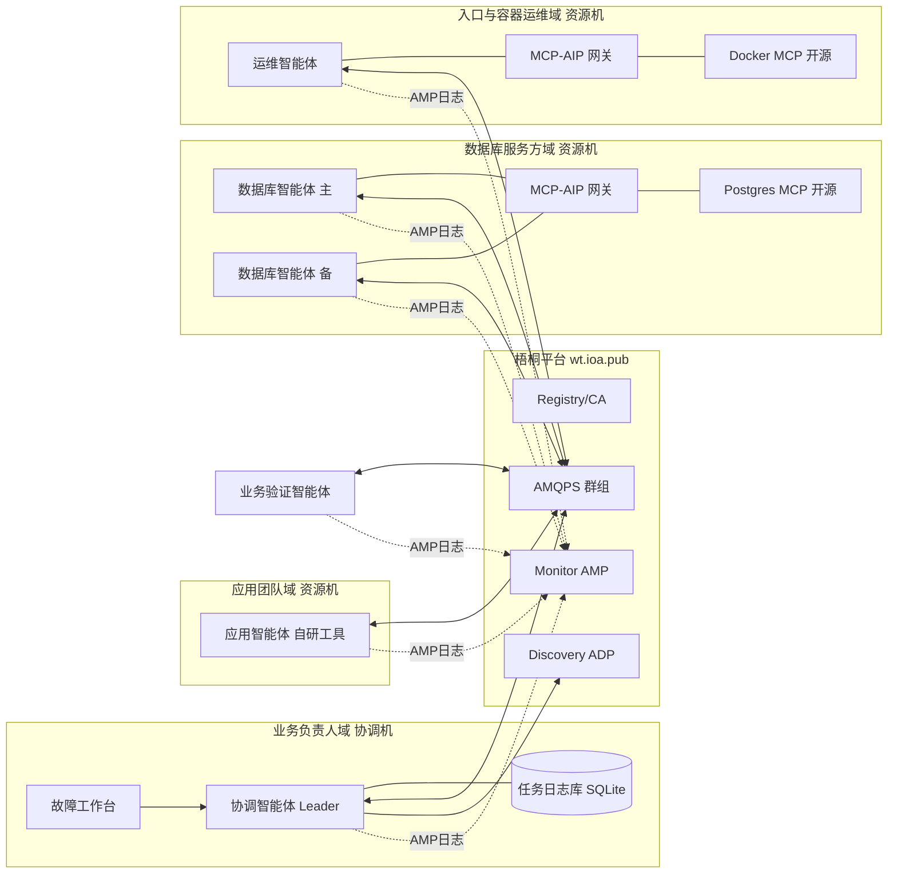
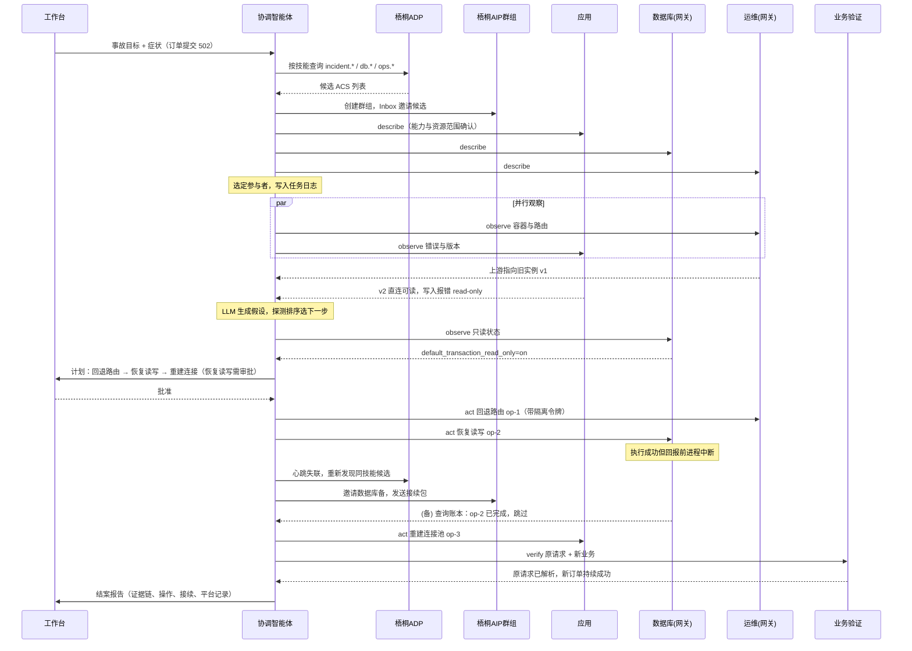
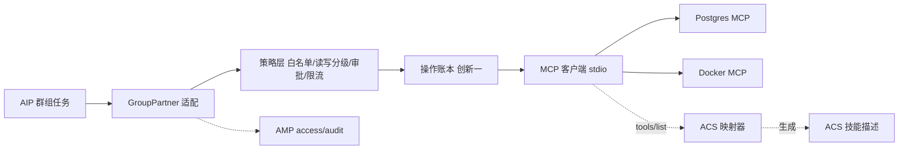

# 高分方案：凭据不出域的跨组织故障协同智能体

本文是 incident-pilot 在“智能体互联”赛道的最终执行方案，取代 `完整架构与业务设计.md`、`分阶段开发计划与评分映射.md`、`故障场景与评测设计.md` 中与本文冲突的部分（未冲突的业务语义、幂等回执设计继续沿用）。写给开发者直接照做：每项任务都有产出物和验收标准。

依据：官方《附件1 竞赛规则及作品提交要求》《附件2 技术报告参考大纲》（`参赛资料_2026AIC_其他赛道_20261016/官方附件/`）、官方代码 `vendor/ACPs-community` v2.2.0（提交 3985c13）、官方教程 `acps-docs/tutorials/amp-agent-observability.md`、现有 v0.2.0 平台运行记录。

---

## 0 定位

**作品名称（16字）：** 凭据不出域的跨组织故障协同智能体

**一句话：** 一个线上业务由多个组织共同维护（应用团队、数据库服务方、入口与容器运维方），各方的凭据和工具不能交给别人；本作品让各方以 AIP 智能体对外暴露“可观察、可操作”的能力，由协调智能体经梧桐平台发现、组队、按证据调度跨组织排查与恢复，中断可接续、全程有 AMP 审计。

**作品简介草稿（约 280 字，提交时按实测数据替换方括号）：**

> 线上业务出故障时，应用、数据库、网关往往分属不同团队或厂商，排障要么靠群聊转述，要么把全部系统的凭据交给一个“万能”运维智能体，后者在跨组织场景中不可接受。本作品基于 AIP 国家标准与 ACPs 开源代码，构建凭据不出域的跨组织故障协同系统：各资源方以独立 AIC 身份在梧桐平台注册，通过自研 MCP→AIP 接入网关把现成开源运维工具变为标准智能体；协调智能体经 ADP 自动发现参与者，以证据驱动的探测排序动态调整跨域任务图；我们为官方 SDK 扩展了可接续群组任务，参与者中断后可由替代智能体无重复地完成剩余操作。在 [8] 类真实故障上，[平均恢复 xx 秒、无效排查减少 xx%、接续零重复修改]，协调方持有凭据数为 0，梧桐平台累计访问 [xx] 次。

---

## 1 评分对照总表

每一项都对应本文中的具体交付和报告中的证据。开发时如果某项任务与评分无关，优先级就往后排。

| 评分项（分值） | 高档要求原文要点 | 本方案的对应 | 报告/材料中的证据 |
| --- | --- | --- | --- |
| 创新性（25） | 基于开源代码**深度二次开发**；创新设计多智能体协同交互方案；适配 AIP 国标 | 创新一：SDK 可接续群组任务扩展（改官方代码）；创新二：MCP→AIP 异构接入网关（新增官方生态组件）；创新三：证据驱动跨域调度 | 原生/改造/新增对照表与改动行数；fork 仓库与 PR；三组对照实验 |
| 需求分析（10） | 异构智能体互联痛点；多智能体互通场景调研；**智能体互联标准化、平台接入场景**分析 | 第 2 节：跨组织、凭据不出域；异构工具无统一身份/发现/审计；本队梧桐接入实测问题清单 | 痛点-需求-指标对应表；调研访谈记录；接入问题清单 |
| AI 技术应用（20） | 熟练运用开源代码；完整遵循 AIP；稳定接入梧桐；**设备自动发现**；**跨智能体双向通信**；难度高、运行稳定 | ADP 按技能发现 + 能力确认；AIP 群组双向任务；AMP 六类日志；LLM 假设生成；7×24 持续运行 | 官方发现原始响应；任务时序；连续运行报告；AMP 查询截图 |
| 项目实施（15） | 实施方案完整，关键技术实现良好 | 第 8 节任务清单、冻结点、一键部署 | 版本记录、接口文档、测试报告 |
| 应用成效（10） | 梧桐**访问数据详实**；多智能体互联稳定；可落地行业场景 | AMP access 全量上报；定时真实故障演练；公共“接入体检”技能带来外部真实调用 | 后台访问量截图；外部调用方统计；演练成功率 |
| 总结与展望（10） | 复盘开源代码改造、平台接入全过程；对**互联标准化落地**提出前瞻思路 | 接入问题→Issue；接续语义、MCP 映射提为标准建议 | AIP-PUB Issue/PR 链接；标准化建议章节 |
| 附加分（10） | 一键部署源码 1-3；视频完整 1-3；访问排行 1-4 | `deploy/` docker compose + 脚本；分镜视频；第 6 节访问量方案 | 部署说明；视频；排行截图 |

---

## 2 需求分析

### 2.1 场景与用户

目标场景是**一个业务由多个组织共同运维**。这在中小企业和高校信息化中非常普遍：业务应用由开发团队维护，数据库托管给云厂商或学校信息中心的 DBA，入口网关和容器平台由另一支运维团队管理。

本作品的演示业务是一个订单服务（创建、查询、取消），由三个“组织”分别管理：

| 组织（信任域） | 掌握的资源 | 掌握的凭据 | 对外愿意提供什么 |
| --- | --- | --- | --- |
| 应用团队 | 订单应用容器、应用配置、应用日志 | 应用部署权限 | 应用诊断、回退配置、重建连接 |
| 数据库服务方 | PostgreSQL 实例 | 数据库管理员账号 | 只读健康诊断、受控的少数恢复动作 |
| 入口与容器运维方 | Nginx 网关、Docker 主机 | Docker 主机权限 | 容器状态与日志、路由检查、受控重启 |
| 业务负责人（协调方） | 业务目标、订单客户端 | **不持有任何资源凭据** | 发起事故、审批高风险动作、查看报告 |

### 2.2 痛点（从智能体互联视角）

1. **凭据不能集中。** 现有 AI 排障方案（如 HolmesGPT）是单个智能体调用多源工具，前提是把所有系统的凭据配置给它。跨组织时，数据库方不会把管理员账号交给应用团队的智能体，这条路走不通。
2. **各方工具异构，没有统一的身份、发现与通信。** 数据库方可能用开源的 Postgres MCP 工具，运维方用 Docker MCP 工具，应用团队用自研脚本。MCP 只解决“智能体调用工具”，不解决“跨组织的智能体之间谁是谁、怎么找到、怎么协作、谁对什么操作负责”。
3. **协作过程不可审计。** 群聊转述“我重启了一下”无法追溯谁在什么时候对哪个资源做了什么、依据是什么。
4. **协作会中断。** 某一方的智能体进程崩溃、网络中断或值班交接时，已经做过的修改和收集的证据容易丢失，导致重复操作（例如重复回退配置）或遗漏。
5. **接入标准落地成本高。** 本队在梧桐平台接入过程中实际遇到：ACS 首轮被驳回、审核通过后 ADP 一度查不到记录、CLI（`/acps-adp-v2`）与 Demo 客户端（`/discover`）的发现路径不一致、单 Inbox 需同时分发邀请与任务反馈、证书 EAB 流程步骤多。每一个新接入方都要重复踩坑。

### 2.3 现有方案为什么不够

| 方案 | 能做到 | 做不到 |
| --- | --- | --- |
| 单体 AI 排障（HolmesGPT 等） | 多工具诊断 | 要求集中凭据；无跨组织身份与审计 |
| MCP 工具协议 | 智能体调用工具 | 无组织级身份、发现、群组协作、监控规范 |
| 工单/IM 人工协作 | 跨组织沟通 | 慢、靠人转述、不可机器验证 |
| 官方 ACPs SDK 原生能力 | 身份、发现、群组任务、监控 | 群组任务状态只在内存，无业务检查点与接管；无现成工具接入层 |

AIP 国标提供了身份（AIC + mTLS）、能力描述（ACS）、发现（ADP）、交互（AIP）、监控（AMP）这五块底座，正好对应痛点 1-3。本作品要验证这套标准能否承载“凭据不出域的跨组织故障协同”，并补上痛点 2、4、5 中官方实现尚缺的部分。

### 2.4 需求与指标（按大纲要求分四类）

| 类别 | 需求 | 指标与目标值 |
| --- | --- | --- |
| 功能 | F-1 各信任域以独立 AIC 注册，经 ADP 自动发现 | 5 个业务智能体全部审核通过；协调者通过 ADP 发现成功率 100% |
| 功能 | F-2 协调方零凭据完成跨域诊断恢复 | 协调方持有资源凭据数 = 0；全部 AIP 消息扫描无凭据泄露 |
| 功能 | F-3 现成开源工具无需改代码接入为 AIP 智能体 | MCP 工具自动映射为 ACS 技能；新增一个 MCP 工具接入时间 ≤ 30 分钟 |
| 功能 | F-4 参与者中断后可接续 | 三种中断点接续成功；重复修改效果 = 0 |
| 功能 | F-5 全程审计 | 每个修改动作都有 AMP audit 记录，可按事故编号查询 |
| 性能 | P-1 恢复速度 | 单故障端到端恢复中位数 ≤ 60 秒（含发现、模型、观察窗口除外） |
| 性能 | P-2 通信时延 | 单个 AIP 群组任务往返中位数、p95（实测报告） |
| 性能 | P-3 排查效率 | 相比固定流程，探测次数下降（实测报告） |
| 兼容性 | C-1 异构工具 | 至少 2 种第三方开源 MCP 工具（PostgreSQL、Docker）+ 1 种自研工具 |
| 兼容性 | C-2 协议版本 | 遵循 ACPs 02.02；改造部分向后兼容原生 Leader/Partner |
| 可部署 | D-1 一键部署 | `deploy/up.sh` 在新 Linux 机器 15 分钟内完成部署 |
| 可部署 | D-2 持续运行 | 7×24 在线，连续运行 ≥ 7 天，心跳在线率 ≥ 99% |

### 2.5 需要收集的调研材料（报告“需求分析”与佐证 PDF 用）

1. 一份真实的跨团队故障处理时间线：找学校信息中心、实验室服务器管理员或实习单位的一次故障，记录涉及几个团队、多少次沟通、各自用什么工具、耗时多久。没有真实对象时，至少引用一篇公开的故障复盘报告。
2. 2-3 位运维或开发人员的简短访谈（每人 10 分钟）：是否愿意把数据库/服务器凭据交给外部 AI 智能体；现在跨团队排障的方式。整理为问卷结果表。
3. 本队梧桐接入问题清单：从 `integration/two-agent/rejection-analysis-v1.json`、`PLATFORM-ONBOARDING.md`、`BUILD-VERIFICATION.md` 整理，每条写现象、原因、解决办法、耗时。
4. 一位队外同学按 `deploy/` 文档独立部署并处理一次故障的记录（耗时、卡点、反馈），作为用户反馈佐证。

---

## 3 总体架构

### 3.1 信任域与智能体



所有智能体之间只通过梧桐 AIP 群组通信；每个资源域的凭据只存在于该域的进程环境变量中。

### 3.2 智能体清单

| 智能体 | AIC | 实现方式 | 技能（ACS skill id） | 能做的动作 | 状态 |
| --- | --- | --- | --- | --- | --- |
| 协调智能体 | 沿用 leader | 自研，官方 GroupLeader + 可接续扩展 | `incident.coordinate` | 发现、组队、调度、接续、报告 | 已有，改造 |
| 应用智能体 | 沿用 application | 自研 Partner，访问应用管理接口 | `incident.application.*` | 读错误与配置、回退配置、重建连接池 | 已有，改造 |
| 数据库智能体（主） | 沿用 database | **MCP-AIP 网关 + Postgres MCP** | 由网关从 MCP 工具自动生成 | 健康诊断、锁与会话、只读状态；受控：恢复读写、结束指定阻塞会话 | 改为网关实现 |
| 数据库智能体（备） | **新注册** | 同上，第二个实例 | 同上 | 同上，用于接管实验 | 新增 |
| 运维智能体 | **新注册** | **MCP-AIP 网关 + Docker MCP** + 自研 Nginx 路由工具 | 自动生成 + `ops.route.*` | 容器状态、日志、重启；路由检查与回退 | 新增 |
| 业务验证智能体 | 沿用 verification | 自研 Partner | `incident.verification` | 订单负载、原请求解析、恢复判定 | 已有，改造 |
| 接入体检智能体（P1） | **新注册** | 自研 Partner，对全平台开放 | `aip.onboarding.check` | 对指定 AIC 做 ACS/发现/端点体检 | 新增 |

### 3.3 部署

| 位置 | 内容 |
| --- | --- |
| 资源机（暂用本地 Windows + Docker Desktop；有条件再换云 Linux） | docker compose：Nginx、订单应用（2 个版本实例）、PostgreSQL；应用、数据库主/备、运维、业务验证、体检 共 6 个智能体进程；Fluent Bit（AMP 转发） |
| 协调机（队友的第二台电脑；没有时与资源机同机） | 协调智能体、故障工作台、任务日志库、Fluent Bit |
| 梧桐平台 | 注册、证书、发现、AMQPS 群组、Monitor |

**本地优先开发。** 全部服务用 docker compose 运行，同一份配置在 Windows（Docker Desktop + WSL2）和 Linux 上都能用，后续迁移到云上只是换一台机器执行 `up`。智能体之间始终经梧桐平台通信，所以即使全部在一台电脑上，也满足“经平台互联”；两台电脑分别跑协调者和资源方，就构成更直观的“跨端互联”。

**7×24 在线的处理。** 访问数据要求资源机持续在线。没有云主机时，选一台能长期开机的电脑（台式机优先）作资源机：关闭睡眠与自动更新重启、插电、开机自启 Docker 与智能体。若做不到连续在线，建议最晚 10-20 租一台学生优惠云主机（2 核 4G 即可）只承担 7×24 运行，开发仍在本地。

### 3.4 原生、改造、新增（报告和答辩 PPT 的核心表）

| 层 | 模块 | 类别 | 位置 |
| --- | --- | --- | --- |
| 身份 | AIC、CA 证书、EAB 签发 | 原生复用 | `acps-cli` |
| 能力 | ACS 结构与校验 | 原生复用 | `registry-server` schema |
| 能力 | MCP 工具 → ACS 技能自动映射 | **新增** | `acps-mcp-bridge/acs_mapper.py` |
| 发现 | ADP 查询 | 原生复用 | `acps_sdk.adp` |
| 发现 | 候选能力确认与资源匹配 | **新增** | `incident/selection.py` |
| 交互 | GroupLeader / GroupPartner、Inbox 邀请 | 原生复用 | `acps_sdk.aip` |
| 交互 | 可接续群组任务（任务日志、尝试映射、接管、隔离令牌） | **改造官方 SDK** | `acps_sdk/aip/resumable/`（fork） |
| 交互 | Partner 侧操作账本与幂等执行 | **改造官方 SDK** | `acps_sdk/aip/resumable/ledger.py` |
| 监控 | 六类 Emitter | 原生复用 | `acps_sdk.amp` |
| 监控 | GroupPartner 自动 access/audit 打点中间件 | **改造官方 SDK** | `acps_sdk/amp/group_access.py`（fork） |
| 工具接入 | MCP-AIP 网关（策略、审批、审计、账本） | **新增** | `acps-mcp-bridge/` |
| 应用 | 证据图、探测排序、动态任务图、LLM 假设 | **新增** | `incident/coordinator/` |
| 应用 | 故障工作台 | **新增** | `demo-ui/` 改造 |

报告里给出每个改造/新增模块的代码行数、测试数和对应创新点。

### 3.5 一次事故的交互时序



### 3.6 任务数据契约

所有业务数据放在 AIP 任务的 `StructuredDataItem`（或 `TextDataItem` 中的 JSON）里，带 `schema_version`。

**协调者 → 参与者（任务命令 start 的数据）：**

```json
{
  "schema_version": "ifc/1.0",
  "incident_id": "inc-20261020-0007",
  "logical_task_id": "lt-0003",
  "kind": "observe | act | describe | verify | resume",
  "tool": "db.read_only_status",
  "args": {"database": "orders"},
  "operation_id": "op-inc-0007-02",
  "fence": {"coordinator_term": 3, "takeover_version": 1},
  "approval": {"approved_by": "workbench", "approved_at": "2026-10-20T10:03:11+08:00"},
  "budget": {"deadline_ms": 15000}
}
```

`operation_id` 只在 `act` 时必填；`fence` 由创新一定义；`approval` 只在高风险动作时出现。

**参与者 → 协调者（Product 中的结果）：**

```json
{
  "schema_version": "ifc/1.0",
  "incident_id": "inc-20261020-0007",
  "logical_task_id": "lt-0003",
  "executor_aic": "1.2.156.3088.1....",
  "status": "ok | tool_error | rejected | unknown",
  "facts": [{"key": "read_only", "value": true, "source": "SHOW default_transaction_read_only", "observed_at": "..."}],
  "local_hypotheses": [{"cause": "db_read_only", "confidence": "high", "because": ["fact:read_only"]}],
  "operation": {"operation_id": "op-inc-0007-02", "state": "applied | skipped_already_applied | rejected_stale_fence | unknown", "before": {}, "after": {}},
  "evidence_ref": "amp:access:<log_id>"
}
```

参与者可以提出局部假设（例如应用方用写入错误质疑数据库方），这是“多智能体协同”而不是“协调者调用远程函数”的关键证据。

---

## 4 创新详解

三项创新分别落在三个层次：协议实现层（改官方 SDK）、生态接入层（官方生态新组件）、应用协同层（AI 调度）。安全管控贯穿三者，单列 4.4。

### 4.1 创新一：AIP 可接续群组任务（改造官方 SDK）

**问题。** 官方 `GroupLeader` 用 `GroupLeaderSession.record_task_state()` 在内存里记录任务状态；`GroupPartnerMqClient` 收到 `TaskCommand` 后直接交给回调执行。AIP 任务状态（accepted → working → awaiting-completion → completed）只描述一次交付。SDK 中唯一的 resume 是 `aip_stream_server.py` 的流事件续传，不覆盖群组任务。由此产生三个缺口：

1. 协调进程重启后，所有在途任务丢失；
2. 参与者在“修改已执行、结果未回报”时中断，协调者不知道该重发还是跳过，重发会造成重复修改；
3. 换一个参与者接手时，没有标准化的“交接包”，也无法阻止旧参与者恢复后继续发出修改（脑裂）。

**设计。** 在 fork 中新增 `acps_sdk/aip/resumable/`，对原生类做组合式扩展，不改变原有 API 行为（原生用法照常可用）：

| 组件 | 作用 | 挂接的官方代码 |
| --- | --- | --- |
| 任务更新监听接口 | 官方 `GroupLeader` 只在私有方法 `_handle_task_update` 中调用 `record_task_state`，没有公开回调；fork 中新增 `add_task_listener()`，在该方法末尾通知监听者 | 修改 `aip_group_leader.py`（小改动、向后兼容） |
| `TaskJournal`（Leader 侧，SQLite） | 持久化 逻辑任务 ↔ 多次传输尝试（groupId、taskId、partner AIC）、状态迁移、产物摘要 | 包装 `GroupLeader.start_task/continue_task/complete_task`，通过上面的监听接口接收状态更新 |
| `CoordinatorTerm` | 协调者任期号，每次协调进程启动 +1 并持久化 | Leader 启动时读取 |
| `OperationLedger`（Partner 侧，SQLite，按资源域共享） | 记录 operation_id、参数摘要、执行阶段（received / executing / applied / failed / unknown）、前后状态 | 包装 `GroupPartnerMqClient.set_command_handler` 注册的处理器 |
| `Fence` 隔离令牌 | `{coordinator_term, takeover_version}`；账本持久保存当前有效值，执行前原子比较，旧令牌的修改被拒绝 | 在账本执行前检查 |
| `ResumePackage` | 交接包：目标、已采集证据引用、当前假设、剩余逻辑任务、已发出动作及其状态 | 作为 `resume` 任务的数据下发 |
| `TakeoverManager` | 检测参与者失联 → ADP 重新发现同技能候选 → 能力确认 → `invite_partner` 入群 → 下发交接包 | 组合 `GroupLeader.check_partner_status`、`force_remove_partner`、`invite_partner` 与 `acps_sdk.adp` |

**失联判定（按优先级）：** 任务超时（deadline 到期仍无状态更新）→ 发送管理命令 `check_partner_status` 无响应 → （若平台开放查询）AMP 心跳 liveness 过期。三者任一成立即进入接管流程，判定依据写入事故记录。

**接续规则：**

| 中断位置 | 账本状态 | 新执行者的行为 |
| --- | --- | --- |
| 观察前 | 无记录 | 重新执行观察 |
| 观察后、回报前 | 观察无需账本 | 证据未过期则复用协调者已有证据，否则重采 |
| 修改前 | received | 校验前置状态后执行 |
| 修改中、结果不明 | executing / unknown | 先查询资源实际状态，与预期后置状态比较，再决定标记 applied 或重试 |
| 修改后、回报前 | applied | 直接返回已有结果，状态 `skipped_already_applied` |

**接管时序：** 协调者先把 `takeover_version` 加 1 并通过新参与者写入账本 → 旧参与者若恢复，持旧令牌发出的修改被账本拒绝（`rejected_stale_fence`）→ 新参与者按上表处理在途动作。

**验证实验：**

| 实验 | 设置 | 指标 |
| --- | --- | --- |
| E1-a 三个中断点 | F15 场景，分别在观察后、修改前、修改后回报前杀掉数据库主智能体进程 | 接续成功率、接续耗时、重复修改效果次数（应为 0） |
| E1-b 交接方式对比 | 同一中断点分叉三组：从头重来 / 转交完整对话 / 转交交接包 | 剩余完成时间、模型 token、重复动作 |
| E1-c 脑裂 | 接管后让旧进程恢复并重放修改 | 旧令牌修改被拒绝次数（应 = 重放次数） |
| E1-d 协调者重启（P1） | 事故进行中重启协调进程 | 事故连续性、在途动作解析正确率 |

**开源贡献：** 模块 + 单元测试 + `examples/resumable_group_demo.py`，向 AIP-PUB 提交 PR，并附一篇“群组任务接续语义”的 Issue 作为标准建议。

### 4.2 创新二：MCP→AIP 异构接入网关（官方生态新组件）

**问题。** 运维领域已经有大量开源 MCP 工具（数据库、容器、云资源），但它们只能被单个智能体当作本地工具调用，无法以组织身份在 AIP 网络中被发现和协作。每个资源方若要接入 AIP 都需要重写一个 Partner，这是标准落地的主要成本。

**设计。** 新增独立包 `acps-mcp-bridge/`，一个进程 = 一个 AIP 身份 + 一个或多个 MCP server：



| 组件 | 功能 |
| --- | --- |
| ACS 映射器 | 启动时调用 MCP `tools/list`，把每个工具（或按前缀分组）转换为 ACS skill：id、name、description、tags、examples（由 inputSchema 生成示例）、inputModes/outputModes；输出可直接提交注册的 ACS JSON，并经官方 schema 校验 |
| 策略层 | `policy.yaml` 声明：允许的工具；每个工具的风险级别（read / write / high）；high 级别需要 `approval` 字段；允许的调用方 AIC 列表；SQL 类工具的语句模板白名单；单位时间调用上限 |
| 账本接入 | write / high 级别工具强制带 `operation_id` 和 `fence`，经创新一的 `OperationLedger` 执行 |
| 结果规范化 | 把 MCP 结果转换为第 3.6 节的 `facts` 结构；超长输出截断并保留摘要 |
| 审计 | 每次调用自动写 AMP access（调用方、工具、耗时、结果）；write/high 写 audit（actor/action/target/result，用 AIC 证书签名） |
| 能力自描述 | 响应 `describe` 任务，返回资源范围、工具清单、风险级别、接口版本，用于协调者的能力确认 |

**接入的工具：**

| 资源域 | 开源 MCP 工具 | 用到的能力 | 安全约束 |
| --- | --- | --- | --- |
| 数据库 | [crystaldba/postgres-mcp](https://github.com/crystaldba/postgres-mcp)（Postgres MCP Pro） | 健康检查、会话与锁、执行受控 SQL | 用最小权限数据库角色运行；只开放模板化 SQL（查看只读设置、查看阻塞链、`ALTER DATABASE ... SET default_transaction_read_only`、`pg_terminate_backend` 限定实验应用用户）；公开报道其 restricted 模式存在绕过问题，因此本作品不依赖上游自带限制，而在网关层与数据库角色双重约束 |
| 容器 | [ckreiling/mcp-server-docker](https://github.com/ckreiling/mcp-server-docker) | 列出容器、读日志、启动/停止/重建容器 | 只允许操作带 `incident-pilot` 标签的容器；GPL-3.0 以独立进程调用，不链接其代码 |
| 路由 | 自研极简 MCP server（约 100 行） | 读取 Nginx 上游、切换到已登记的路由版本、`nginx -s reload` | 只允许切换到预先登记的配置版本 |

**验证实验：**

| 实验 | 指标 |
| --- | --- |
| E2-a 接入成本 | 从零把一个新的 MCP 工具接成已注册 AIP 智能体的步骤数与耗时（目标 ≤ 30 分钟，录屏）；对比手写 Partner 的代码行数 |
| E2-b ACS 质量 | 自动生成的 ACS 一次通过官方 schema 校验；ADP 能按生成的技能发现 |
| E2-c 安全拦截 | 构造越权调用（未授权调用方、非白名单 SQL、无审批的 high 动作、旧令牌），拦截率 100%，每次拦截都有 audit |
| E2-d 网关开销 | 经网关与直接调用 MCP 的时延差（中位数、p95） |

**开源贡献：** 独立仓库（或 fork 内子目录）+ README + 最小示例；在梧桐平台“技能/工具分享”处发布（大纲鼓励项）。

### 4.3 创新三：证据驱动的跨域协同调度（AI）

**问题。** 跨组织排障中，同一外部症状对应多种原因（502 可能是应用挂了，也可能是路由指错）。固定流程要么查得太多（浪费时间、触发不必要的操作权限），要么漏查。让大模型自由调用工具则不可控、不可复现、难以解释。

**设计。** 模型负责“想”，确定性规则负责“选”，参与者负责“查”：

1. **假设生成（LLM）。** 输入：业务症状、已有 facts、各参与者的 local_hypotheses、可用工具目录。输出 JSON：候选原因列表；每个原因对每个可用探测的预期结果（离散类别，如 reachable/unreachable、ro/rw、unknown）。使用 OpenAI 兼容接口，模型可配置；输出用 JSON schema 校验，不合格重试一次，再不合格回退到规则库的默认假设集。
2. **探测排序（确定性）。** 对每个候选探测计算区分度 D（预测结果集合不相交的假设对数 ÷ 全部假设对数），按 `D / (C + 0.2·T)` 排序（C 为工具成本单位，T 为近期中位耗时秒）；并列时选耗时短者。独立观察最多并行 3 个。沿用 `故障场景与评测设计.md` 中已定义的规则，参数在正式评测前冻结。
3. **证据更新。** 结果回来后剔除被事实否定的假设；参与者之间的冲突判断（应用方说是数据库、数据库方说正常）触发一次针对冲突点的补充探测。
4. **动态任务图。** 节点为 observe / act / verify；同资源修改串行；跨域依赖显式声明（如“恢复读写”完成后再“重建应用连接池”）；新证据使未执行节点失效时重新规划，并记录调整理由。
5. **AMP 作为证据源（亮点）。** 参与者的 AMP 心跳、access 错误率与时延本身被当作 facts 进入证据图。这样“某个智能体自己出问题”也能被同一套机制诊断，并直接驱动创新一的接管。
6. **人工审批。** high 风险动作在工作台弹出审批，附带证据链；审批记录随任务下发并进入审计。

**验证实验（同一模型、同一工具集、同一预算）：**

| 方法 | 说明 |
| --- | --- |
| M0 固定流程 | 预设顺序全部观察，再按规则处置 |
| M1 自由工具循环 | 同模型、同角色，模型自由选择下一步工具（不排序） |
| M2 完整方案 | 假设生成 + 探测排序 + 动态任务图 |
| M3 单体对照（P1） | 一个智能体持有全部凭据直接调用全部工具 |

指标：根因定位准确率、探测次数、修改动作次数、不必要的高权限调用次数、端到端耗时、模型 token。M3 的意义不是比效果，而是量化“单体方案需要集中的凭据数量”，与 M2 的“协调方零凭据”形成对照。每个场景重复 3 次，报告中位数。

### 4.4 贯穿：凭据不出域的安全管控

| 机制 | 实现 | 可验证的结果 |
| --- | --- | --- |
| 身份 | 每个智能体独立 AIC + clientAuth 证书，AMQPS mTLS | 平台证书记录 |
| 调用方授权 | 先用官方 `aip_group_identity.assert_incoming_group_message_identity` 校验消息发送方身份，再检查该 AIC 是否在本域白名单 | 越权调用拦截日志 |
| 凭据隔离 | 资源凭据仅在本域进程环境变量；协调方配置中无任何资源凭据 | 自动扫描全部 AIP 消息与协调方配置，凭据命中数 = 0 |
| 最小权限 | 数据库角色、容器标签、路由版本白名单 | 策略文件 |
| 高风险审批 | high 动作必须携带工作台审批记录 | 审计记录 |
| 防重放与脑裂 | operation_id 幂等 + 隔离令牌 | E1-c 结果 |
| 审计不可抵赖 | AMP audit 使用 AIC 证书签名 | Monitor 验签结果 |

---

## 5 业务与故障场景

### 5.1 订单业务

沿用原设计的业务语义：创建带客户端请求键，订单与回执同事务提交；同键同内容返回原结果；取消用独立操作键，CREATED → CANCELLED；超时、502/504、连接中断一律视为“结果未知”，按原键查询或续办。应用提供 v1、v2 两个镜像版本（v2 新增一个字段，用于路由指错场景）。技术栈：FastAPI + asyncpg + PostgreSQL 16 + Nginx，全部 docker compose。

### 5.2 故障集（8 个 + 健康对照）

真实原因只写入评测记录，协调者和参与者只看到业务症状和正常工具输出。

| 编号 | 真实原因 | 外部症状 | 关键证据来源 | 正确处置 | 用途 |
| --- | --- | --- | --- | --- | --- |
| H00 | 无 | 正常 | 全部 | 零修改 | 误报对照、定时巡检 |
| F01 | 应用容器退出 | 502 | 运维（容器 exited）、应用（不可达） | 运维重启容器 | 502 同症异因 A |
| F02 | 网关上游指向旧实例 v1 | 502 / 部分请求字段缺失 | 运维（上游配置）、应用（v2 直连正常） | 回退路由版本 | 502 同症异因 B |
| F06 | 长事务持锁 | 查询正常，创建/取消超时 | 数据库（阻塞链）、应用（写等待） | 结束指定阻塞会话 | 写失败同症异因 A |
| F07 | 数据库被设为只读 | 查询正常，创建/取消失败 | 数据库（只读设置）、应用（写错误） | 恢复读写 + 重建连接池 | 写失败同症异因 B |
| F10 | F02 + F07 叠加 | 修好入口后仍写失败 | 三域 | 回退路由 → 恢复读写 → 重建连接 | 复合故障，主演示 |
| F12 | 创建已提交但网关丢弃回复 | 客户端超时 | 数据库（原键回执）、运维（回复链路） | 按原键取回唯一订单 | 结果未知解析 |
| F15 | F07 + 数据库主智能体在三个时点中断 | 同 F07，处理中途失联 | 账本、心跳 | 数据库备接管，无重复修改 | 创新一主实验 |
| F19 | 运维智能体进程本身宕机（智能体故障） | 无业务症状，但巡检任务超时 | 任务超时、AMP 心跳 | 判定参与者故障，告警并接管或转人工 | 展示“诊断智能体网络自身” |

F01/F02、F06/F07 是两组同症异因，用于创新三的消融；F10、F15 组合成主演示。

---

## 6 平台数据与访问量方案

这一节决定应用成效（10）和附加分第 3 项（4），从第一天开始执行。

### 6.1 数据链路

按官方教程 `acps-docs/tutorials/amp-agent-observability.md`：智能体用 `acps_sdk.amp` 的 Emitter 把日志写成本地 `amp_<类型>_<名称>.jsonl` → 本机 Fluent Bit 尾追文件 → 推送到梧桐的 Kafka（本队接入文档记录的地址为 `wt.ioa.pub:19092`，TLS）→ Monitor 入库并去重（按 log_id）→ 后台统计与 Discovery 存活视图。

| 日志类型 | 打点位置 | 作用 |
| --- | --- | --- |
| heartbeat | 每个智能体后台任务，15 秒一次 | 在线状态、存活视图、失联判定 |
| access | 每处理一个 AIP 任务一条（T05 中间件自动打），协调者每发出一个任务一条 | 访问量、时延、错误率 |
| message | 注入官方 `MessageEmitter` 到群组客户端（SDK 已支持该参数） | 消息收发轨迹 |
| metrics | 30 秒一次：在途任务数、成功率、时延分位 | 运行指标、报告图表 |
| system | LLM 调用、工具调用、进程启停 | 排障与报告 |
| audit | 每个修改动作、审批、接管、拒绝 | 安全审计 |

### 6.2 访问量来源（全部是真实任务）

1. **定时巡检：** 协调者每 30 分钟对全部参与者执行一次 H00 健康巡检（每次约 6-8 个任务）。
2. **定时故障演练：** 每 2 小时随机注入一个可自动恢复的故障并完整处理（每次 8-15 个任务），同时为评测积累样本和稳定性数据。
3. **开发与评测运行：** 所有正式评测都经梧桐平台进行。
4. **外部调用：** P1 的接入体检智能体对所有参赛队开放，在赛题 QQ 群公布用法；它带来的是其他团队的真实调用，也是“用户反馈”的来源。

粗算：仅 1、2 两项，每天约 48×7 + 12×12 ≈ 480 个任务；10-20 至 10-29 约 4000-5000 次。不要写空转循环刷量：access 日志是自报的，赛方可以对照 AIP 任务与消息记录核查，每条 access 都必须对应一个真实任务。

### 6.3 要截图留存的平台证据

注册审核通过页、各智能体详情（AIC、证书状态）、ADP 发现原始响应、Discovery 存活视图、Monitor 访问统计与排行、群组任务记录。每两天截一次，形成访问量增长曲线放进报告。

---

## 7 评测汇总

正式评测在 10-27 前完成，全部经梧桐平台运行，结果冻结后不再改动。

| 实验 | 场景 | 方法/组 | 重复 | 主要指标 |
| --- | --- | --- | --- | --- |
| E3 调度消融 | F01、F02、F06、F07、F10 | M0、M1、M2（M3 可选） | 各 3 次 | 根因准确率、探测次数、修改次数、耗时、token |
| E1 接续 | F15 三个时点；F19 | 从头/整段对话/交接包；脑裂重放 | 各 3 次 | 接续成功率、接续耗时、重复修改、旧令牌拦截 |
| E2 网关 | 新接入一个 MCP 工具；越权调用集 | — | 1 次录屏 + 自动化 | 接入耗时、拦截率、网关时延开销 |
| E4 稳定性 | 7×24 运行期间全部巡检与演练 | — | 全量 | 心跳在线率、演练成功率、任务往返时延分布 |
| E5 业务正确性 | F12 及全部场景 | — | 全量 | 重复订单 0、已受理订单丢失 0、未知请求解决率 |
| E6 凭据隔离 | 全部运行 | — | 全量 | 协调方凭据数、消息凭据命中数 |

报告中健康场景单列，不进入恢复率分母；开发调参用的实例与正式评测实例分开（正式实例改端口、版本号、锁来源等参数）。

---

## 8 任务清单

优先级：**P0** 不做就明显丢分，必须完成；**P1** 明显加分，P0 完成后做；**P2** 有余力再做。“依赖”列出必须先完成的任务。各组任务之间可以并行，同组内基本按编号顺序。

### A 平台与数据（最先启动）

| 编号 | 优先级 | 任务 | 产出 | 验收标准 | 依赖 |
| --- | --- | --- | --- | --- | --- |
| T00 | P0 | 在赛题 QQ 群确认第 12 节的问题 | 问答截图与结论记录 `docs/赛方确认.md` | 拿到访问量统计口径和 AMP 转发配置 | — |
| T01 | P0 | Fork 官方 ACPs-community（AtomGit 与 GitHub 各一份），建分支 `incident-ext`；`vendor` 改为指向 fork | fork 仓库链接 | 官方自带测试在 fork 上通过 | — |
| T02 | P0 | 准备资源机：安装 WSL2 与 Docker Desktop（Windows）或 Docker（Linux）、Python 3.12、uv；PowerShell 用 `Test-NetConnection wt.ioa.pub -Port 5671`、`-Port 443`、`-Port 19092` 确认出站可达；关闭睡眠、设置开机自启 | 主机清单 `deploy/HOST.md` | 资源机上 `wutong_smoke.py --run` 成功；`docker compose version` 正常 | — |
| T03 | P0 | **尽早注册新身份**：数据库备、运维、接入体检。ACS 使用稳定的粗粒度技能 id：`db.observe` `db.act` `ops.observe` `ops.act` `aip.onboarding.check`，细粒度工具清单放在 describe 任务中返回；现有 database 身份的 ACS 同步改为 `db.observe` `db.act`，若需重新审核则与新身份同批提交 | 三个新身份 + 一个更新身份的 ACS 已提交审核 | 审核通过、取得 AIC 与证书；之后调整工具不必改技能 id | — |
| T04 | P0 | 全部智能体接入 heartbeat、metrics、system、audit Emitter（参照官方 `demo-partner/partners/generic_runner.py`） | `incident/amp_setup.py` | 本地 `amp_*.jsonl` 持续增长，aic 与注册身份一致 | — |
| T05 | P0 | Fork 中新增 `acps_sdk/amp/group_access.py`：GroupPartner 每处理一个任务自动写一条 access（caller=发送方 AIC，callee=本身，method=命令类型，route=技能或工具名，耗时，状态，trace_id=sessionId，correlation_id=taskId）；Leader 每发出一个任务写一条；群组客户端注入官方 `MessageEmitter` | 中间件 + 测试 | 跑一次 F10：本地 access 条数 = AIP 任务数（可对账） | T01、T04 |
| T06 | P0 | 配置 Fluent Bit 把 `amp_*.jsonl` 推送到梧桐 Kafka（按 T00 拿到的地址与 TLS 配置） | `deploy/fluent-bit/` | 平台后台/Monitor 能看到心跳和访问记录；Discovery 存活视图出现本队智能体 | T00、T04 |
| T07 | P0 | 现有四个身份在资源机上 7×24 运行（compose `restart: unless-stopped`），配置定时巡检（30 分钟）与定时演练（2 小时） | compose 服务；`ops/schedule.py` | 连续 24 小时无人工干预，访问量持续增长 | T02、T05、T06 |

### B 业务底座

| 编号 | 优先级 | 任务 | 产出 | 验收标准 | 依赖 |
| --- | --- | --- | --- | --- | --- |
| T10 | P0 | 订单应用 v1/v2：FastAPI + PostgreSQL；创建/查询/取消；请求键与回执同事务；管理接口（连接池状态、重建连接池、配置版本回退） | `business/order_app/` | 自动化测试：同键重试同订单、同键异内容冲突、重复取消返回原结果 | — |
| T11 | P0 | docker compose：Nginx、app-v1、app-v2、PostgreSQL，统一 `incident-pilot` 标签；智能体也做成容器；`deploy/up.ps1`（Windows）与 `deploy/up.sh`（Linux）都只是调用同一个 `docker compose up -d` | `deploy/` | 新机器（Windows 或 Linux）按文档 15 分钟内完成部署 | T10 |
| T12 | P0 | 故障注入器：实现 5.2 节全部场景的注入与复原；真实原因只写入评测记录 | `eval/inject.py` | 每个场景注入后出现预期症状，复原后 H00 通过 | T11 |
| T13 | P0 | 业务负载与观察器（业务验证智能体使用）：1 请求/秒，固定种子；恢复后 30 秒观察窗口至少 10 个完整流程 | `business/load.py` | 输出成功、失败、未知请求统计 | T10 |
| T14 | P0 | 应用智能体、业务验证智能体改为新数据契约（3.6 节），应用方返回局部假设 | 两个 Partner | 契约 schema 校验通过 | T10 |

### C 创新二：MCP→AIP 网关

| 编号 | 优先级 | 任务 | 产出 | 验收标准 | 依赖 |
| --- | --- | --- | --- | --- | --- |
| T20 | P0 | MCP 客户端（官方 MCP Python SDK，stdio）+ GroupPartner 适配：AIP 任务 → MCP `tools/call` → Product | `acps-mcp-bridge/bridge.py` | 通过 AIP 群组调用 Postgres MCP 的健康检查并返回结果 | T01 |
| T21 | P0 | ACS 映射器：`tools/list` → ACS 技能（按风险等级聚合为粗粒度技能，细粒度工具进 describe），并用官方 schema 校验（复用 `integration/validate_acs.py`） | `acps-mcp-bridge/acs_mapper.py` | 生成的 ACS 一次通过校验 | T20 |
| T22 | P0 | 策略层 `policy.yaml`：工具白名单、风险等级、调用方 AIC 白名单、SQL 模板、限流、high 级别需审批 | `acps-mcp-bridge/policy.py` | E2-c 越权调用集拦截率 100%，每次拦截有 audit | T20 |
| T23 | P0 | 数据库域：Postgres MCP + 最小权限角色 + SQL 模板；主、备两个网关实例共享同一账本文件 | `domains/database/` | F06、F07 可以通过网关诊断和恢复 | T20、T22、T31 |
| T24 | P0 | 运维域：Docker MCP（只操作带标签容器）+ 自研 Nginx 路由 MCP（约 100 行） | `domains/ops/` | F01、F02 可以通过网关诊断和恢复 | T20、T22 |
| T25 | P1 | 接入成本实验 E2-a：录屏从零接入一个新的 MCP 工具；网关开销测量 E2-d | 录屏 + 数据 | 接入 ≤ 30 分钟 | T21 |

### D 创新一：可接续群组任务（改官方 SDK）

| 编号 | 优先级 | 任务 | 产出 | 验收标准 | 依赖 |
| --- | --- | --- | --- | --- | --- |
| T30 | P0 | `TaskJournal` + `CoordinatorTerm`：包装 GroupLeader 的任务方法与任务更新回调，持久化逻辑任务与尝试 | `acps_sdk/aip/resumable/journal.py` | 协调者进程被杀后，重新启动能列出全部在途任务 | T01 |
| T31 | P0 | `OperationLedger` + `Fence`：Partner 侧幂等执行；执行前原子比较隔离令牌；执行中状态可查询 | `acps_sdk/aip/resumable/ledger.py` | 单元测试覆盖 4.1 节接续规则表全部 5 行和旧令牌拒绝 | T01 |
| T32 | P0 | `TakeoverManager`：失联判定（超时 → 管理命令状态查询 → 心跳）→ ADP 重新发现 → 能力确认 → 邀请入群 → 下发 `ResumePackage` | `acps_sdk/aip/resumable/takeover.py` | F15 三个中断点全部接续成功，重复修改 0 | T30、T31、T23 |
| T33 | P1 | 协调者重启续接（E1-d） | 同上 | 事故编号连续，在途动作正确解析 | T30 |
| T34 | P0 | 单元测试、`examples/resumable_group_demo.py`、模块 README；向 AIP-PUB 提交 PR | PR 链接 | PR 已提交（是否合并不影响） | T30-T32 |

### E 创新三：证据驱动调度

| 编号 | 优先级 | 任务 | 产出 | 验收标准 | 依赖 |
| --- | --- | --- | --- | --- | --- |
| T40 | P0 | 证据图与假设生成：LLM（OpenAI 兼容接口，可配置）输出 JSON，schema 校验，失败回退规则假设集；记录 token | `incident/coordinator/hypothesis.py` | 对 F01/F02 能给出两项假设及各探测的预期结果 | T14 |
| T41 | P0 | 探测排序 + 动态任务图 + 冲突补充探测；每次调整记录理由 | `incident/coordinator/planner.py` | F01 与 F02 走出不同的探测路径；F10 修好入口后自动继续排查写失败 | T40 |
| T42 | P0 | 能力确认与参与者选择：ADP 候选 → describe → 按资源范围匹配 | `incident/selection.py` | 同技能两个候选时能按资源范围选对 | T21 |
| T43 | P1 | AMP 证据接入：参与者心跳、access 错误率作为 facts；实现 F19 | `incident/coordinator/amp_facts.py` | F19 被正确判定为参与者故障 | T05、T32 |
| T44 | P0 | 高风险动作审批流（工作台弹窗 → 审批记录随任务下发） | 接口 + 界面 | 无审批的 high 动作被网关拒绝 | T22、T50 |
| T45 | P0 | 基线方法 M0 固定流程、M1 自由工具循环（同模型同工具同预算） | `eval/methods/` | 三种方法都能在 F01 上跑完 | T41 |

### F 工作台

| 编号 | 优先级 | 任务 | 产出 | 验收标准 | 依赖 |
| --- | --- | --- | --- | --- | --- |
| T50 | P0 | 在现有 `demo-ui` 基础上做三个视图：①事故与证据计划（假设、证据、下一步、调整理由）②操作与接续（每个动作、审批、接管过程）③业务结果与平台记录（订单曲线、AIP 任务列表、AIC、访问量） | `demo-ui/` | 主演示全程可在界面上看懂，不需要看终端 | T14 |

### G 评测

| 编号 | 优先级 | 任务 | 产出 | 验收标准 | 依赖 |
| --- | --- | --- | --- | --- | --- |
| T60 | P0 | 评测运行器：场景 × 方法 × 重复，自动注入、运行、复原、汇总 CSV 与图 | `eval/run.py`、`eval/results/` | 一条命令跑完 E3 | T12、T45 |
| T61 | P0 | E1 接续实验（三种交接方式、脑裂重放） | 数据与图 | 4.1 节指标齐全 | T32 |
| T62 | P0 | 凭据扫描器：扫描协调方配置与全部 AIP 消息 | `eval/secret_scan.py` | 输出命中数（目标 0） | T14 |
| T63 | P0 | 稳定性报告：汇总 7×24 期间巡检、演练、心跳、时延 | `eval/stability_report.py` | 报告图表可直接放入技术报告 | T07 |

### H 接入体检智能体（P1，带来外部访问与用户反馈）

| 编号 | 优先级 | 任务 | 产出 | 验收标准 | 依赖 |
| --- | --- | --- | --- | --- | --- |
| T70 | P1 | 技能 `aip.onboarding.check`：输入目标 AIC；检查 ADP 能否发现、ACS 是否通过官方 schema、端点格式、协议版本、技能描述完整性；给出修改建议（来自本队驳回与排障经验）。“深度检查”（向目标发邀请并做任务往返）只允许目标 AIC = 调用方 AIC，防止被滥用 | `domains/onboarding/` | 对本队全部身份体检通过；对构造的错误 ACS 给出正确建议 | T03、T05 |
| T71 | P1 | 在平台技能分享处发布；在赛题 QQ 群公布用法；收集使用者反馈 | 发布截图、反馈记录 | 有外部 AIC 的真实调用 | T70 |

### I 开源与标准反馈

| 编号 | 优先级 | 任务 | 产出 | 验收标准 | 依赖 |
| --- | --- | --- | --- | --- | --- |
| T80 | P0 | 把 2.5 节接入问题清单整理成 AIP-PUB Issue（每条：现象、复现、建议） | Issue 链接 | 至少 4 条 | — |
| T81 | P1 | 网关仓库发布（README、示例、许可证与第三方来源说明） | 仓库链接 | 他人按 README 可运行 | T21 |

### J 提交材料

| 编号 | 优先级 | 任务 | 产出 | 验收标准 | 依赖 |
| --- | --- | --- | --- | --- | --- |
| T90 | P0 | 技术报告 PDF（第 10.1 节结构） | PDF ≤ 10MB | 覆盖大纲全部条目 | 全部实验 |
| T91 | P0 | 答辩 PPT PDF（第 10.2 节） | PDF | 原生/改造/新增对照、平台接入、效果数据齐全 | T90 |
| T92 | P0 | 演示视频（第 10.3 节分镜） | MP4，3-5 分钟，≤ 300MB | 含注册、发现、互联、访问全流程与后台数据 | T50、T06 |
| T93 | P0 | 佐证 PDF：平台截图、访问量曲线、Issue/PR、用户反馈、调研记录、实验原始数据摘要 | 单个 PDF | 合并为一个文件 | — |
| T94 | P0 | 网盘目录：完整代码包、部署包、原始实验数据、视频；按“团队编号-赛题名称-作品名称-材料名称”命名，永久有效 | 分享链接 | 用另一个账号能打开 | T90-T93 |
| T95 | P0 | 公平性检查：全部材料检索学校名称、校徽、指导教师姓名；ACS provider 字段、截图中的个人信息一并检查 | 检查记录 | 命中 0（平台 AIC 前缀按 T00 结论处理） | T90-T94 |
| T96 | P0 | 冷启动验收：在一台新机器按文档部署并跑通 F10 | 记录 | 一次通过 | T11 |

---

## 9 冻结点

按日期设检查点，到点检查验收标准，未达标就按第 11 节降级。

| 日期 | 必须达成 | 意义 |
| --- | --- | --- |
| 10-19 | T00 已提问；T01、T02、T04 完成；T03 新身份已提交审核 | 审核与平台配置的等待时间开始计时 |
| 10-20 | T05、T06、T07 完成 | **访问量与在线数据开始积累**，这是全计划最重要的节点 |
| 10-22 | T10-T14、T20-T22 完成；F01、F02 经网关在梧桐上跑通 | 新业务与异构接入成立 |
| 10-24 | T23、T24、T30、T31、T40-T42 完成；F10 跑通 | 三项创新的主体可运行 |
| 10-26 | T32、T44、T45、T50 完成；主演示 F10+F15 连续跑通 3 次 | **代码冻结**，之后只修缺陷 |
| 10-27 | T60-T63 完成 | **数据冻结**，报告只使用这批数据 |
| 10-28 | 报告与 PPT 初稿；视频录制 | — |
| 10-29 | T90-T96 全部完成 | 可提交版本 |
| 10-30 | 中午前完成上传与链接核对（系统 20:00 关闭） | 留出提交系统出问题的余量 |

---

## 10 提交材料怎么写

### 10.1 技术报告结构（对齐官方大纲七章）

| 大纲章节 | 写什么 | 用到的材料 |
| --- | --- | --- |
| 一 作品概述 | 跨组织运维背景；AIP 国标与异构互通难题；硬性目标：梧桐注册、发现、互联、访问全流程并留存后台数据；预期指标（2.4 节表） | 2.1、2.4 节 |
| 二 需求分析 | 五个互联痛点；现有方案对比；调研访谈与真实故障时间线；本队接入问题清单；功能/性能/兼容/可部署四类指标 | 2.2-2.5 节、T80 |
| 三 技术选型与方案设计 | ACPs v2.2.0 与梧桐接入环境；分层架构图、信任域图；注册发现机制、AIP 群组通信、协同调度、安全鉴权；**原生/改造/新增对照表** | 第 3、4 节 |
| 四 项目实施 | 开发流程（需求 → 开源改造 → AIP 兼容 → 梧桐对接 → 联调）；三项创新的核心代码片段、模块流程图、交互时序图；遇到的兼容性问题及解决（证书、ACS 驳回、发现路径、Inbox 分发） | 第 4、8 节，`BUILD-VERIFICATION.md` |
| 五 应用成效 | 功能逐项验证与平台截图；量化：接入响应、通信时延、并发参与者数、累计访问次数、演练成功率；E1-E6 结果；必要验证场景逐项完成情况；开源贡献（fork、PR、Issue、技能分享） | 第 6、7 节 |
| 六 总结与展望 | 开源改造与平台接入复盘；标准化建议：群组任务接续语义纳入 AIP、MCP 工具到 ACS 的标准映射、AMP 证据用于智能体网络自诊断；后续：多协调者高可用、跨平台互联 | T34、T80 |
| 七 附录 | 测试原始数据、后台截图、联调记录；源码改造说明与一键部署；参考文献（AIP 标准文档、ACPs 规范、HolmesGPT、MCP 规范等） | `eval/results/` |

### 10.2 答辩 PPT（约 15 页）

1 作品名与一句话 → 2 跨组织故障的痛点（一张真实时间线图）→ 3 为什么必须互联而不是单体（凭据对照）→ 4 总体架构与信任域 → 5 原生/改造/新增对照表（重点页）→ 6 梧桐接入全流程与平台截图（重点页）→ 7 创新一 可接续任务 → 8 创新二 MCP 网关 → 9 创新三 证据驱动调度 → 10 安全管控 → 11 主演示截图序列 → 12 实验结果（三张图）→ 13 平台访问数据与稳定性 → 14 开源贡献与标准建议 → 15 总结。

### 10.3 演示视频分镜（约 4 分 30 秒）

| 时间 | 画面 | 旁白要点 |
| --- | --- | --- |
| 0:00-0:20 | 标题、三方运维示意图 | 问题：跨组织、凭据不能集中 |
| 0:20-1:00 | 梧桐平台：智能体列表、审核通过、AIC、证书；网关自动生成的 ACS | **注册** |
| 1:00-1:30 | 工作台发起事故 → ADP 发现原始响应 → describe 能力确认 | **发现** |
| 1:30-2:50 | 主演示 F10+F15：并行观察 → 假设收敛 → 审批 → 修改 → 数据库主中断 → 备接管、账本显示“已执行，跳过” → 业务恢复曲线 | **互联**、三项创新 |
| 2:50-3:20 | 群组任务记录、AMP audit 记录、凭据扫描结果 0 | 安全与审计 |
| 3:20-4:00 | 平台后台访问量、排行、在线状态；访问量增长曲线 | **访问** |
| 4:00-4:30 | 实验结果三张图、开源仓库与 PR | 效果与贡献 |

录制要求：使用一次真实连续运行的录屏，剪辑只做加速和标注，不拼接不同运行；画面中不出现学校信息。

---

## 11 风险与降级

| 风险 | 预防 | 发生后的降级 |
| --- | --- | --- |
| 新身份审核慢或被驳回 | T03 第一天提交，按以往驳回意见写 ACS | 用现有 database 身份做主，现有某个身份临时承担备的角色；运维域先由应用智能体代管 |
| AMP 转发配置拿不到 | T00 第一天问；对照官方 `monitor-server/config/fluent-bit` 与部署文档 | 先保证本地 jsonl 完整，并保留 AIP 任务记录作为访问证据，持续追问赛方 |
| Monitor 查询接口不对参赛者开放 | — | 失联判定只用任务超时 + 管理命令状态查询；F19 改为本地心跳判定 |
| LLM 输出不稳定或接口不可用 | JSON schema 校验 + 回退规则假设集；评测前冻结模型与参数 | M2 用规则假设集运行，报告中如实说明 |
| Postgres MCP 工具不能满足某个动作 | 网关同时支持接入自研 MCP 工具 | 缺的动作用自研 MCP 工具补齐，仍经同一网关 |
| 资源机出站端口受限（如校园网封 19092） | T02 第一天验证 | 换手机热点或家庭网络测试；仍不通则租云主机 |
| 资源机不能长期开机 | 选台式机，关闭睡眠与自动更新重启 | 10-20 前租学生云主机，仅承担 7×24 运行 |
| 时间不够 | 冻结点检查 | 依次放弃：M3 单体对照 → T33 协调者重启 → F19 → T70/T71 体检 → F12。**不得放弃**：T05-T07 平台数据、T30-T32 SDK 改造、T20-T24 网关、T50 工作台、T92 视频 |

---

## 12 需要向赛方确认的问题（T00）

1. 平台后台“访问量”和“访问频次排行榜”按什么统计：AMP access 日志条数、平台转发的 AIP 任务数，还是别的？是否去重？
2. 参赛智能体把 AMP 日志推送到梧桐 Kafka 的地址、TLS 配置和认证方式；Monitor 查询接口是否对参赛者开放？
3. 平台分配的 AIC 中包含 `BUPT` 字段（平台命名空间），作品材料中出现是否违反“不得出现学校名称”的规定？
4. 对官方开源代码的二次开发，是否要求以 fork 仓库或向 AIP-PUB 提交 PR 的形式体现？
5. 一个团队可注册的智能体数量是否有上限？

---

## 参考

- 官方规则与大纲：`参赛资料_2026AIC_其他赛道_20261016/官方附件/`
- 官方代码：[AIP-PUB/ACPs-community](https://github.com/AIP-PUB/ACPs-community)（本地 `vendor/ACPs-community`，v2.2.0）；AMP 教程 `acps-docs/tutorials/amp-agent-observability.md`；AMP 规范 `acps-specs/09-ACPs-spec-AMP`
- 第三方工具：[crystaldba/postgres-mcp](https://github.com/crystaldba/postgres-mcp)；[ckreiling/mcp-server-docker](https://github.com/ckreiling/mcp-server-docker)；Postgres MCP restricted 模式绕过的公开报道：[Forkast](https://forkast.news/postgres-mcp-pro-restricted-mode-bypass-exposes-the-gap-in-ai-database-security/)（单一来源，未独立核实）
- 对照方案：[HolmesGPT](https://github.com/HolmesGPT/holmesgpt)
- 本项目已有记录：`integration/platform-status.json`、`integration/incident/README.md`、`baselines/incident-v0.2.0-20261017T045307Z/`
