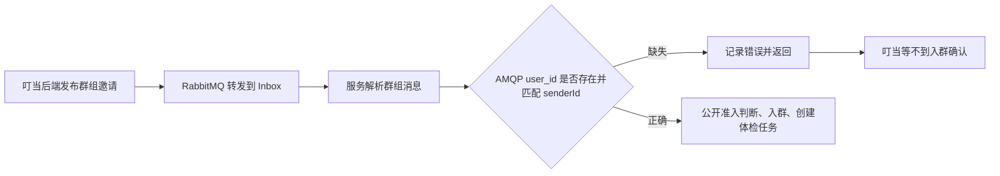

# 叮当外部调用失败：身份绑定链路调查

结论：本次调用卡在入群前的消息身份校验。接收端看到的 AMQP `user_id` 缺失，触发官方 SDK 的 `PeerAicMissingError`，体检业务未执行。当前能够确定接收端的失败机制；尚未取得叮当后端发送记录，不能断言它具体是漏填属性、关闭绑定，还是中转环节清掉属性。

## 真实现场与代码核对

- [原调用记录](attempt.json)：会话 `3101`、运行 `collab_c85a6bb5307d`，最终失败、taskId 为空、无 Product。HTTP 200 仅为 SSE 连接建立。
- [本轮云端只读核对](live-runtime-contract.json)：运行中的体检镜像为 `sha256:110d145f430217affeb09ed85257f59738a3c7b19509bc37905e79818ccd7d8b`；Inbox 分发器、身份校验模块、体检 worker 三个文件的标准化哈希都与本地一致。
- 同一服务在 `2026-10-20T13:27:55.782593Z` 记录 `PeerAicMissingError: AMQP user_id is required for group identity binding`。它已收到、解析了群组类型消息，并执行到身份判断；“没有在线消费”不能解释这条日志。
- [官方源码比较](upstream-comparison.json)：官方 main 当时为 `94077d10b336bfdb9a7d68e4859390bf44a67a27`。身份校验模块全文相同；`invite_via_inbox` 与 `start_inbox_consuming` 的函数 AST 相同。这项身份要求并非本队添加的特殊协议。

原接收日志未保存消息 type、groupId、senderId 或原始 properties，故与叮当运行的关联依据仍是时间、目标身份及两端错误，而不是完整原邀请的逐字段抓包。本轮没有重启服务、重新发起叮当任务或中断 24 小时观察。

## 为什么“消息送到了”仍然失败



AMQP `user_id` 是消息的标准属性，必须由发布端携带；它不是浏览器登录账号，也不是 JSON 中自行声明的 `senderId`。RabbitMQ 会核对已填写的属性与发布连接账号，却不会在属性缺失时自动补上。经过 Broker 转发后，接收服务不能从自己到 Broker 的 TLS 连接恢复原始发布者身份。[RabbitMQ 4.2 官方说明](https://www.rabbitmq.com/docs/4.2/validated-user-id)

官方 SDK 的链条是：

```text
发布方证书 AIC / Broker 认证账号
    == AMQP 标准属性 user_id
    == AIP 消息 senderId
```

因此，浏览器重新登录、重启我们的服务、开放白名单，都不能给这条入站消息补出经过认证的发布者身份。

## 精确代码位置

| 位置 | 行为 |
| --- | --- |
| `integration/wutong_smoke.py::_dispatch_inbox` | 先解析邀请，再取 `message.user_id` 并校验，成功后才调用 `_accept_probe_invitation` |
| `acps_sdk/aip/aip_group_identity.py::extract_amqp_user_id` | 读取标准属性；不把自定义 header 或 body 字段当作认证身份 |
| 同文件 `assert_incoming_group_message_identity` | `amqp_user_id is None` 时立即抛出本次错误 |
| `incident/platform_worker.py::DomainGroupRuntime._invitation_policy` | 公开体检允许非白名单合法 AIC；此判断在身份校验之后 |
| `acps_sdk/aip/aip_group_leader.py::invite_via_inbox` | 创建 `aio_pika.Message(..., user_id=...)` |
| 同文件 `GroupLeaderMqClient.__init__` | `identity_binding_enabled` 默认 `True` |
| `aip_group_identity.py::build_outgoing_amqp_user_id` | 绑定开启时返回经过一致性校验的发送者；关闭时返回 `None` |

官方原件：[身份校验](https://github.com/AIP-PUB/ACPs-community/blob/94077d10b336bfdb9a7d68e4859390bf44a67a27/acps-sdk/acps_sdk/aip/aip_group_identity.py)、[群组发送端](https://github.com/AIP-PUB/ACPs-community/blob/94077d10b336bfdb9a7d68e4859390bf44a67a27/acps-sdk/acps_sdk/aip/aip_group_leader.py)、[群组接收端](https://github.com/AIP-PUB/ACPs-community/blob/94077d10b336bfdb9a7d68e4859390bf44a67a27/acps-sdk/acps_sdk/aip/aip_group_partner.py)。

## 离线复现：7 项通过

[脚本](reproduce_identity.py)使用真实 SDK 的邀请序列化及本项目真实 Inbox 分发函数，替换网络 channel/delivery 为假对象；没有连接平台或占用七个身份。[结果](offline-reproduction.json)：

| 条件 | 结果 |
| --- | --- |
| 官方 SDK 绑定开启，标准属性正确 | 到达邀请处理器，公开准入判断通过 |
| 绑定关闭，`user_id=None` | 复现同样的 `PeerAicMissingError`，未到达邀请处理器 |
| 只在普通 header 填 `user_id` | 仍为缺失标准属性，复现相同错误 |
| 标准属性与 body.senderId 不一致 | 变为 `SenderIdentityMismatchError`，证明不是本次“缺失”错误 |
| 身份正确但关闭公开模式 | 到达准入判断后因白名单拒绝；与本次失败阶段不同 |
| 简短“检查某 AIC 的公开元数据” | 生成只读体检请求 |
| 原长指令包含“不要修改/不要主动探测” | 命中保守关键词拒绝，属于后续独立问题 |

复现只证明这些输入与接收行为的因果关系，不证明叮当后端实际使用了哪个分支。

## 平台方应怎么修

先查会话/运行对应的发布代码和消息 properties：

1. 若自建 `aio_pika.Message`，在 **标准属性**设置 `user_id=实际发送者 AIC`；不能写成 `headers={"user_id": ...}`，也不能填被调用方 AIC或网页用户名。
2. 若使用官方 SDK，确认运行版本及 `identity_binding_enabled=True`；Broker 发布连接的认证身份须与发送者一致。对邀请和后续群组任务消息都检查，不能只修邀请。
3. 若发送端已携带正确属性，则查中转/Federation 是否清除了它。RabbitMQ 的 Federation 默认可能清除 `user_id`；只有核实上游身份保证后才能选择正式的信任配置。本次尚无证据证明平台使用了此路径，不能直接改设置。

现有公开叮当前端 `app.js?v=v1.8.2-login-ontology-20261017` 的执行逻辑只向 `/dingdang/api/agent/execute` 发送所选智能体和任务描述；AMQP 发布在后端。前端源中的网站 `user_id` 与上述标准属性无关。本次查到的完整公开 ACPs 仓库树没有 `dingdang` 路径，未取得发送端实现。

本项目能做的是保留校验、提供复现与准确错误。不能用 body.senderId 代替缺失的认证属性；这会让调用者自行声称身份。也不能假定额外查一次 Registry 就能证明这条消息来自该身份。

## 修通邀请后还要处理两件事

1. 原长指令在本地会被保守文本解析器拒绝。这次根本未创建任务，所以它不是当前入群失败的原因。复验用最短句：`请检查 <目标 AIC> 的公开元数据`。
2. 公开 ACS 仍只声明 JSON、描述仍写仅限获准协调者。按[既有更新说明](../../docs/接入体检_ACS模式更新说明_20261020.md)由平台管理员同步文本模式及公开只读描述。叮当已经发现并尝试调用该服务，故不能把本次入群错误归因于 ACS 未发现。

平台修复后，以非空 taskId、入群回执、实际体检 Product、双方 access 配对及正常关组验收；服务在线或 SSE 200 均不代替调用成功。
