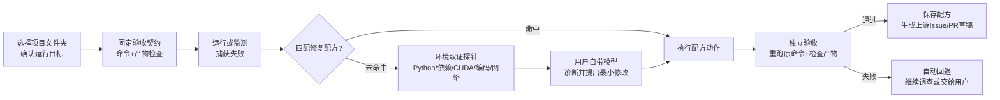

# 作品定位与范围方案

2026年10月15日。在"报错修复助手"方向基础上收窄定位，目标是范围既不过小、也不宽泛。距初赛截止（10月30日20:00）还有15天。本文是方案建议，其中的效果判断都需要后续实测验证。

## 一句话定位

**让下载的开源项目在你自己的 Windows 电脑上跑起来：自动发现运行失败，用你自己的模型 API 定位原因，在不弄乱电脑的前提下最小修复，并由独立验收确认真的跑通。**

暂定作品名（不超过20字）：**跑通：开源项目本地运行修复智能体**（16字）。

## 为什么这样收窄

"自动抓各种 BUG、一键修复"范围太宽：评委无法判断它到底能修什么，团队也拿不出可信的成功率。只修一种错误（比如只修 tsconfig 路径）又太小，场景价值和创新性都撑不起来。

这里收窄的方式是**固定一个任务，覆盖这个任务里的各种故障**：

| 维度 | 固定下来的 | 在这个范围内覆盖的 |
| --- | --- | --- |
| 用户 | 在自己电脑上运行开源项目的学生和研究者 | 本科课设、研究生复现论文代码、跑开源 AI 项目的人 |
| 任务 | 让某个开源项目的指定命令跑通，并产出预期结果 | 首次安装、首次运行、拉取更新后坏了、换电脑重装 |
| 平台 | Windows 本机，不依赖 Docker | 已有的 conda/venv、多个 Python、混乱的 PATH |
| 生态 | Python 为主，Node 为辅 | pip/conda/npm 依赖，配置文件，环境变量，模型和数据下载 |
| 故障 | 环境与配置类运行故障 | 依赖缺失或版本冲突、解释器选错、路径/编码、网络与镜像、CUDA 与 torch 版本不匹配、缺编译工具等 |

**明确不做**：修用户自己写的业务逻辑 bug、桌面 GUI 软件故障、驱动和硬件安装（只诊断、给出指引）、服务器部署、Linux/macOS（写入后续计划）。原有的 Windows 原生桥和浏览器扩展不放进主线，在报告里作为扩展原型说明。

这个范围对应评分细则中的"学习、科研、开源生态价值"：开源项目跑不起来，是学生使用开源成果时最常见的第一道门槛。

## 竞品格局：不能说的和可以说的

| 类别 | 代表 | 它们已经做到 | 我们不能声称 |
| --- | --- | --- | --- |
| 从零构建环境的研究型 Agent | [RepoLaunch](https://github.com/microsoft/RepoLaunch)（微软，9种语言，Windows/Linux 容器）、[Repo2Run](https://arxiv.org/abs/2502.13681)（Python，Docker，报告86%成功率） | 在全新容器里把仓库装好并跑通测试 | "首个自动配置开源项目环境的 Agent" |
| 通用编程 Agent | Cursor、Claude Code、Copilot、OpenHands、Aider | 把报错贴进去，AI 读代码并修改 | "AI 能根据报错修代码" |
| 运维/终端修复 | [Eir](https://github.com/Swatto86/eir)、[Intelligent Terminal](https://github.com/microsoft/intelligent-terminal) | 后台监测、终端失败捕获、AI 修复建议 | "首个自动发现故障并修复的工具" |

我们的差异要建立在它们没覆盖、并且能用数据证明的地方：

1. **就地修复用户真实的电脑，而不是新建一个干净容器。** RepoLaunch 和 Repo2Run 面向批量构建基准环境，产物是 Docker 镜像；普通学生在 Windows 上基本不用 Docker，面对的是已经装乱的 Python 和 PATH。就地修复的难点是不能破坏用户已有的环境，这正是我们"最小修改加可撤销"能发挥作用的地方。

2. **独立验收，直接针对现有 Agent 已被记录的主要失败原因。** [DeployBench](https://arxiv.org/abs/2606.05238)（2026年）用 OpenHands 评测5个先进模型部署论文代码，通过率只有7.8%到51.0%。失败主要来自"完成判断"问题：181次失败中有102次是 Agent 自己判断已完成并停止，但它自检的目标比任务实际要求更弱。我们的设计是在 Agent 开始前固定验收命令和产物检查，并存放在 Agent 改不到的地方，Agent 无权宣布成功。这是现有代码已有的核心机制，有外部研究支撑它的必要性。

3. **中国学生在 Windows 上的特有故障。** 例如：中文或带空格的路径（你们自己的目录"D:\AI + 开源"就同时带空格、加号和中文）、GBK 编码报错、pip 和 Hugging Face 在国内访问失败需要镜像、CUDA 与 torch 版本不匹配、缺 MSVC 编译工具、PowerShell 执行策略。国外工具很少针对这些场景做专门处理。

4. **修复经验沉淀，并回馈上游开源社区。** 每次验证成功的修复都保存成结构化"修复配方"，内容包括触发特征、前置条件、动作和验收方式。同类故障再次出现时先匹配配方，不必再调用模型；匹配不上或验收失败时才交给模型。同时生成给原项目的 Issue 或 PR 草稿（例如"README 缺少 Windows 下的依赖版本说明"）。这一点同时对应"开源协作方式"创新和"社区贡献记录"。

5. **用户自带 API 带能力分级。** 接入时实测用户填写的模型：能否稳定调用工具、能否输出合格的修复方案。按实测结果自动决定开放的档位："自动修复"、"给出方案由用户确认"或"只解释原因"。配方机制让便宜的小模型也能处理常见故障。

## 核心流程

## 功能分级

P0 必须在初赛前完成并实测，P1 尽量完成，P2 只写入后续计划。

| 优先级 | 功能 | 现有代码状态 | 需要的工作 |
| --- | --- | --- | --- |
| P0 | 项目接入：选择文件夹，从 README 识别或由用户确认运行命令和预期产物 | 已有 TaskSpec（命令、产物检查、可写文件） | 加入从 README 推断运行目标，并由用户确认 |
| P0 | 失败捕获：在助手内运行命令，或用 `pt run <命令>` 包装器运行 | 已有受控子进程捕获 | 补命令行包装器，用户不必复制报错 |
| P0 | 环境取证探针：Python 版本和路径、已装包、CUDA/torch、系统编码、路径特征、网络和镜像连通性 | 只有读文件、列目录 | 新增约8个只读探针 |
| P0 | 环境类修复动作：在项目专属虚拟环境中安装或固定依赖版本、写入项目级环境变量和启动脚本、修改配置文件 | 只支持文本替换 | 新增动作类型；依赖改动限制在项目虚拟环境内，回退即恢复锁定文件或删除该环境 |
| P0 | 独立验收与回退 | 已有：哈希核对、重跑原命令、产物检查、失败回退 | 扩展到环境类动作的回退 |
| P0 | 用户自带 API：配置、连接测试、能力分级 | 已有配置和工具调用测试 | 加入能力分级，用至少两家真实模型实测 |
| P1 | 修复配方：保存、匹配、复用 | 无 | 结构化存储 + 特征匹配；命中后仍须通过验收 |
| P1 | 上游回馈：生成 Issue/PR 草稿 | 无 | 依据修复记录生成草稿，由用户自己审阅后提交 |
| P1 | 修复报告导出：本项目在 Windows 下的正确运行方式 | 无 | 由修复记录生成 Markdown |
| P2 | Node 生态、浏览器错误、Windows 应用事件 | 有原型 | 只在报告中作为扩展说明 |

## 评测设计

这是"实现完成度与可验证效果"（25分）的主要证据，也是回答"为什么不直接用 Cursor"的依据。

**任务集**：20到30个真实故障。主要来源是真实开源项目在一台干净 Windows 电脑上首次运行时自然出现的故障，优先选可以用 CPU 运行、依赖体积适中的 Python 项目。补充来源是常见故障的真实复现，例如放到中文路径下、换成不匹配的 Python 版本、断开镜像。每个故障事先写好验收命令和产物检查，评测期间不让 Agent 看到验收条件。

**对照组**（同一个模型、相近的调用预算）：

1. 只把报错文本发给模型，人工按它的回答操作（模拟"问 ChatGPT"）。
2. 去掉我们的探针、验收契约和配方，只保留通用读写工具循环（模拟通用 Agent）。
3. 完整系统。
4. 消融：分别去掉探针、独立验收、配方，观察各自贡献。

**指标**：经独立验收的修复成功率；虚报成功次数（Agent 声称修好但验收失败，对应 DeployBench 发现的问题）；有害修改次数（破坏了其他东西或改了范围外的内容）；耗时；Token 数和费用；同类故障第二次出现时的成本下降。另外至少换一个模型复测，确认结论不是只对某一家模型成立。

失败案例要如实保留并写进报告。评分细则看重"测试方法合理"，不要求成功率很高。

## 三类证据如何获得（主项目可不公开）

| 证据 | 做法 |
| --- | --- |
| 对比结果 | 上面的评测，全部在本地完成 |
| 用户反馈 | 找10名左右同学，只给安装包，让他们各运行一个自己想跑的开源项目，用问卷记录结果 |
| 社区贡献 | 评测中发现的上游文档或配置问题，以队伍账号向原项目提交 Issue 或 PR，并记录链接和状态 |
| 开放成果 | 主程序在参赛期间用私有仓库提交；故障任务集、评测脚本和修复配方库单独开源 |

## 演示视频脚本（3到5分钟）

1. 15秒：问题。打开一个热门开源项目，按 README 运行，在中文路径的 Windows 电脑上直接报错。
2. 60秒：自动发现与取证。不复制报错，助手自动出现故障记录，界面展示探针检查到的实际情况。
3. 60秒：修复与验收。显示最小修改的具体内容，重跑原命令，产物出现，状态变为"已验证恢复"。点击撤销，确认能恢复原状。
4. 30秒：失败案例。展示一个超出范围的问题（例如需要更新显卡驱动），助手如实说明原因并给出指引，不乱改。
5. 30秒：配方复用。换另一个项目出现同类故障，配方直接命中，不调用模型，几秒修好。
6. 30秒：上游回馈。生成 Issue 草稿，并展示已提交的真实 Issue 或 PR 链接。
7. 30秒：数据。对照实验的成功率、虚报率和成本对比表。

## 15天安排

| 日期 | 工作 |
| --- | --- |
| 10/15—10/17 | 选20到30个候选项目，在干净环境中跑一遍，登记真实故障；同时实现 P0 环境探针 |
| 10/17—10/21 | 实现环境类修复动作和回退、命令包装器、能力分级；接通两家真实模型 |
| 10/21—10/24 | 跑完整评测和对照组；根据失败案例改进；做修复配方和 Issue 草稿 |
| 10/22—10/26 | 用户内测、提交上游 Issue/PR；整理故障集和评测脚本准备开源 |
| 10/25—10/29 | 技术报告、视频、README、许可证清单、匿名检查；在另一台电脑上安装验证 |
| 10/29 | 首次上传，预留一天处理意外 |

## 主要风险

- **依赖下载慢、体积大**（torch 动辄数 GB）：评测优先选 CPU 版和依赖小的项目，并提前做好本地缓存。
- **效果差距不明显**：如果完整系统相比"只给报错文本"没有明显提升，就把重点转到虚报率和有害修改上。独立验收和可撤销在安全性上的优势更容易得到稳定的数据。
- **范围蔓延**：P2 的功能在初赛前一律不做。

## 参考来源

- [RepoLaunch（微软）](https://github.com/microsoft/RepoLaunch)，[论文](https://arxiv.org/abs/2603.05026)
- [Repo2Run](https://arxiv.org/abs/2502.13681)
- [DeployBench](https://arxiv.org/abs/2606.05238)
- [ResearchEnvBench](https://arxiv.org/abs/2603.06739)：研究代码运行失败主要来自依赖解析不完整和版本耦合脆弱
- [EnvBench](https://arxiv.org/abs/2503.14443)
- 赛规与评分见本目录"官方原件/附件1"
