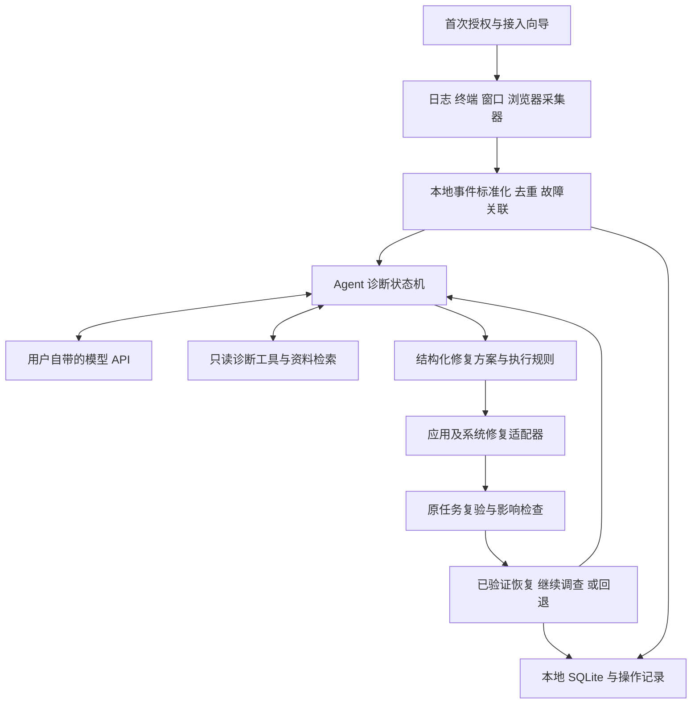

# 报错助手可行性与实现架构

核对日期：2026年10月15日。产品按 Windows 首发、用户自带模型 API、开源桌面 Agent 设计。

**建议立项。自动发现故障、收集环境证据、执行修复、复验原任务都有可用的实现路径；无需训练模型或配置 GPU。决定产品效果的是接入覆盖、诊断准确性和修复验收，不能承诺安装后识别并修好任意软件的所有故障。**

首次运行引导用户授权和接入，能够解决相应的访问限制。授权后，监测及授权范围内的修复自动进行。产品应公开支持的软件、故障类型和自动化程度，并让这些范围随着适配器扩展。实际控制不到的服务端故障、硬件损坏、无法观察的软件内部状态，需要给出证据和处理路径。

“API 自己提供”在本方案中指每个使用者填写服务地址、密钥和模型名称。软件不依赖团队运营的模型中转服务器；团队如果只给本队提供密钥，也可使用同一架构。模型 API 和互联网搜索是两个能力，不能假设任意模型接口都自带联网搜索。

## 可行性依据与本机验证

底层能力存在明确的官方入口，并有开源实现可参考。它们支持可行性判断，也说明“自动报错后让 AI 修复”已有直接先例。

| 依据 | 已有能力 | 对项目的影响 |
| --- | --- | --- |
| [Windows Event Log](https://learn.microsoft.com/en-us/windows/win32/wes/subscribing-to-events) | 订阅指定日志通道，保存书签并继续接收事件 | 可以监听系统和应用上报事件；应用未写入该通道的错误需要另行采集 |
| [UI Automation](https://learn.microsoft.com/en-us/windows/win32/winauto/uiauto-eventsforclients) | 订阅窗口结构、属性、通知等变化 | 可从支持的控件读取错误提示；官方明确并非所有控件都产生完整事件 |
| [ConPTY](https://learn.microsoft.com/en-us/windows/console/creating-a-pseudoconsole-session) | 宿主创建终端会话和通信通道 | 自己托管的终端可采集输出；不能据此追溯读取任意已运行终端的历史输出 |
| [Chrome debugger](https://developer.chrome.com/docs/extensions/reference/api/debugger) | 在允许的目标上获取运行时、网络等调试事件 | 浏览器错误可以自动采集；需要扩展权限和接入目标 |
| [Eir](https://github.com/Swatto86/eir) | Windows 后台监测、AI 诊断、允许的自动修复与执行反馈 | 直接竞品和可参考实现，不能把这条整体流程称为首次提出 |
| [Intelligent Terminal](https://github.com/microsoft/intelligent-terminal) | 失败命令检测、错误上下文、Agent 修复建议或执行 | 终端自动发现已有先例；必须比较同样的故障子集 |

本轮使用独立目录和测试浏览器进行了以下检查。原始结果见 [验证结果](验证/运行记录/20261015-143853/results.json)。

| 检查 | 实际结果 | 证据范围 |
| --- | --- | --- |
| 应用日志文件监听 | 捕获了测试目录中新建日志的文件系统事件 | 真实 FileSystemWatcher 通路；尚未测真实应用日志解析、轮转和高负载 |
| Windows 应用事件订阅 | 非管理员进程成功启用和关闭订阅 | 仅验证注册权限与接口，没有注入系统事件，也没有导出用户日志内容 |
| UI Automation | 成功创建 UIA COM 对象 | 仅验证接口可用，未验证弹窗识别率或真实软件操作 |
| 终端失败捕获 | 捕获受控子进程的 FileNotFoundError 和非零退出状态 | 自己启动的进程；没有安装真实终端 Hook |
| 浏览器错误采集 | 独立无头 Chrome 收到 JavaScript 异常、console.error 和测试请求 404 | 真实 CDP 事件；没有验证日常浏览器扩展、Native Messaging 或已有登录会话 |
| 修改与恢复 | 修正测试配置后原任务成功，独立检查输出内容；恢复原配置后故障重现 | 确定性样例修复，没有调用模型，没有证明真实软件或 AI 修复成功率 |

探针未调用付费模型 API、安装扩展或改动真实软件配置。测试浏览器已通过 Browser.close 正常退出。本机 `dotnet --list-sdks` 未列出 SDK，本轮没有编译或打包 C# 原生桥；后续开发机需要 SDK，发布时可采用自包含部署，使用者不必安装开发 SDK。[.NET 部署说明](https://learn.microsoft.com/en-us/dotnet/core/deploying/single-file/overview)

## 总体架构与技术选型

在尚未指定团队语言偏好的条件下，建议采用 **Electron 与 TypeScript 负责桌面应用和 Agent 调度，C# 原生辅助进程负责 Windows 接入，SQLite 保存事件与操作记录**。目标首先选择受支持的 Windows 11；其他系统通过平台适配器逐步覆盖。

| 组件 | 建议实现 | 选择理由与边界 |
| --- | --- | --- |
| 桌面界面与托盘 | Electron、React、TypeScript | 便于做事件列表、修复过程和 API 设置；安装体积、内存及升级维护需要实际测试 |
| Agent 调度 | TypeScript 显式状态机，模型接入可用 AI SDK | 单个调度器已足够，不需要以多个 Agent 对话作为默认架构 |
| Windows 原生桥 | C#、受支持的 .NET，UIA 或 FlaUI | 便于接入事件日志、文件监听、窗口自动化、进程与服务 API；C# 与 TypeScript 之间用版本化消息协议 |
| 原生桥通信 | 父子进程的标准输入输出；确有跨进程连接需要时使用受限 Named Pipe | 小范围部署可先用 JSON 消息；超时、进程退出和协议错误必须能被主程序识别 |
| 本地数据 | SQLite、FTS5 | 事件、案例、变更、验证记录可用关系数据和全文检索；不必先部署向量数据库 |
| 终端接入 | Shell Hook、编辑器扩展；可选 node-pty 托管终端 | 可继续使用用户原来的工具；托管终端可以获得更完整的命令上下文 |
| 浏览器接入 | Chrome/Edge 扩展与 Native Messaging | 读取获准站点的异常，并将事件交给本机程序；不依赖团队中转服务器 |
| 模型适配 | Provider Adapter，首批覆盖一种经过验证的工具调用协议 | 统一调用、预算、超时和能力探测；不同 API 的能力不能由地址格式推断 |

AI SDK 官方支持自定义地址及密钥，也提供带输入模式的工具调用。是否支持某项功能仍取决于实际提供方与模型。[Provider 配置](https://ai-sdk.dev/providers/openai-compatible-providers)、[工具调用](https://ai-sdk.dev/docs/ai-sdk-core/tools-and-tool-calling)。Electron 的 utilityProcess 可隔离进程生命周期和崩溃，但不能自动当作限制文件访问的操作系统沙箱。[utilityProcess](https://www.electronjs.org/docs/latest/api/utility-process)

三种实现路线都可行，应选一条完成核心流程：

| 路线 | 可继承的部分 | 主要代价 | 适用条件 |
| --- | --- | --- | --- |
| 在 Eir 上改进，沿用 Rust 与 Tauri | 现有采集、执行规则、记录、托盘和安装流程 | 要适应其系统健康模型，并新增直接 API 接入、终端/浏览器事件和任务验收 | 团队愿意维护 Rust，且希望复用最多现成能力 |
| 自建 Electron 与 C# 原生桥 | 复用现有库，核心数据模型和任务流程自己设计 | 两种语言、原生桥打包及消息协议需要维护 | 希望围绕普通软件的原任务恢复设计产品；本方案的默认选择 |
| Python 桌面应用与 pywinauto | Windows 自动化和诊断库丰富 | 分发环境、依赖与原生接口生命周期仍需处理 | 团队已有成熟 Python 桌面开发基础 |

不要同时维护三套实现。Eir 是 MIT 项目，合法改进并如实披露也符合开源作品形态；独立界面或换一种语言本身不构成技术创新。Eir 本轮源代码固定到提交 `c67ae5c951fbc8b0e0a502b4a7b33141976d6966`，来源快照包含对应的许可文件。

## 自动识别如何实现

自动识别由“接入、发现信号、判断任务失败、合并事件”四步组成。先用本地规则过滤明确无关的信息，再对有价值的新故障调用模型。平时可以持续监听而不持续付费调用模型。

| 来源 | 接入方法 | 可以自动获得 | 必须解决的限制 |
| --- | --- | --- | --- |
| 终端 | Shell 完成事件、Hook、编辑器任务接口；可选 ConPTY | 命令、目录、退出状态、受控输出与运行标识 | PowerShell、CMD、Bash 的接入不同；退出码正常但结果错误需要任务检查 |
| 应用日志 | 已知日志目录适配器与文件变化监听 | 新增错误片段、日志来源和时间 | 轮转、截断、编码、多行堆栈、重复日志和监听缓冲溢出需要处理 |
| 系统事件 | EventLogWatcher 或 EvtSubscribe | 崩溃、应用事件和部分服务故障 | 通道权限各异；服务未运行可能是正常按需启动，不能一概判断失败 |
| 窗口界面 | UIA、窗口事件和应用适配器 | 支持的弹窗、通知、状态与操作控件 | 自绘界面和未暴露控件可能只能读到部分信息；截图或视觉模型可作为补充 |
| 浏览器 | 扩展监听网络/页面异常；增强模式使用 debugger | 已获准目标的页面异常与请求失败信息 | 浏览器内部页、权限策略、子框架及 Worker 覆盖需要分别验证 |

node-pty 使用 Windows ConPTY，但其子进程继承父进程权限，并非自动隔离。必须把托管终端作为受控工具来设计。[node-pty](https://github.com/microsoft/node-pty)。文件监听可能发生缓冲溢出，不能把每个通知都当作永不丢失的日志；适配器要保存读取位置，并在通知缺失后按范围重新核对。[FileSystemWatcher](https://learn.microsoft.com/en-us/dotnet/api/system.io.filesystemwatcher?view=net-10.0)

首次接入终端时，软件可以引导安装当前用户的 Hook，备份配置并提供卸载。持续监测从接入成功后开始；用户无需每次复制日志。研究探针本轮仅证明受控进程输出采集，尚未验证这些 Hook。

浏览器建议分两级：普通模式采集获准站点的导航/网络失败、页面未捕获异常；增强模式对用户选择的目标启用 debugger，获取更完整的运行时与网络证据。HTTP 4xx/5xx、页面异常和业务失败并不等价，需要根据操作上下文判断。Native Messaging 将扩展事件发送到本机程序，安装器可以按用户范围注册自己的宿主。[扩展权限](https://developer.chrome.com/docs/extensions/reference/api/permissions)、[webRequest](https://developer.chrome.com/docs/extensions/reference/api/webRequest)、[Native Messaging](https://developer.chrome.com/docs/extensions/develop/concepts/native-messaging)

**不能直接把 BrowserTools MCP 的当前实现视作无需操作的全浏览器后台监测。**其文档要求打开 DevTools 才开始采集，之前的请求不会补录；它适合参考或复用部分代码，自动监测模式仍需专门实现。[当前接入要求与局限](https://github.com/AgentDeskAI/browser-tools-mcp)

Chrome 136 起，对默认用户资料目录的远程调试开关进行了限制。正式产品应使用浏览器允许的扩展方案，或明确的独立测试资料目录，不能把“为日常 Chrome 打开一个调试端口”作为默认接入方案。[Chrome 官方说明](https://developer.chrome.com/blog/remote-debugging-port)

事件进入本地数据库时，建议至少保存：来源、发生与采集时间、进程及启动标识、软件版本、相关文件/端口/目标地址、工作区、原操作标识、证据片段和接入覆盖状态。来源若没有某字段，应保留未知，不能由模型补写为事实。

事件处理需要区分四种情况：同一错误的重复输出、同一原因造成的多个现象、彼此独立的并发故障，以及被应用自行处理的异常。可先以进程继承、同一端口/文件、共同操作标识和配置变更形成可解释的关联，再用诊断探针检验。时间接近只作为弱线索。

核心难点是“可采取行动的故障”判断。大量 Warning、用户取消、测试故意制造的 Error、重试后已恢复的瞬时失败都不应触发修改。助手自身的日志和修复动作还需要标记来源，避免自己触发自己。

## 自动诊断与修复如何实现

诊断 Agent 负责提出候选原因和下一步检查；执行器根据明确的工具接口和范围执行操作。模型给出的置信度只能作为辅助信息，不能代替执行条件和实际验收。

建议的第一批诊断工具包括：查看指定应用日志片段、读取软件与依赖版本、检查解释器和工作目录、检查文件与路径、查询端口及拥有它的进程、核对指定配置、运行受限的无副作用诊断命令。模型根据检查结果继续选择工具，形成短的可追溯调查过程。

典型案例是浏览器“连接失败”。候选原因可能是后端崩溃、端口不匹配、本机代理配置、远端服务异常。助手先核对目标地址和端口，再检查相关进程和近期日志，选择能排除候选原因的检查。修复应作用在已定位的范围，不能直接对所有软件重置网络或重装依赖。

资料检索排在本机取证之后。查询应带上错误特征、操作系统、软件和依赖版本，优先官方文档、版本发布说明和项目 Issue。检索结果保存出处和适用条件；外部文本作为证据处理。默认可接入已知公开来源与本地案例索引；完整互联网搜索作为独立插件，可能需要用户另外配置服务。任意文本模型 API 不保证提供搜索能力。

修复方案至少包含以下内容：

| 字段 | 用途 |
| --- | --- |
| 故障与证据引用 | 说明修复对应哪次故障，依据哪些实际检查 |
| 前置条件 | 软件/版本、配置当前值、文件哈希、进程身份等是否仍符合诊断时状态 |
| 操作及范围 | 指明允许修改的配置键、文件、项目环境或指定进程 |
| 预期变化 | 说明这项改动应产生什么结果 |
| 复验任务 | 明确重做哪一步，以及怎样判定输出正确 |
| 回退办法 | 对支持回退的动作记录原内容和恢复条件 |

首批自动修复适合覆盖：项目内配置错误、工作目录或解释器选择错误、局部路径失效、确定的依赖环境问题、可明确控制的本地进程启动问题。修改配置应采用解析后的最小变更；操作前保存原内容和必要元数据，并核对当前状态，防止覆盖用户刚做的修改。

每种修改都需要配套验收。比如恢复本地服务后，继续检查原客户端请求；重新导出后，检查新文件的生成时间、格式和必要内容；修复项目启动后，检查实际功能，而不只看进程存活或退出码。

原任务通常由应用适配器、终端运行上下文或浏览器操作上下文保留。日志未必包含完整用户意图。无法获得可靠任务要求时，应显示“操作已执行，效果尚未验证”，必要时只请求一次具体补充。不能由修复模型根据自己做了什么临时改写验收标准。

回退也需要明确支持范围。配置文件备份不等于可以撤销所有系统和远端副作用；依赖安装、进程重启、外部提交等动作的恢复方式各不相同。动作执行超时后先核对状态，不能假定未执行并直接重试。可安全重试与不可安全重试的原任务需要区分。

Eir 现有服务执行器会等待服务达到目标状态，其反馈模块还会核对服务故障是否消失；并非仅记录命令执行成功。在本轮阅读的模块中，未发现通用的原用户任务重放与业务成果验收，这可以作为待验证的改进方向。[服务执行器](https://github.com/Swatto86/eir/blob/c67ae5c951fbc8b0e0a502b4a7b33141976d6966/eir-svc/src/executor/services/windows.rs)、[反馈模块](https://github.com/Swatto86/eir/blob/c67ae5c951fbc8b0e0a502b4a7b33141976d6966/eir-svc/src/feedback/mod.rs)

## 权限引导与用户自带 API

采用用户提出的应用式授权流程：首次配置时引导完成接入，之后在已授予范围内自动工作。不要把每个诊断步骤都变成弹窗；用户应能选择“仅监测”“诊断并建议”“在指定范围内自动修复”。

| 能力 | 软件如何引导 | 授权后的行为 |
| --- | --- | --- |
| 应用日志 | 识别已支持软件的日志位置，用户选择监测范围，进行读取测试 | 只增量读取选定来源并报告断连、拒绝访问等状态 |
| 终端接入 | 提供当前用户 Hook 或编辑器扩展安装入口，备份并测试 | 自动记录获准会话的失败上下文，可单独关闭与卸载 |
| 浏览器接入 | 引导安装扩展、选择站点范围并完成连接检查 | 自动发现范围内的错误；增强调试能力需要对应权限 |
| 窗口与截图 | 在当前用户会话中运行采集器，让用户选择软件范围 | 优先读控件/事件，需要视觉补充时再采集相应窗口 |
| 自动修改 | 为工作区、应用和动作类别设置自动执行范围 | 符合条件的修复自动进行，范围外的修改交给用户决定 |
| 管理员能力 | 需要特定系统操作时申请 UAC，交给有限职责的辅助程序 | 仅完成该类获准动作，模型调用和日常界面不必常驻管理员权限 |

Windows 服务处在不同会话中，不能直接承担用户桌面的所有界面观察和操作。采集窗口的进程应在用户会话内运行；如采用后台服务，则通过受限 IPC 与用户会话进程通信。[Windows 服务交互说明](https://learn.microsoft.com/en-us/windows/win32/services/interactive-services)

管理员权限扩大可访问范围，不能让应用自动获得从未输出的日志、缺失的用户意图、远端服务器控制权。浏览器扩展也需要遵守浏览器自己的安装和授权过程。产品可以提供检查、跳转、说明和完成测试，不能把用户尚未完成的授权显示为已开启。

BYOK 设置页建议只保留服务类型、Base URL、API Key、模型名和测试连接。进阶项包括超时、代理、单次/每日使用上限和可选视觉模型。连接测试应分别识别网络或证书问题、认证失败、限流、模型不存在，以及工具调用不支持；不能只因返回了一个 HTTP 响应就显示全部可用。

配置测试可检测文本返回、工具调用、结构化结果和可选图像输入。通过实际能力决定自动化等级：支持可靠工具调用和输入校验的模型可用于诊断执行；不满足要求时仍可做解释或建议，界面明确功能限制。密钥只供对应用户设置的端点使用，不作为普通事件数据传给修复工具。

Electron safeStorage 可调用操作系统能力保存密钥，前端只显示掩码。Windows 下使用 DPAPI；它不能防止同一用户权限下的所有其他程序访问已解密信息，不能宣称“绝对安全”。[safeStorage](https://www.electronjs.org/docs/latest/api/safe-storage)。前端、原生桥和模型输入之间需要限制消息接口，模型看到的日志先移除不必要的凭据与敏感内容。[Electron 进程与接口建议](https://www.electronjs.org/docs/latest/tutorial/security)

BYOK 免除了团队承担所有推理费用的必要，但不会消除使用者的 API 成本。没有新故障时不调用模型；相同故障归并，工具输出截断到相关片段，对每次调查设步骤和 Token 预算。实际费用必须根据所选提供方价格与运行记录计算，不能在未测试前承诺固定单次成本。

## 开放接口与持续运行

适配器是扩展泛用性的主要方式。一个适配包应说明支持的软件和版本、日志发现方式、错误解析、只读探针、可执行修复，以及原任务验收方法。仅有采集器时也可以贡献；进入自动修复范围则必须同时提供动作条件和验收。

| 接口 | 输入输出责任 |
| --- | --- |
| Collector | 产生带来源和覆盖状态的事件；报告读取失败与丢失范围 |
| Correlator | 将事件关联为候选故障，保留关联理由与不确定性 |
| DiagnosticTool | 返回可核对的探针结果，不执行隐含修复 |
| RepairAction | 声明动作、适用条件、影响范围及可用回退方式 |
| TaskVerifier | 根据修复前保存的要求检查任务结果 |
| Provider | 统一模型能力、调用、错误和使用量信息 |

开放插件中的可执行代码本身有本机权限，不能仅因采用插件格式就当作受控工具。初期适合内置经过审查的适配器，第三方扩展采用明确的安装与更新流程。MCP 可以作为后续工具接口，但不必让所有采集器先变成 MCP 服务；后台事件触发和持续运行仍由桌面应用负责。

SQLite 保存故障、证据、诊断步骤、修复动作、备份引用、验证结果和模型使用记录。全文检索可先用 FTS5；中文检索分词、错误码与路径检索需要分别测试，不能假设默认分词能满足全部场景。[SQLite FTS5](https://www.sqlite.org/fts5.html)

核心任务状态建议区分“已发现、调查中、待执行、执行中、复验中、已验证恢复、未能确认、需外部处理、已回退”。事件可以重复投递，修改动作必须有唯一标识和当前状态。进程崩溃后恢复时，先核对执行中的动作是否已生效，再决定后续处理。

不同故障可以并行做只读调查，但指向同一配置或工作区的修改需要串行控制。持续日志使用限额和保留期限；采集器断连、权限撤销、磁盘不足、API 不可用等状态应向用户可见，不能把“没有收到数据”显示为“没有问题”。

本轮核验的主要候选依赖为 Electron（MIT）、node-pty（MIT）、FlaUI（MIT）、AI SDK（Apache-2.0）以及可参考的 Eir 和 BrowserTools（MIT）。实际开发应锁定所用版本并保留相应版权、许可与第三方组件清单；这些项目的依赖还需要按最终打包内容核对。许可原文保存在来源快照中。

## 实施顺序与立项验收

不按工期压缩产品价值，但实施需要依赖顺序。先做一条真实闭环，尽早验证模型和接入的实际效果。

| 阶段 | 应交付的能力 | 通过条件 |
| --- | --- | --- |
| 第一阶段 | 桌面托盘、用户 API 设置、终端或日志自动发现、本地诊断、一个真实软件故障族的修复和复验 | 用户不复制报错；一次受控故障从发现到原任务恢复全程运行，并保留失败案例 |
| 第二阶段 | 浏览器扩展和 Windows 原生桥，接入普通桌面软件 | 至少包含开发工具之外的操作；观察到真实错误，并验证实际输出恢复 |
| 第三阶段 | 跨来源关联与主动诊断 | 同一句报错对应不同原因时采取不同检查与修复；一因多错可以正确合并，并发独立故障不会误合并 |
| 第四阶段 | API 适配、安装升级、开机启动、权限撤销、异常恢复与适配器开放 | 在独立机器安装并运行；API 断连和进程重启后状态正确；停止或卸载能停止接入 |

建议首轮登记约30个故障实例，分布在至少三类任务中；这是项目验证建议，不是比赛要求。另设无故障但存在 Warning/已处理 Error 的负对照，以及远端故障、权限不足和无法确定原因的案例。实际软件故障需先确认可复现，不能把所有演示都替换为自己编写的报错程序。

核心指标为端到端自动恢复率：无需人工诊断或手动修改，并通过独立任务验收的故障数，除以全部预先登记的目标故障实例数。分母包含漏检、未受理、诊断失败、执行失败和验收失败。不可本机修复的案例另外评估判断和处置，不混作修复成功。

同时记录告警准确率、每小时误报、误合并、错误修改、人工操作时间、恢复耗时和使用量。故障检出延迟从实际可观察信号产生开始计时；原故障发生却没有任何采集信号，属于覆盖不足，不能从评测中删除。

至少保留以下对照：相同模型直接接收错误文本；相同采集证据、工具和预算下的通用 Agent；Intelligent Terminal 的终端子集，以及 Eir 所覆盖的 Windows 故障子集。分别移除跨来源关联、主动探针和原任务复验，检查效果变化。验收要求与评分程序在 Agent 无法修改的位置保存。

可争取的技术贡献有两项：一是桌面异构证据下的故障关联与候选原因消歧；二是可获得任务上下文时的最小修复和独立复验。它们都需要比较实验支持，不能仅凭模块名称宣布创新。“重试后恢复”与“根因得到验证”也应分开记录。

继续投入的依据是：真实软件中的自动发现稳定可复现；至少若干故障可在不手动搬运上下文的情况下完成闭环；与相同能力的通用 Agent 对照能看到有意义的增益。如果结果长期依赖人工挑选报错、手动补齐关键环境、固定答案脚本或放宽验收，应先调整识别与任务模型，再扩展界面和软件数量。

该形态符合 AI+开源赛道允许的应用、工具和实质改进方向。参赛材料应突出真实问题、自己新增的技术、对照结果和开放成果；模型 API 设置页本身不能支撑实质贡献。[官方赛题要求](https://www.aicomp.cn/tracks/tracks-5/4924.html)

## 交付材料与后续验证范围

来源目录保存35份官方文档、项目说明或源代码快照及哈希索引。Eir 已固定提交，其余滚动文档和源码采用本次快照；正式选用依赖前再锁定实际版本。FlaUI 许可的首次地址返回404，已更正为仓库实际的 LICENSE.txt，首次抓取记录仍保留。

本轮已验证的是底层通路和受控样例，不包含生产桌面应用、日常浏览器扩展、真实软件修复率、模型 API 兼容性、C# 原生桥编译、安装包或跨机器运行。这些分别由上述实施阶段验收。

独立测试浏览器退出后，其临时资料目录的清理被执行策略以“blocked by policy”拒绝。目录保留在该次验证记录内，不包含在交付压缩包中；没有重新尝试其他删除方式。
