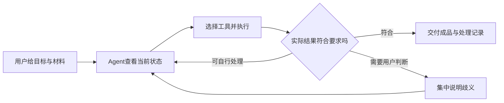

# 模型 API 与 Agent 选题重规划

2026年10月15日。本版结合用户明确的产品形态——“我们的开源软件调用模型API，现场完成实用任务”——以及随后提出的“AI＋Agent”方向重新规划。按泛用、重复使用价值、实际交付及可证明的改进排序；不以工期或工程难度淘汰方向。

**建议将主方向收敛为：面向具体工作的任务型Agent开源软件。当前优先候选是可教会的资料处理Agent，图形创作Agent与软件验收Agent保留为两条不同的竞争路线。** 这是研究后的优先验证顺序，尚未形成实测支持的最终立项结论，更不是获奖概率排名。

本版与《模型API开源案例对照_20261015.md》配套，后者整理26个项目及额外研究、用户问题和商业替代。案例依据原始文档，未在本轮运行软件或付费模型API。所有“我们可以改进”的表述均为待检验假设。

**赛事契合度。** 官方明确接受智能体、应用、插件和工作流，并允许对已有开源项目做实质改进；不要求训练大规模模型。官方同时要求说明团队贡献，单纯接通用模型接口、换界面或部署现成项目不能充分满足要求。我们的作品应说明模型做什么、开源工具做什么，以及新增的软件机制改善了什么。[官方赛题及附件入口](https://www.aicomp.cn/tracks/tracks-5/4924.html)

**Agent在产品中的作用。** 用户提出目标后，软件查看材料和当前状态，选择工具执行，再根据实际结果决定继续、修正或请用户解决歧义。一个固定的“上传→总结→导出”流程可能已经足够好；当材料、目标和异常会变化时，多轮决策才有额外价值。先用一个Agent配工具即可，多Agent分工需要用效果或成本证据证明必要性。

**本轮候选比较。** 下表是产品判断，不是官方打分。“广泛”指可以迁移到多种任务，尚未通过访谈证明每类用户的使用频率。

| 候选 | 用户一次委托后拿到什么 | Agent的必要作用 | 主要竞争压力 | 当前判断 |
| --- | --- | --- | --- | --- |
| 可教会的资料处理Agent | 符合目标模板的总表、异常项、可复用处理办法 | 判断材料差异、选择处理步骤、处理歧义与新批次变化 | DocETL、DocWrangler、Data Formulator、SheetAgent及通用Agent | 主候选；跨场景交付明确，须证明减少复核劳动 |
| 可控图形创作Agent | 可以继续编辑的流程图、架构图或教学图示 | 理解连续修改，协调语义结构、局部保护和布局 | Next AI Draw.io及现有布局工具 | 强备选；展示直观，须证明连续修改更稳定 |
| 软件验收Agent | 独立确认的缺陷、复现过程及可重跑测试 | 探索操作、准备前置状态、核对实际结果、缩减失败流程 | Hercules、Browser Use、Keploy及通用开发Agent | 强备选；用户偏开发者，效果证据更易定义 |
| 示范后批量办事Agent | 一批已完成记录、未处理原因和下一次入口 | 识别变量和分支，处理异常，复用纠正 | OpenAdapt、Skyvern、Power Automate | 高价值保留；“示范一次＋自检”已被直接覆盖 |
| 可控剪辑Agent | 成片、字幕和可继续编辑的工程 | 选段、理解内容要求、协调时间线与局部修改 | OpenChatCut、StoryToolkitAI及商业编辑器 | 保留；泛用创作价值明确，主观评价需转成任务验收 |
| 开源应用执行Agent | 根据任务选择软件并交付转换或加工结果 | 工具选择、环境诊断、执行失败恢复 | Pinokio、RepoLaunch及通用Agent | 暂不主推；需要证明陌生工具泛化，不能只靠预写适配器 |
| 软件故障修复Agent | 恢复可用的软件、最小修改与复验记录 | 多步诊断、更新原因判断、修复后验证 | OpenHands等通用软件Agent | 保留；真实价值高，但需排除重装和偶然成功 |
| 学习与课件Agent | 可互动课件、练习及学习过程 | 按理解状态选择讲解与活动 | OpenMAIC、Open Notebook等 | 暂不主推；增加AI教师或多角色不足以区分 |

**主候选：可教会的资料处理Agent。**

建议作品名称使用“可教会的资料处理智能体”，表达直接，也符合官方作品名称不超过20字的要求。产品的一句话承诺是：给它一批杂乱资料和成品要求，帮助完成整理、核对与导出；用户确认过的处理办法能用于下一批资料。

三个示范任务可以用来检验核心能力能否复用：活动报名材料整理成名册；不同供应商报价整理成可比较表；实验记录整理成标准数据集。目标是在不同场景复用输入理解、任务执行和纠错机制，并明确哪些规则需要重新配置；迁移效果尚待验证。

现场可以这样展示：提供一批表格、PDF及截图，加一个目标Excel模板。Agent先检查文件，提出必要的字段对应问题，生成初版；发现同名异人、单位差异、缺项或互相冲突的记录后，将需要人判断的部分集中呈现。用户纠正一个有代表性的处理规则，系统显示影响范围，重新处理相关记录，导出成品。最后追加一批格式变化的材料，观察能否复用已确认规则并发现新增异常。

这里不是承诺无需核对。真正的价值目标是让用户更快得到合格成品，并减少没有必要的逐行检查。

模型API负责理解材料、意图和歧义；Agent根据文件与中间结果选择抽取、合并、单位转换、查重或导出等操作。表格计算、格式转换、校验和文件生成尽量由确定性程序完成。若流程与规则已经稳定，可以直接重用处理方案，无需每次重新规划。

已有工作对创新边界的限制很明确：[DocETL](https://github.com/ucbepic/docetl)支持语义数据流水线；[DocWrangler](https://arxiv.org/abs/2504.14764)支持用户注释驱动提示修改和操作分解；[SheetAgent](https://github.com/hvithalani/sheetagent)公开了示例学习与处理方案复用；[LangExtract](https://github.com/google/langextract)已有抽取来源定位。不能把这些功能简单叠加后称为首次提出。

最值得集中验证的研究问题是：**在有限的人工审核时间内，Agent怎样选择最值得用户确认的问题，并让纠正只影响真正相关的记录？**

建议将新增机制限定在三个可解释部分：

1. **选择要问的问题。** 结合字段冲突、结果约束、来源质量和错误类型相似性，选择能解决一组问题的代表记录。不能仅采用模型自报的“置信度”。
2. **限制纠正的适用范围。** 用户说“这个表里的金额单位是万元”，系统应区分这个文件、这种模板和全部材料的作用范围，先展示会受影响的记录，避免把局部规则错误推广。
3. **处理新批次变化。** 对格式、字段和分布变化的部分重新检查，复用仍然成立的规则。比较节省的复核量，同时记录漏发现的新错误。

这三个部分都有相关研究和产品基础，当前不能宣称首创。可能形成的实质贡献是任务表示、审核选择和纠正作用范围之间的具体方法，以及在真实工作中的收益证据。若专项检索或对照表明已被充分覆盖，应调整方法或转向备选。

对照对象至少包含人工现有做法、同模型的通用Agent、DocWrangler/DocETL，以及涉及表格时的Data Formulator或SheetAgent。给出相同原始材料、工具权限及相近模型预算；把整理输入、配置、回答问题、核对和返工都计入人工时间。

主要指标是合格成品的总人工时间、未被发现的字段错误、错误合并记录数、新批次重审量和每个合格任务的模型成本。分别移除“选择问题”“纠正范围限制”“新批次检查”做对照，才能知道收益来自哪里。如果只减少几次点击、没有减少复核或错误，就不足以支持重点参赛。

**备选一：可控图形创作Agent。**

用户提供流程说明或草图，要求画成可编辑图；之后提出“增加一个失败分支，保留我调整过的左半边”。交付原生可编辑文件及图片，适用于教学、项目沟通、技术文档和产品设计。

Agent读取当前图、分析修改涉及的关系、调用图形编辑和布局工具，再根据结构及渲染检查处理错误。模型理解意图；坐标约束、重叠检查、文件导出交给程序。核心比较应是多轮修改后的可用程度，而不是首次生成截图。

[Next AI Draw.io](https://github.com/DayuanJiang/next-ai-draw-io)已有选区修改、版本恢复和原生编辑。[Issue #655](https://github.com/DayuanJiang/next-ai-draw-io/issues/655)已提出重叠及布局约束需求。因此，新贡献需要具体到语义关系、受保护区域和布局之间的联合处理，不能只加一个自动排版引擎。

建议比较同一模型下，原项目、原项目加约束提示、你们的方案，连续修改5—10次。测错连漏连、元素重叠、非目标区域位移、修改完成率及人工修正时间。若原项目通过更好的提示便达到相同效果，不应声称方法优势。

**备选二：软件验收Agent。**

用户交给它一个自己开发或有权测试的网站，以及“同一用户不能重复预约，取消后名额要恢复”等验收要求。软件自己准备数据、走完整流程、核对实际状态，交付问题复现过程和可重跑的测试。

现场最有说服力的案例是：页面显示成功、接口也返回正常，但实际名额或状态不符合要求。Agent找出矛盾，再把冗长探索缩减成一个可以稳定复现的操作序列。

直接竞品包括[Hercules](https://github.com/test-zeus-ai/testzeus-hercules)以及通用浏览器Agent；接口层还要比较[Keploy](https://github.com/keploy/keploy)、[Schemathesis](https://schemathesis.readthedocs.io/en/stable/)和[RESTifAI](https://arxiv.org/abs/2512.08706)。自然语言生成测试、业务流程测试和自动点击本身都已有基础。

值得研究的是把用户明确要求转成可审查的状态约束，区分已知要求和模型假设，联合页面与接口等可获得证据核对，再自动缩减并重复验证失败流程。验收标准不能全部由同一个模型凭空产生，否则可能只是证明自己猜的规则。

测独立确认的真实缺陷检出率、误报率、复现稳定性、漏检类型和维护同等测试所需人工时间。不能仅展示生成了多少测试，也不能只使用团队自己设计的明显错误。此题的优势是开发任务会重复发生、证据结构清楚；用户主要集中于软件开发与测试，与资料处理服务的对象不同，实际使用频率和价值仍需需求比较。

**为什么暂不把“全能Agent”设为作品目标。**

浏览器、文件、代码和创作工具都可以接入，但工具数量不能说明任务完成质量。宽泛目标还会让比较对象、失败范围和团队新增贡献难以界定。更好的产品扩展方式是先证明一类任务可靠，再用同一机制迁移到新的任务。例如资料处理从名册迁移到报价表时，应展示哪些机制无需改动、哪些规则必须由用户重新确定。

“示范一次后批量办事”依然是有吸引力的方向，但[OpenAdapt](https://docs.openadapt.ai/)已覆盖示范转程序、正常步骤复用、结果核对和变化处理。若选择这一题，必须测新变体和异常分支的再教学成本，不能只演示一套固定网页。

**如何把工作变成评分证据。** 下表分值来自官方附件1；建议证据是本报告设计，不是官方额外要求。

| 官方评分项 | 分值 | Agent作品应拿出的证据 |
| --- | ---: | --- |
| 问题与场景价值 | 15 | 真实输入、现有做法、实际交付要求，以及任务重复出现的用户记录 |
| 创新性与方案设计 | 20 | 最强同类对照、具体新增机制、去掉该机制后的效果变化 |
| AI与开源融合 | 20 | 模型与工具的分工、采用开源资源的理由、自研代码和改动边界 |
| 实现完成度与可验证效果 | 25 | 未见任务上的成功与失败记录、真实成品、复现实验和用户返工数据 |
| 开放成果与复用价值 | 15 | 可运行软件、示例、脱敏任务集、处理方案格式或可独立使用的组件 |
| 材料规范与表达 | 5 | 报告、视频与程序对应同一版本，来源和限制说明完整 |

[官方规则及评分附件](https://www.aicomp.cn/tracks/tracks-5/4924.html)。不将开源星标、Agent数量、接入模型数量等自行当作评分项。

**选题验证与演示设计。**

建议先准备12个有明确验收答案的任务，来自3种不同工作，各4个；每个任务再提供第二批或一次修改，用于检验复用及变化处理。这个数量是探索性建议，不能当作统计充分性标准。邀请实际会处理这类任务的人完成配对比较，并调整使用顺序以减小学习效应。

在开发样例之外保留未见材料。预先固定最重要的质量条件，再比较用时和成本，避免通过降低成品要求获得“提速”。记录未完成、超时、需要接管和错误交付；不要只汇报成功案例。用同模型和相近预算隔离软件贡献，再用第二种模型检查结论是否只依赖某一个模型。

演示建议包含一次正常完成、一次真实出现的歧义或失败、一次纠正后继续交付，以及一次追加材料或修改。观众应直接打开最终文件或看到应用真实状态。模型现场调用、录制的历史运行和缓存回放应分别标明；备用录屏可保证说明完整，但不能把回放描述成现场成功。

API接入采用可替换模型配置，实验记录模型标识、输入版本、工具结果、耗时、费用和失败原因。开发订阅用量与产品模型调用预算分开记录，不把已有Agent订阅自动计入可用API额度。

**当前决策。** 主线采用“可教会的资料处理Agent”，集中验证有限审核时间下的合格交付与纠正复用；图形创作及软件验收作为两条独立备选。最终立项取决于真实任务需求和最强同类对照，已有研究未能支持“任何一题天然更容易国一”的结论。
