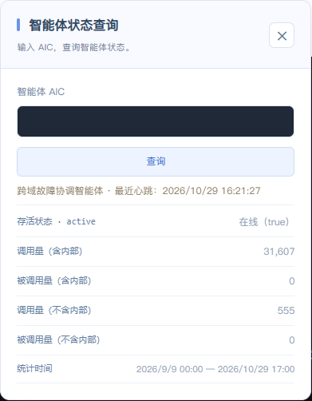

# 联枢多智能体协同运维系统

## 技术报告 · 扩充协作稿

团队编号：AIC-2026-23708513  
数据采集：2026年10月29日；正文扩充：2026年10月30日。

## 作品概述

联枢多智能体协同运维系统面向跨应用、数据库和入口服务的故障处理。操作者提交订单异常后，协调智能体通过梧桐平台寻找具备相应技能的执行者，由各执行者检查自己管理的资源，再按检查结果、操作权限和审批决定执行修复。业务验证角色在修复后运行订单流程，核对服务状态与请求结果。

项目围绕三个相连的问题展开：怎样找到当前能执行任务的智能体，怎样让远程工具调用遵守资源权限，以及执行者中断后怎样继续任务。实现上保留平台的身份、发现和群组通信，增加统一任务格式、资源侧权限检查、持久操作记录和备用接管。每次修改既关联消息任务，也关联实际资源操作，便于查询已经完成的工作。

业务原型由Nginx入口、订单应用和PostgreSQL数据库组成。复合故障案例F10用于说明入口与数据库问题怎样依次处理；接管案例E1-a用于说明主执行智能体完成修改后退出时，备用怎样读取已有结果并继续后续工作。两组案例均在2026年10月29日采集，使用规则模式，模型调用为0。

### 本轮验证结果

| 验证项目 | 本次结果 | 记录说明 |
| --- | --- | --- |
| 梧桐登记与能力确认 | 7个身份注册已通过；5个执行角色完成describe | 注册后台、ADP发现响应与执行者能力响应相互对应 |
| 复合故障与备用接管 | 两例各自最终窗口30次请求成功、10个订单流程 | 核对同次运行的消息、执行记录与订单结果 |
| 本地代码验证 | 146项中143通过、3错误 | 错误集中于旧测试会话；独立诊断3/3通过 |
| 本地进程中断测试 | 4次执行，3成功、1启动失败 | 使用独立文件资源，三种中断点均有成功记录 |

全文时间采用北京时间。源码路径相对团队项目仓库，证据路径相对现有材料目录。实现说明和本地测试对应c88b203及工作树；云端运行和录像对应c390386及各次运行工作树。

## 一 作品概述与目标定位

### 1.1 从订单异常出发

一个订单创建失败，排查入口至少涉及请求发到了哪个应用版本、应用是否仍在运行、连接池保存了什么连接状态，以及数据库是否允许写入。只看入口响应难以区分这些原因；只看数据库又缺少应用与用户请求的上下文。项目选择订单业务作为验证对象，使入口、应用、数据库和最终订单结果能够在同一个流程中对应起来。

这些资源在工程上通常由不同进程、配置和账号管理。将检查职责交给各自的执行智能体，可以让数据库配置留在数据库执行端，入口配置留在运维执行端，协调智能体集中处理故障事实、任务顺序和审批。新增一个资源执行者时，主要工作是发布技能、描述资源范围并接入本地工具，原有协调流程继续使用统一任务格式。

目标使用者是开发人员、运维人员和需要复现实验过程的教学团队。操作者关心的不只是某个命令返回成功，还包括故障原因、做过哪些修改、哪些请求已经确认，以及出现中断后下一步由谁处理。系统因此同时提供工作台、事件记录和业务验证结果，使技术过程可以回到具体资源与订单上核对。

源码：domains/setup_platform.py；business/order_app/store.py:121–175；incident/partners.py:150–200。

## 一 目标与验收方法

### 1.2 将互联过程与业务结果逐项对应

互联的第一项验收是取得候选执行者的实际响应。平台发现提供身份和技能线索，能力查询进一步核对对方当前公开的工具和资源范围。第二项验收是修改前的资源侧检查：请求中包含调用者、工具和参数，涉及写入时再包含操作编号与接管版本，需要审批时附上签名凭据。检查结果决定是否进入工具调用。

第三项验收发生在执行中断之后。系统先查操作记录，再决定返回已有结果、继续尚未执行的操作，或保留待核对状态。第四项验收回到业务：任务协议结束后，还要创建、查询和取消订单；若操作者提供了结果未确认的原业务请求，则另外查询原请求回执。四项验收覆盖从找到执行者到确认结果的完整过程。

| 目标 | 实现方式 | 验收方法 |
| --- | --- | --- |
| 完成互联 | AIP配套SDK、ACS登记、ADP发现、AMQPS群组 | 发现执行者后查询并核对其能力 |
| 按权限执行 | 检查调用者、工具、参数、审批和资源范围 | 拒绝缺少权限或有效审批的修改 |
| 中断后继续 | 任务日志、操作记录和递增的接管版本号 | 重发时复用已有结果；结果未确认时继续核对 |
| 确认业务恢复 | 分别检查原业务请求和恢复后的新订单 | 分别记录任务完成、服务恢复和原请求处理结果 |

项目将这些验收项落实为独立记录，便于定位问题发生在哪一层。例如，能力查询完成后工具权限检查仍可拒绝修改；订单新请求恢复后，遗失原请求编号的订单仍转人工核对。相应状态和处理分支由代码输出，并在各自的验证记录中保存。

源码：incident/contracts.py:33–73；incident/coordinator/engine.py:196–218。证据：E10 演示视频/V2-discovery/capture.json；E14 演示视频/V6-safety/policy-denials.json。

## 二 需求分析

### 2.1 将一次故障处理拆成有记录的步骤

从故障现象到恢复结果，需要依次完成发现、能力确认、观察、审批、修改和业务验证。发现阶段按技能查找候选；能力确认阶段查询对方实际工具；观察阶段返回带来源和时间的事实；修改阶段根据已确认事实生成动作；验证阶段再检查资源状态和订单结果。每个阶段都保存输入与响应，供后续步骤引用。

任务数据中需要区分故障、逻辑任务、资源操作和消息发送。一个数据库恢复操作可以因超时发生多次发送，但仍对应同一个资源修改。执行者返回的结果还要能关联到原任务和身份。项目以结构化字段保存这些关系，协调端按这些字段校验结果，资源端按操作编号查询历史修改。

资源变化还会改变后续判断依据。恢复数据库写入后，早先的只读结果失效；重建应用连接池后，连接池版本和应用侧只读状态都要重新获取。系统按动作所影响的资源刷新事实，保留其他资源仍有效的检查结果，使复合故障能够在修复第一项问题后继续处理。

| 类别 | 需求 | 验证方法 |
| --- | --- | --- |
| 功能 | 跨角色发现、诊断、审批、执行和业务验证 | 逐项核对技能查询、任务回执和订单状态 |
| 一致性 | 区分重复操作、参数变化和旧执行者请求 | 对照操作记录与实际修改计数 |
| 权限 | 凭据由执行端保存，公开检查与内部修改分开授权 | 测试身份及工具允许列表、Schema、审批和资源检查 |
| 兼容性 | 将AIP互联任务转换为MCP工具调用 | 验证初始化、查询工具列表和工具调用 |
| 部署 | 分别提供本地演示和正式平台部署入口 | 检查依赖、配置、身份准备和启动步骤 |
| 运行记录 | 记录失败和结果未确认的请求 | 保留原始状态，并为重试建立发送记录 |

源码：incident/contracts.py:33–73；incident/coordinator/planner.py:160–208。

## 二 中断、权限与运行记录

### 2.2 将故障后的决策条件写进实现

消息发送和资源修改是两个独立过程。发送方连接中断时，消息可能已到达；执行者退出时，修改也可能已经完成。因此，发送异常写入delivery_unknown，操作异常写入unknown，并由后续查询确认资源状态。执行前保存记录、执行后保存结果，是区分这些情况的基础。重试沿用原操作编号，发送记录则另建一条。

权限要求在资源执行端落实。协调智能体发布任务时可以说明要做什么，但执行者仍检查调用身份、工具清单、参数格式和目标资源。参数格式使用JSON Schema，即机器可校验的数据结构约束；高风险操作还核对审批凭据。审批绑定到具体调用者、故障、操作和参数，任务更换内容后需要重新取得匹配的批准。

运行记录服务于故障定位和指标计算。任务记录回答是谁执行了哪项工作，操作记录回答资源修改到了什么状态，访问记录回答某次发送或处理花了多长时间，业务请求记录回答订单是否完成。各记录保留自身的时间和统计范围，按任务关联字段连接。累计调用量、任务数量和订单请求数量分别统计。

非功能指标包括接入耗时、任务处理耗时、恢复耗时、检查成本和业务成功率。本轮已保存发送回调、执行回调、任务区间及订单窗口。后续对比实验使用相同故障、业务负载和统计方法，比较不同检查顺序或模型辅助方式；本报告先解释现有运行中能够直接复算的结果。

源码：acps_mcp_bridge/policy.py:61–105；acps_mcp_bridge/approval.py:10–43；vendor/ACPs-community/acps-sdk/acps_sdk/aip/resumable/journal.py:51–79。

## 三 技术选型与总体架构

### 3.1 协调与资源执行分开

梧桐平台承担身份登记、技能发现和智能体消息互联。项目使用AIP及其配套软件开发工具包SDK处理群组任务，使用MCP连接执行端工具。MCP是模型上下文协议，在本项目中提供初始化、工具查询和调用接口。资源网关位于AIP任务与MCP工具之间，将业务工具名称映射到执行端配置，并在调用前检查权限。

协调部分保存故障事实、计划、任务和审批；资源执行部分保存数据库连接、工具进程环境与操作权限。这种划分使任务计划与资源访问各有明确负责人。应用、数据库、运维和业务验证采用相同任务格式，工具实现可以不同。文中的资源范围指由同一配置、凭据与权限管理的执行对象。

图1 角色分工与资源访问关系（矢量图见同名PDF）

| 层次 | 选型 | 承担的职责 |
| --- | --- | --- |
| 互联层 | AIP配套SDK、ACS、ADP、AMQPS | 发布和发现能力，绑定身份并交换任务状态 |
| 工具层 | MCP Python SDK与资源工具 | 初始化、查询工具列表、检查策略并调用工具 |
| 业务层 | PostgreSQL、订单应用、Nginx | 提供订单业务和请求结果验证 |
| 存储层 | SQLite日志、操作记录与业务事务回执 | 保存发送记录、执行状态、接管版本和操作结果 |

任务日志和操作记录使用SQLite文件保存。SQLite提供事务与写锁，适合本原型中主备共享文件、少量并发写入和进程中断后恢复读取的需要；订单本身由PostgreSQL事务处理。两类存储分别保存协调过程和业务结果，查询时以任务及操作编号关联。

源码：incident/wutong_transport.py:28–61；acps_mcp_bridge/bridge.py:167–174；vendor/ACPs-community/acps-sdk/acps_sdk/aip/resumable/ledger.py:55–96。

## 三 角色与资源配置

### 3.2 七个角色各自负责什么

| 代号 | 角色 | 职责 |
| --- | --- | --- |
| A01 | 协调 | 组织故障处置、安排检查、分派任务、处理审批并汇总结果 |
| A02 | 应用 | 检查订单应用和数据库连接池，执行恢复操作 |
| A03 | 数据库主执行者 | 检查和修改数据库状态，返回操作结果 |
| A04 | 数据库备用执行者 | 读取共享操作记录，在主执行者中断后继续任务 |
| A05 | 运维 | 检查和调整入口路由，管理授权的进程与容器 |
| A06 | 业务验证 | 核对原请求结果，检查未完成操作和新的订单流程 |
| A07 | 接入检查 | 检查公开登记的能力信息与接入问题 |

A01根据订单症状组织检查。A02观察应用连接池、版本和读写状态；A03检查数据库并执行获准的修改；A04与A03访问同一数据库并共享操作记录；A05检查入口路由、进程和容器；A06运行订单流程及回执查询；A07只读检查公开能力信息与接入配置。主备在这里指数据库执行智能体的主、备角色。

A03和A04拥有相同业务资源范围，是接管的关键配置。接管时只匹配相同技能还不够：两个执行者可能都提供数据库工具，却连接不同数据库。实现进一步比较完整资源范围，确认目标一致后才推进共享接管版本。应用和运维执行者也按各自配置限制目标，使工具参数始终落在对应资源内。

公开接入检查采用单独角色和权限，只检查公开描述及接入问题。内部修复能力通过其他角色提供，并携带调用授权、操作编号和必要审批。这使外部发现与内部修改共用平台互联流程，同时保留各自的操作范围。

源码：incident/wutong_transport.py:87–102,345–405；acps_mcp_bridge/policy.py:107–115。证据：E09 演示视频/V1-registry；E10 演示视频/V2-discovery。

## 三 发现与能力确认

### 3.3 先取得候选，再确认能否执行

发现查询按active=true和技能标识筛选，存活条件显式包含online、offline与unknown。返回后逐项核对能力描述中的身份、active状态、技能和AMQPS地址。AMQPS是使用加密连接的消息传输方式，正式运行通过证书建立连接。发现请求对连接异常、读超时和服务端错误设置有限重试，并记录重试原因。

协调智能体随后邀请候选进入群组，发送kind=describe的任务。候选响应中必须带回匹配的executor_aic、资源列表和工具列表；配置了可信身份名单时，还要先通过身份筛选。响应超时、身份不匹配、工具缺失或资源不匹配的候选被跳过，选择结果与原因写入事件记录。

这两步分别解决平台描述和执行端当前状态的核对。describe查询返回的是网关实际加载后的工具清单，网关启动时已检查配置工具是否存在。备用接管再次执行发现与能力查询，并比较前后完整资源范围，使恢复动作继续访问原来的资源。

E10保存五次发现响应及A02至A06的五份能力确认结果。发现采集从17:38:53.377255至17:39:00.909271，耗时7.532016秒，期间包含群组准备、邀请、能力查询和记录写出。该段记录用于复现接入过程；回调耗时另外按访问记录统计。

源码：incident/selection.py:10–107；incident/wutong_transport.py:71–102。证据：E10 演示视频/V2-discovery/capture.json；指标 原始目录/答辩PPT材料/5-量化指标/指标.md。

## 三 消息与业务操作的关联

### 3.4 四类编号分别记录

incident_id标识一次故障处理，logical_task_id标识其中一项检查或动作，operation_id标识实际资源修改，每次AIP发送再分配task_id并保存attempt。这样，一项动作因超时重新发送时，仍然查询同一个operation_id；新的发送与旧发送各自保留消息和状态。任务输出按故障和逻辑任务关联，便于从业务计划找到对应通信记录。

| 字段 | 关联对象 | 使用方式 |
| --- | --- | --- |
| incident_id | 一次故障处理 | 关联事实、计划、审批和最终结果 |
| logical_task_id | 一项检查或动作 | 多次发送仍属于原任务 |
| operation_id | 一次资源修改 | 重发和备用查询共用原操作编号 |
| sessionId、taskId | 一次协议任务 | 关联群组消息和access记录 |
| attempt | 一次发送尝试 | 发送前保存，再记录状态变化 |

业务任务使用ifc/1.0格式，包含kind、tool、args、执行预算以及必要的operation_id、fence和approval。kind区分observe、act、describe、verify与resume。写入任务必须包含操作编号和接管版本；deadline_ms限制执行时间。接收端先验证格式，再进入工具权限检查，结果统一返回身份、状态、事实和操作状态。

事实记录带有key、value、source和observed_at，即名称、值、来源与观察时间。交接时沿用原观察时间，并附上有效期限；复制到恢复任务中不会更新事实的观察时刻。备用据此判断哪些信息可以继续使用，哪些资源状态需要重新查询。

源码：incident/contracts.py:13–73；vendor/ACPs-community/acps-sdk/acps_sdk/aip/resumable/journal.py:51–79；incident/wutong_transport.py:189–218。

## 三 AIP任务生命周期

### 3.5 从开始任务到确认完成

正式传输先检查群组连接和通道，再调用start_task发送任务。协调端等待AwaitingCompletion，读取同一taskId、同一执行者发送的任务结果。输出必须只有一个约定格式的数据项，解析后继续核对executor_aic、incident_id和logical_task_id。匹配后调用complete_task，再等待Completed。

AwaitingCompletion表示结果已经可读、等待协调者确认；Completed表示这段协议交互完成。业务恢复由验证角色另行检查。实现将结果解析和身份关联放在协议完成前，防止迟到或关联错误的结果被用于当前计划；协议完成后再保存本地消息记录，存储错误按本地证据保存问题处理。

任务状态还要处理消息乱序。历史联调中，旧working消息晚于带结果的awaiting-completion到达。项目按消息携带的状态更新时间决定当前状态，同时保留原始事件。新的Continue任务继续按时间参与排序，既保存已经就绪的结果，也允许后续合法状态更新。

超时或连接异常会保存执行者、任务和截止时间，随后进入接管判断。接管过程中产生的新发送仍关联原逻辑任务。若候选无法确认或拒绝交接，协调端保存失败原因并结束这次接管尝试；这些记录为人工处理和下一次恢复提供定位依据。

源码：incident/wutong_transport.py:182–268；vendor/ACPs-community/acps-sdk/acps_sdk/aip/_task_order.py:16–26；vendor/ACPs-community/acps-sdk/acps_sdk/aip/resumable/journal.py:63–79。证据：兼容问题 原始目录/答辩PPT材料/3-接入兼容问题.md。

## 三 MCP网关与权限检查

### 3.6 在工具调用前检查请求

网关使用MCP SDK建立stdio会话，完成initialize，分页读取list_tools，再将业务工具名映射到具体MCP工具。启动时核对策略中配置的工具是否全部存在。业务任务使用db.restore_writes等稳定名称，执行端配置决定连接哪个工具服务、使用哪个底层工具和固定参数。

每次请求首先核对调用者身份，再检查工具允许列表和JSON Schema。任务类型还需匹配风险等级：read工具接收observe，write和high工具接收act。修改任务必须带有operation_id和包含coordinator_term、takeover_version的fence；high工具继续核验审批。策略还按调用者与工具统计调用次数，限制配置窗口内的调用频率。

| 检查项 | 检查内容 | 检查未通过时 |
| --- | --- | --- |
| 调用身份 | 允许的调用者与目标资源范围 | 拒绝越权请求 |
| 工具与参数 | 工具允许列表、JSON Schema、任务类型 | 拒绝未知工具和无效参数 |
| 重复操作 | operation_id、参数校验值与fence接管版本 | 拒绝相同编号但参数不同的操作，以及旧执行者请求 |
| 修改审批 | 调用者、故障、动作、参数及有效期 | 等待审批；拒绝与请求不匹配的审批凭据 |
| 目标资源 | 容器标签、阻塞会话PID、允许的SQL模板 | 拒绝超出范围的资源和状态已变化的执行目标 |

参数转换在执行端完成。固定参数由配置提供，SQL使用执行端保存的模板，远端只传入模板允许的字段。参数名称需要转换时，网关按配置映射。工具返回值再转换为统一事实和操作状态，使协调程序按业务名称处理结果，而执行细节留在资源侧。

源码：acps_mcp_bridge/client.py:26–53；acps_mcp_bridge/policy.py:61–105；acps_mcp_bridge/bridge.py:167–196,252–317。

## 三 审批与目标资源核对

### 3.7 批准具体动作，执行时再次核对

需要审批的动作先进入awaiting_approval状态。批准后，审批服务对调用者、incident_id、operation_id、tool和args生成HMAC签名。HMAC利用共享密钥计算校验值，用于核验审批记录是否与批准内容一致；记录同时保存批准者、批准时间和失效时间。执行端检查各字段、有效期及签名后，才接受该高风险调用。

审批与资源检查承担不同职责。审批记录说明这项修改已经获得批准，资源检查确认当前目标仍符合条件。容器操作核对Compose项目、服务和名称，并使用已核验的容器标识；终止阻塞会话前重新查询数据库，确认目标PID仍处在允许的阻塞关系中。入口回退也使用版本和文件摘要检查，确保修改依据对应当前配置。

这些检查放在执行端，是因为资源状态会在发现和实际操作之间变化。检查通过后，网关再按策略调用工具，并记录调用者、执行者、故障、任务、操作编号、状态和耗时。审批密钥与资源配置分别保护，数据库连接参数和工具进程环境由对应执行端加载。

E11中的db.restore_writes经过真实待审批状态。采集脚本在弹窗显示后按事先授权点击批准，批准凭据继续通过原审批通道传到执行端。审批开始和批准时刻都保存在记录中，可以与修改任务和后续资源观察对应。

源码：acps_mcp_bridge/approval.py:10–43；acps_mcp_bridge/bridge.py:176–185,254–268；incident/wutong_transport.py:53–61,164–167。证据：E11 演示视频/V3-f10/approvals.json。

## 三 操作记录与接管版本

### 3.8 将修改前后的状态保存到磁盘

操作记录以资源范围和operation_id作为主键，保存参数摘要、原参数、执行状态、结果、修改前后状态以及接管版本。参数摘要用于比较两次请求内容是否相同；相同编号但参数变化时返回rejected_parameter_mismatch。已保存applied的操作直接返回skipped_already_applied，并带回原结果。

SQLite事务在执行前取得写锁，先将executing状态提交到文件，再进入资源动作。进程在修改过程中退出后，备用可以读取这一状态，继续查询真实资源。进入实际动作前还要重新核对fence和执行者标识；当前版本已变化或执行权已转移时，旧请求被拒绝或转入核对。动作异常则保存unknown及异常类别。

fence由coordinator_term和takeover_version组成，分别表示协调者任期和该任期内的接管次数，按两个整数的顺序比较。执行端只接受当前或更新版本。操作记录提供next_fence方法，在事务内分配下一个接管次数；梧桐传输则先提出新版本，再等待备用激活并回传确认。当前执行权限保存在资源侧，旧进程重新出现时仍按该状态检查。

图2 操作结果确认与备用接管流程
源码：vendor/ACPs-community/acps-sdk/acps_sdk/aip/resumable/ledger.py:55–140,194–284。（矢量图见同名PDF）

## 三 备用接管与执行分支

### 3.9 根据已有结果决定下一步

接管先为相同角色加锁，保存原任务和失败执行者，再通过ADP重新发现候选。候选必须通过实际describe确认，完整资源范围还要与原执行者一致。协调端在原版本基础上提出新fence，将剩余任务、操作编号和证据引用放入ResumePackage，再通过resume任务发送给备用。

备用激活共享版本后返回active_fence。协调端确认该版本达到要求，才更新当前执行者并移除旧参与者。只读检查可以重新发送；修改任务则按操作记录分支处理。这里的resume负责查询和接管授权，资源检查使用只读工具，执行修改需要进入相应动作分支。

| 资源侧记录或响应 | 处理方式 | 返回结果 |
| --- | --- | --- |
| applied | 读取已保存结果，跳过修改 | skipped_already_applied |
| executing、unknown、failed，资源已达目标 | 只读核对后确认已完成 | reconciled_applied |
| received | 使用新fence发送原动作 | 执行后记录结果 |
| 状态仍待确认 | 保留记录，继续核对 | unknown或reconciliation_required |
| 旧fence或参数变化 | 拒绝请求 | rejected_stale_fence等 |

通用操作记录支持在明确前置状态和重试条件满足时再次执行。网关恢复流程先核对已有动作，结果仍不明确时交回协调端处理。执行修改的进程共同使用该操作记录，或遵守资源本身的锁与隔离规则，构成这套接管机制的执行条件。

源码：incident/wutong_transport.py:345–430；acps_mcp_bridge/bridge.py:200–250；vendor/ACPs-community/acps-sdk/acps_sdk/aip/resumable/ledger.py:194–284。证据：E12 演示视频/V4-takeover/result.json。

## 三 检查选择与修复计划

### 3.10 根据检查结果形成操作顺序

基础规划器维护故障原因候选和已观察事实。每个候选原因包含其对工具结果的预期；收到新事实后，程序剔除与观察冲突的候选。选择下一项检查时，统计该检查能区分多少对候选原因，再结合配置成本和耗时估计计算S = D / (C + 0.2T)。D是能区分的候选原因对占比，C是检查成本，T是配置的秒级耗时估计。

修复动作根据具体事实生成。入口仍指向v1时安排路由回退；数据库只读时安排恢复写入；数据库已恢复写入而应用仍保留只读连接时安排重建连接池。应用与数据库只读状态冲突时，先补查数据库；重建连接池需要当前revision，缺少时先查询应用状态。这样的先后关系落实在动作条件和depends_on字段中。

动作完成后，程序只刷新受影响事实。例如入口回退后重新查询路由，数据库恢复后重新查询读写状态，连接池重建后重新查询应用与连接池版本。仍有效的其他资源事实继续保留，使多个同时存在的问题可以逐项处理。

代码还提供模型生成原因假设和跨资源检查模式。模型输出按工具、结果枚举及格式校验，失败时回退规则；跨资源模式每个资源范围同时处理一个任务，最多三个范围并行。10月29日F10使用M0预设检查顺序，模型调用与Token用量为0，后续修复仍依据各次检查返回的事实和审批。

源码：incident/coordinator/planner.py:73–84,128–208；incident/coordinator/hypothesis.py；eval/run.py:118,151,230。证据：E11 演示视频/V3-f10/incident-state.json。

## 三 订单验证与原请求回执

### 3.11 将业务写入与结果记录放在同一事务中

订单创建和取消使用operation_key标识同一次业务请求。数据库事务先对这个键加锁，再查询已有回执；相同键、相同内容直接返回原结果，内容冲突则拒绝。新操作将订单修改和operation_receipts回执写入同一事务。应用响应丢失后，验证角色可按原键查询已经提交的处理结果。

验证分三部分进行：查询操作者给出的原业务请求，处理前次症状检查留下的待确认操作，再使用新编号运行创建、查询和取消流程。新窗口默认持续至少30秒，至少完成10个完整流程，失败数为0，待处理操作全部结束。每次验证采用新的运行编号，原有成功回执留在各自记录中。

```text
"passed": duration >= 30 and completed >= min_complete
          and counts["failed"] == 0
          and not self.state["pending"]
```

源码摘录：business/load.py第142至143行

service_recovered记录新业务和前序待处理操作的恢复情况，original_request_resolved记录原业务请求处理结果，两者同时满足才输出business_recovered。指定原请求却缺少编号、回执缺失或查询失败时，输出人工核对要求。F10本次未绑定特定原订单编号，记录中的original_request_resolution为not_required；其业务结果由实际订单窗口给出。

源码：business/order_app/store.py:125–175；business/load.py:136–143；incident/partners.py:150–200；incident/coordinator/engine.py:196–218。证据：E11 演示视频/V3-f10/incident-state.json。

## 四 项目实施与开源改造

### 4.1 复用官方互联基础，补充任务恢复

项目使用AIP官方配套实现提供的证书身份、登记发现、群组管理和任务协议，MCP SDK提供工具客户端接口，PostgreSQL与Docker工具提供资源操作。团队开发围绕这些组件的连接处展开：统一业务任务、核对执行能力、限制工具权限、保存任务与操作状态，以及在中断后继续处理。

SDK对比使用固定上游提交3985c1330209f075c124669cc9d31f0e75448140，对应SDK 2.2.0。统计将换行统一后逐文件比较，排除字节码、虚拟环境和构建目录；新增与删除行包含注释、空行和文档字符串。差异表分别列运行时、测试、示例和文档，便于从文件层面核对改造内容。

| 文件范围 | 变化文件 | 新增行 | 删除行 |
| --- | --- | --- | --- |
| SDK运行时 | 14 | 1,436 | 144 |
| SDK测试 | 14 | 1,635 | 5 |
| 示例 | 1 | 80 | 0 |
| 文档 | 1 | 152 | 0 |
| 合计 | 30 | 3,303 | 149 |

当前SDK运行时共有68个文件、17,526行，其中54个文件与上游一致，共11,659行；6个修改过的原文件全文4,757行；8个新增运行模块共1,110行。差异量用于说明实际新增和删除，保留代码规模用于说明复用情况，逐文件目的记录在改造清单中。

源码：vendor/ACPs-community/ORIGIN.md。证据：改造统计 原始目录/答辩PPT材料/1-开源改造/改造说明.md；统计文件 原始目录/答辩PPT材料/1-开源改造/统计依据.json。

## 四 SDK改造的关键处理

### 4.2 状态顺序、恢复记录与调用日志

第一项改造处理任务结果乱序。历史记录中，较旧working比结果就绪消息晚到约24.6毫秒，按接收顺序覆盖会让协调端丢失当前结果状态。排序函数比较状态更新时间，任务日志继续保存迟到事件；当前状态只接受符合顺序的更新。相关改动将协议接收顺序与状态新旧分别处理。

第二项改造增加恢复所需的持久记录。任务日志保存发送尝试及状态转换，操作记录保存参数、接管版本和资源结果，恢复数据携带证据与剩余任务。协调端重启或参与者退出后，可以按原逻辑任务找到先前发送，再按operation_id查询实际修改。状态仍待确认时，后续动作先执行只读核对。

第三项改造补充群组调用的访问记录。一次任务含开始、状态更新和完成等多条消息，SDK按会话、任务和方向识别首次Start，再分别记录发送回调和执行回调。持久访问记录在进程中断后恢复未结束条目，接管案例中因此保留了原A03工具任务的OutcomeUnconfirmed。

第四项改造处理日志写入并发。消息发射器构造时将目标解析为完整路径，同一进程内相同文件路径共用锁，锁覆盖一条JSON记录的完整写入。后续本地改动还涉及权限重试、参与者清理和调用记录保存。PR #13、#14对应其中部分改动，当前SDK差异包含两项公开贡献及之后的开发内容。

源码：vendor/ACPs-community/acps-sdk/acps_sdk/aip/_task_order.py:16–26；vendor/ACPs-community/acps-sdk/acps_sdk/aip/resumable/journal.py:51–79；vendor/ACPs-community/acps-sdk/acps_sdk/amp/group_access.py:51–115；vendor/ACPs-community/acps-sdk/acps_sdk/amp/message_emitter.py:26–48,91。证据：兼容说明 原始目录/答辩PPT材料/3-接入兼容问题.md。

## 四 实施过程与部署资源

### 4.3 围绕订单原型逐步联调

项目于2026年10月15日启动。开发先划分入口、应用、数据库和验证职责，再建立任务格式和工具网关，随后接入平台群组、增加中断恢复，并以订单创建、查询和取消贯穿联调。代码提交记录说明实现何时纳入项目，运行记录说明具体案例采用的源码和环境。

| 日期 | 阶段 | 代表记录 |
| --- | --- | --- |
| 10月17日 | 形成团队初始源码快照 | 800607c |
| 10月18日 | 本地模型工作台与健康业务验证；整理PR | 7d31150、a3812e7 |
| 10月19日 | 权限检查与进程中断恢复 | 4396461、4f157a1 |
| 10月20日 | 参与者清理与后续协作基线 | c390386，后续本地至c88b203 |
| 10月29日 | 采集平台注册、F10、接管和安全记录 | E09至E15 |

平台接入中分别配置消息Broker和群组授权API；ADP发现使用确认过的完整路径，处理短路径301重定向和存活筛选差异。数据库MCP与运维MCP各自安装依赖、加载资源配置。正式运行先检查身份、证书、群组连接和工具列表，再开始业务任务。

10月29日21:52保存的资源记录显示，云服务器可用逻辑核心数为2、内存3.6 GiB、Swap 4.0 GiB，根文件系统50 G，系统为Ubuntu 22.04.5 LTS。该资源配置用于运行本原型的多角色进程、容器业务和采集服务；本地使用Windows 11与Python 3.12.14，负责开发、离线检查和材料整理。

源码：docs/local_model_workbench_20261018.md。证据：实施记录 原始目录/答辩PPT材料/2-项目实施.md；资源采集 原始目录/答辩PPT材料/scripts/implementation_resources.json。

## 四 代码版本与复现入口

### 4.4 将实现、测试和录像对应到源码

报告中的本地实现和统计采用c88b203及10月29日工作树，云端F10与接管采用c390386及对应运行工作树。本地参考提交位于云端参考提交之后，包含另外32个提交；两处各有未提交内容。因此，复核时使用提交、源文件清单和运行记录共同定位版本。

本地报告引用27份源文件，测试另外保存155份源码与配置清单，测试前后这些文件保持一致。云端各次run.json保存源文件摘要、运行方法、业务参数及录像对应信息。实现说明据本地代码展开，案例分析据云端记录展开，队友可以沿来源直接查到相应文件。

| 材料用途 | 来源 | 使用方式 |
| --- | --- | --- |
| 实现说明与本地修复 | c88b203及本地工作树 | 原始目录/当前源码及引用、测试清单 |
| 云端实验与视频证据 | c390386及云端工作树 | V3、V4的run.json源文件清单与采集脚本 |

日常开发从本地容器业务和stdio演示开始，验证任务格式、策略检查与订单结果；正式平台入口再接入证书、发现地址和群组认证。最终协作版本需要统一本地与云端差异，修复原有测试与启动问题，再为新版本建立对应验证记录。共享资料保留可编辑正文、生成脚本、源码和历史证据，便于分工修改后统一排版。

证据：E11 演示视频/V3-f10/run.json；E12 演示视频/V4-takeover/run.json；本地源码 原始目录/当前源码核查.md；修复入口 原始目录/测试问题复现与修复验收.md。

## 五 平台接入与访问数据

### 5.1 注册、发现与下午访问记录

10月29日16:19至16:20查询公开注册和发现接口，七个角色ACS均返回HTTP 200且身份匹配。ADP在16:20:45返回七个角色，active与alive均为true，最近心跳为16:20:18至16:20:37。随后后台画面确认七个身份审核通过，云端实际能力查询覆盖A02至A06。

| 角色 | 榜单 | 位置 | access | message | count |
| --- | --- | --- | --- | --- | --- |
| A01 协调 | 发起调用 含内部 | 2 | 5,514 | 26,093 | 31,607 |
| A05 运维 | 被调用 含内部 | 10 | 1,660 | 6,226 | 7,886 |
| A03 数据库执行 | 被调用 含内部 | 11 | 1,653 | 6,233 | 7,886 |
| A02 应用 | 被调用 含内部 | 13 | 837 | 6,242 | 7,079 |
| A06 验证 | 被调用 含内部 | 14 | 801 | 6,219 | 7,020 |
| A07 接入检查 | 被调用 含内部 | 34 | 8 | 1,173 | 1,181 |
| A01 协调 | 发起调用 不含内部 | 10 | 555 | 0 | 555 |

表中排行榜查询起点为9月24日00:00，参数上界为10月29日17:00，响应在16:19:45取得，缓存标记MISS、age为0。count由access与message相加得到，表示平台访问和消息活动。A01独立状态页另显示外部被调用为0；外部被调用榜返回列表中没有本队角色，其他角色在该项下缺少独立查询值。

访问记录用于说明平台交互规模，业务恢复结果由同次任务和订单记录给出。E09至E12依次保留注册、发现、跨端任务和业务验证，能够按角色与任务编号连起来查看。晚间补录统计在5.7节单独对照。

证据：E02、E03 原始目录/平台记录；E09 演示视频/V1-registry；E10 演示视频/V2-discovery/capture.json。

## 五 本地代码与进程中断验证

### 5.2 用例结果与本地恢复记录

10月29日16:18:35至16:19:25执行六类本地验证，梧桐传输相关组件使用模拟通道，其余按各用例启动本地组件或子进程。总计146项，143通过、3错误。三项错误均在恢复回执解析测试中，旧测试会话缺少新增AMQP连接检查所需字段，任务在派发前被拒绝。

| 范围 | 用例 | 通过 | 错误 |
| --- | --- | --- | --- |
| 协议与发现 | 24 | 24 | 0 |
| 接管与身份管理 | 36 | 33 | 3 |
| 工具权限与审计 | 37 | 37 | 0 |
| 业务回执处理 | 18 | 18 | 0 |
| 工作台状态与证据 | 14 | 14 | 0 |
| 接入检查与调用管理 | 17 | 17 | 0 |
| 合计 | 146 | 143 | 3 |

补充诊断脚本构造通过连接状态检查的测试通道，3项独立诊断均通过。随后本地进程验证真实启动AIP stdio与MCP子进程，以独立JSON文件作为资源，在观察后、修改前和修改后三个位置中断执行者。成功案例中备用继续任务，修改计数为1，旧fence请求被拒绝。

| 中断点 | 尝试 | 结果 | 修改次数 | 操作回执 |
| --- | --- | --- | --- | --- |
| 观察后退出 | 首次 | 通过 | 1 | applied |
| 修改前退出 | 首次 | 启动失败 | 未进入任务 | 无 |
| 修改后退出 | 首次 | 通过 | 1 | skipped_already_applied |
| 修改前退出 | 独立重试 | 通过 | 1 | applied |

修改前退出案例首次发生工作进程启动失败，独立重试通过，首次失败原因仍待定位。四次记录合计3成功、1启动失败。当前后续代码工作包括补齐原测试会话、定位启动异常，并对修复后的统一版本重新建立验证记录。

证据：E06至E08 原始目录/测试记录；修复记录 原始目录/测试问题复现与修复验收.md。

## 五 F10复合故障处理过程

### 5.3 从入口错误到连接池刷新

F10将入口指向旧版本与数据库默认只读组合到同一订单场景。协调智能体收到订单异常后，按M0顺序检查容器、入口路由、应用、数据库读写状态和阻塞会话。观察分别确认应用仍在运行、入口需要回退、数据库只读，阻塞会话为空。这些结果将修复分成入口、数据库和应用连接三项。

第一步ops.route_rollback恢复登记的v2入口，让后续订单访问正确应用。第二步db.restore_writes清除实验数据库与应用角色的默认只读设置。该操作在17:39:18.638716请求审批，17:39:21.958909获批，等待3.320秒；采集脚本在弹窗出现后按事先授权批准。

数据库恢复写入后，应用原连接仍带有只读状态，系统重新检查数据库并核对应用状态，再调用application.pool_rebuild。该任务携带expected_revision=18，随后应用观察中的连接池版本为19、只读状态为false。三步修改分别对应不同资源，顺序由入口可达、数据库可写和新连接生效的依赖决定。

最后运行incident.verification，发起新的订单创建、查询和取消。整次故障处理记录13个业务任务、20条transport事件和40条协调器事件，故障处理状态耗时42.748秒。五份前置describe另列在能力确认记录中。本轮模型调用及Token用量均为0。

源码：incident/coordinator/planner.py:160–208。证据：E11 演示视频/V3-f10/incident-state.json；审批 演示视频/V3-f10/approvals.json；事件 演示视频/V3-f10/events.jsonl。

## 五 F10全过程数据解读

### 5.4 连续采样与最终验证分别查看

| 观察范围 | 实测结果 | 含义 |
| --- | --- | --- |
| 调用双方访问记录 | 18对，按trace/correlation配对 | 18条资源执行端记录均为AMP状态200，用于核对工具访问 |
| 完整连续采样 | 52条：36成功、16未知 | 包含5条故障注入前的基线请求 |
| 故障后汇总 | 47条：31成功、16未知 | summary统计故障后数据，另5条为故障前基线 |
| 最终订单验证 | 30.002秒，30次成功请求，10个流程 | 每个流程包含创建、查询和取消；0失败、0未知 |
| 收尾独立H00 | 30次成功请求，10个流程 | 资源恢复后再次执行独立验证 |

完整连续采样覆盖故障注入前后，共52条请求，其中36成功、16结果未知。最早5条为注入前基线，因此故障后summary统计47条，31成功、16未知。两份记录保留相同的16条未知，差异来自统计起点。查看故障过程时使用连续样本和事件顺序，查看最终恢复时使用独立业务窗口。

最终窗口持续30.002秒，30次请求成功，完成10个完整流程，失败与未知均为0。每个流程包含创建、查询和取消三次请求，既检查新的写入，也检查后续读取和取消。资源恢复后的独立H00再次执行30次请求、10个流程，用于确认案例结束后的健康状态。

18对access来自调用双方的工具访问记录，包含5次能力确认与13次业务任务。它们通过trace和correlation关联到同次运行，资源执行端18条记录的AMP状态均为200。录像复用工作台前端，由独立观察程序读取协调器和事件，以A01至A07显示身份，画面与记录通过采集时间对应。

F10验证任务未提供特定原订单编号，原请求核对结果为not_required。持续采样中的未知请求继续保存在原观察文件；最终窗口使用新请求编号。案例因此同时呈现故障期间请求状态、执行过程和恢复后的新订单结果。

证据：E11 演示视频/V3-f10/order-samples.json；任务状态 演示视频/V3-f10/incident-state.json；访问配对 演示视频/V3-f10/access/pairing-summary.json；录像对应 演示视频/V3-f10/run.json。

## 五 主执行智能体退出后的接管

### 5.5 E1-a修改完成后退出

接管案例在after_applied检查点退出A03数据库主执行智能体的工作进程。该检查点位于修改完成并保存操作结果之后、工具任务回执完整返回之前，Docker记录退出码83。协调智能体先等待原任务，超时后重新发现备用，确认A04身份、工具及完整资源范围，再发送剩余任务与证据。

| 关键事件 | 北京时间 | 时间依据 |
| --- | --- | --- |
| A03工作进程退出 | 17:41:44.663452691 | Docker FinishedAt |
| 超时并进入接管 | 17:42:04.448493 | AMP事件 |
| 接管任务发送 | 17:42:05.111754 | AIP消息及AMP关联记录 |
| A04跳过已执行操作 | 17:42:05.144490 | 备用响应消息时间 |
| 最终订单验证通过 | 17:42:38.592668 | 协调器成功审计时间 |

A04读取共享操作记录并返回skipped_already_applied，复用已保存的修改结果，后续继续重建连接池并验证订单。调用记录显示A03发起修改类MCP工具调用1次。双端access共13对，其中A03的db.restore_writes工具任务仍为OutcomeUnconfirmed，响应状态和耗时缺失；其余12条资源侧记录的AMP状态为200。

最终订单窗口为30.002秒，30次成功请求、10个完整流程，0失败、0未知，资源复原后的独立H00也通过。时间线包含21个节点，备用入群时间保存区间及上界。结果将A03工具任务的确认状态、备用的操作查询结果和新的订单验证分别列出，便于判断恢复具体完成到了哪一步。

证据：E12 演示视频/V4-takeover/result.json；时间线 演示视频/V4-takeover/takeover-timeline.json；交接消息 演示视频/V4-takeover/handover-message-excerpts.json；访问配对 演示视频/V4-takeover/access/pairing-summary.json。

## 五 调用耗时与协作规模

### 5.6 分开发送、处理和任务数量

访问计时从各进程中的monotonic开始，到对应callback返回或抛错结束。协调侧包住publish_message，记录发布回调耗时；资源侧包住任务处理器，包含权限检查、工具执行和结果处理。订单验证工具本身运行30秒窗口，因此资源侧较长耗时对应实际验证工作。两端按correlation_id配对，各自统计。AMP中间件按发送和接收方向分别填写202与200状态码。

| 案例与记录端 | 总记录／有耗时 | 中位数ms | P90 ms | 最大ms |
| --- | --- | --- | --- | --- |
| F10发送 | 18／18 | 9.429 | 16.414 | 227.633 |
| F10处理 | 18／18 | 97.913 | 2,463.076 | 30,895.049 |
| E1-a发送 | 13／13 | 6.204 | 9.139 | 11.047 |
| E1-a处理 | 13／12 | 27.733 | 30,032.069 | 30,041.869 |

P90表示升序排列后位于ceil(0.9×n)处的样本值，采用最近秩法；中位数按通常的样本中位数计算，正文显示三位小数。E1-a资源侧一条OutcomeUnconfirmed记录没有durationMs，耗时分位数使用其余12条，记录总数仍为13。按案例、记录端、路由和方法细分后，共有32组指标。

F10访问记录覆盖五个执行角色，其中A04只参加describe；13个业务任务由A02、A03、A05和A06执行，加协调A01共涉及六个角色。根据同一协调器的task_started与task_returned扫描，13个业务任务同时未结束的数量峰值为1。接管案例的13对调用覆盖六个执行角色，参与数量与并行执行数量分别统计。

源码：vendor/ACPs-community/acps-sdk/acps_sdk/amp/group_access.py:82–112。证据：指标说明 原始目录/答辩PPT材料/5-量化指标/指标.md；计算结果 原始目录/答辩PPT材料/5-量化指标/计算结果.json。

## 五 访问统计与持续运行观察

### 5.7 保留各次采集时间和查询起点

历史查询固定起点为9月24日00:00，逐小时改变截止时间，覆盖10月20日07:00至10月29日17:00，共227个累计区间。9次首次超时后补查，最终全部取得有效结果。下午网页和晚间网页使用各自页面显示的统计起点，下表将各次来源并列。

| A01数据来源 | 采集时刻 | 含内部／外部 | 统计区间 |
| --- | --- | --- | --- |
| E04早期API | 16:19:45 | 31,607／555 | 9月24日00:00至10月29日17:00 |
| E05早期网页 | 16:21 | 31,607／555 | 9月9日起 |
| E13历史API最后区间 | 本轮集中回查 | 31,759／563 | 9月24日00:00至10月29日17:00 |
| E13下午网页 | 约17:24 | 31,836／568 | 9月9日00:00至10月29日17:24 |
| E13晚间官方查询页 | 21:08:56 | 32,620／612 | 9月9日00:00至10月29日22:00 |

日期均为10月29日，晚间实际观测时刻为21:08:56，22:00是页面显示的查询截止上界。A01晚间被调用与外部被调用均为0。21:09:05另查A03，其被调用为8,099，其余三项为0。各角色、方向和统计起点随原页面保存。

17:27:51的运行日志显示工作台、调度和采集服务为active/running，工作台connected=true。inspect类别共有1,214条巡检，1,142条completed、72条unknown。按15秒时间段统计七角色心跳，有心跳记录的时间段占99.47%至99.61%。这些数据分别说明巡检结果与心跳记录覆盖情况。

证据：E13 演示视频/V5-access/ranking-hourly.json；晚间查询 演示视频/V5-access/status-observation.json；运行观察 演示视频/V5-access/longrun-summary.json。

## 五 权限测试与开源贡献

### 5.8 资源权限和社区记录

本地E2-c共15项策略测试，14项违规请求在工具调用前被拒绝，MCP调用均为0；1项合法操作执行修改1次，完整合法流程共3次MCP调用，包括读取。静态凭据检查覆盖10个来源、2,615个字符串，0命中；本地签名审计记录验证通过。各结果按测试文件和作用范围记录。

| 项目 | 本轮结果 | 验证范围 |
| --- | --- | --- |
| E2-c策略用例 | 15/15符合预期 | 本地组件与本地MCP |
| 拒绝测试 | 14次拒绝，MCP调用均为0 | 不合规请求在工具调用前被拒绝 |
| 合法调用测试 | 1项合法操作，资源修改1次 | 共3次MCP调用，包含合法流程中的读取 |
| 静态凭据检查 | 10个来源，2,615个字符串，0命中 | 检查所列文件和记录中的凭据字符串 |

开源贡献围绕任务状态、群组访问记录、并发日志写入以及接入配置讨论展开。PR #13增加1,599行、删除11行，涉及14个文件；PR #14增加159行、删除5行，涉及3个文件。两个PR包含共同测试文件，逐项规模按各自差异保存，当前30文件SDK统计另列于第四章。

| 条目 | 采集时状态 | 改动规模或说明 |
| --- | --- | --- |
| PR #13 | Open，非Draft，未合并 | +1599 / -11，14个文件 |
| PR #14 | Open，非Draft，未合并 | +159 / -5，3个文件 |
| Issue #15 / #17 / #18 | Open | 问题与讨论记录 |
| Issue #16 | Closed | 问题记录已关闭 |

状态来自2026年10月29日17:08的官方仓库查询和当轮页面采集。Issue #15记录任务结果顺序，#16记录群组入口，#17记录群组访问统计，#18记录发现存活筛选。PR与Issue连接代码修改、接入现象和历史讨论，作为队友继续协作时的定位入口。

证据：E14 演示视频/V6-safety/policy-denials.json；扫描 演示视频/V6-safety/credential-scan.json；E15 演示视频/V7-opensource/contributions.json。

## 六 总结与展望

### 6.1 工程结果与后续工作

联枢将平台上的身份和消息互联延伸到资源操作与业务结果。发现后查询实际能力，使选择依据落到执行端；工具调用前在资源侧检查身份、参数、审批和目标，使权限随工具实现落实；共同操作记录和递增接管版本，使中断后的处理能够依据历史结果和当前资源状态继续。

订单原型把这些机制放到完整业务流程中检验。F10展示入口回退、数据库恢复写入与应用连接池刷新之间的依赖，E1-a展示主执行智能体退出后备用复用已有结果。两个案例的最终订单窗口和独立H00通过；全过程未知样本与A03工具任务未确认状态分别保存。本地146项测试中的3项错误和一次启动失败继续按原问题处理。

| 事项 | 当前情况 | 下一步 |
| --- | --- | --- |
| 操作记录与资源权限 | 共同操作记录覆盖接入该机制的执行者 | 增加资源本身的锁和跨进程执行权限检查 |
| 备用角色 | 当前部分角色配置同资源备用 | 增加备用角色，验证失联与重新上线 |
| 诊断工具和规则 | 当前诊断依据已配置工具和规则 | 增加故障类别，使用固定基线进行对照 |
| 跨资源调度 | 跨资源规划模式由评测入口启用 | 增加工作台配置入口并验证执行行为 |
| 测试会话与启动异常 | 原143/146通过及一次启动失败仍待处理 | 修复原问题并记录复验结果 |
| 本地与云端版本 | 本地测试和录像使用不同工作树 | 核对差异，确定最终代码并记录对应证据 |

近期工作先统一本地与云端代码、补齐原测试会话并定位启动异常，再以固定故障与业务负载比较M0、模型辅助诊断和跨资源检查方式。评价同时记录恢复完成情况、检查次数、耗时、模型调用量和高权限操作，分析每项机制在实际流程中的作用。

应用扩展从资源和权限明确的环境开始，将新的资源工具接入相同任务格式与执行端检查，再增加故障类型、备用角色和部署方式。材料与源码保留可编辑入口，队友可以按证据编号修订案例、补充新运行记录，并在确定最终版本后统一生成技术方案、报告和佐证。

证据：待修入口 原始目录/测试问题复现与修复验收.md；实施资料 原始目录/答辩PPT材料/2-项目实施.md。

## 七 附录与证据索引

### 7.1 实现与前期验证

| 编号 | 证据 | 支持的结论 |
| --- | --- | --- |
| E01 | 源文件审查与文件清单 | 角色、调用流程和实现方式 |
| E02 | 七个ACS公开响应 | 能力描述已发布，身份匹配 |
| E03 | ADP发现响应 | 采集时七个角色均在线且能被发现 |
| E04 | 官方四榜API响应 | 指定统计区间内的平台累计访问计数 |
| E05 | 官方状态页截图 | 协调智能体在线状态与页面计数 |
| E06 | 146项本地代码验证记录 | 离线单元、组件与本地进程测试结果 |
| E07 | AMQP测试通道补充诊断 | 原3项错误与测试会话字段缺失的关系 |
| E08 | 四次独立进程运行记录 | 三类中断点恢复和一次启动失败 |

互联实现入口为incident/wutong_transport.py与incident/selection.py；任务格式为incident/contracts.py；协调与规划位于incident/coordinator/；工具权限与审批位于acps_mcp_bridge/；恢复扩展位于vendor/ACPs-community/acps-sdk/acps_sdk/aip/resumable/；订单与回执位于business/order_app/store.py。

查阅时先按证据编号定位运行，再查run.json或文件清单确定代码来源，最后用事件和业务记录核对过程。源码中的字段名、协议状态和文件名保持原样，正文在首次使用时说明含义。公开材料用固定角色代号，并隐去完整平台身份、资源地址、个人路径和凭据。

## 七 官方平台查询画面

### 7.2 A01协调智能体状态



图3 A01协调智能体的官方状态查询截图

截图来自官方状态查询页，对象为A01协调智能体，最近心跳为10月29日16:21:27，在线状态为true。含内部调用31,607次，不含内部调用555次，被调用两项为0。查询页统计从9月9日开始，接口E04从9月24日开始，两项来源分别保留在原始记录中。

查看累计活动时，同时读取角色、调用方向、是否包含内部活动、统计区间和实际采集时刻。与任务事件对应时再使用案例编号和任务关联字段，晚间数据及历次查询对照见5.7节。

证据：E05 原始目录/平台记录/协调智能体状态截图.png。

## 七 后续证据与参考资料

### 7.3 云端运行与材料索引

| 编号 | 来源目录与主记录 | 可支持的结论 |
| --- | --- | --- |
| E09 | V1-registry / registry-observation.json | 七个身份审核通过，记录能力、传输和安全字段 |
| E10 | V2-discovery / capture.json、describe-*.json | 五次ADP响应与A02至A06能力查询结果 |
| E11 | V3-f10 / run.json、incident-state.json | F10过程、审批、调用双方记录与订单结果 |
| E12 | V4-takeover / result.json、takeover-timeline.json | A03退出、A04复用已完成结果和最终订单验证 |
| E13 | V5-access / ranking-hourly.json、longrun-summary.json | 历史查询、巡检统计与心跳记录 |
| E14 | V6-safety / policy-denials.json、credential-scan.json | 本地权限检查与指定文件的静态凭据检查 |
| E15 | V7-opensource / contributions.json | 官方仓库PR与Issue在采集时的状态 |

本页证据目录位于演示视频。各案例的actions.json、browser-run.json与run.json保存采集动作、浏览器过程和运行对应信息。量化指标位于原始目录/答辩PPT材料/5-量化指标，SDK统计位于1-开源改造。历史统计沿用原采集日期，新补运行记录另建目录并注明代码版本。

### 7.4 参考资料

[1] AIC大赛组委会 智能体互联赛题及竞赛规则与两份附件。https://www.aicomp.cn/tracks/tracks-5/5169.html。访问日期：2026-10-29。

[2] AIP-PUB ACPs-community 配套开源实现。https://github.com/AIP-PUB/ACPs-community。访问日期：2026-10-29。

[3] Model Context Protocol Architecture 2025-06-18。https://modelcontextprotocol.io/specification/2025-06-18/architecture。访问日期：2026-10-29。

证据：指标 原始目录/答辩PPT材料/5-量化指标/计算结果.json；改造 原始目录/答辩PPT材料/1-开源改造/统计依据.json。
