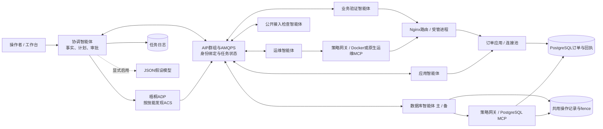

# 当前源码事实与技术写作输入

本文件汇总10月29日工作树的源码、依赖与部署定义，供技术方案和报告查阅。运行结果见对应E编号证据。

- 作品名称：联枢多智能体协同运维系统；团队编号：AIC-2026-23708513。
- 代码路径均相对当前团队工作树；绝对路径仅保留在内部核验JSON中。
- 审查日期：2026-10-29，北京时间。
- 审查时 HEAD：`c88b203ff417dca0b028784a569e741d62db2c02`。工作树存在已修改与未跟踪源码，实际内容见源文件清单。
- 下文 `路径:行号` 均相对此源码目录，指向本次读取的实际代码。
- 机器可读绑定：`当前源码引用清单.json`；包括审查时 Git 状态、被引用文件哈希和代码片段。用于定位本次写作引用的源文件。

## 1. 可直接写入技术方案的事实

| 编号 | 当前实现事实 | 源码依据 | 说明 |
|---|---|---|---|
| C01 | 平台配置准备器生成协调者、应用、数据库主/备、运维、验证和可选接入检查角色的配置。数据库备份与主角色归入同一数据库操作范围。 | `domains/setup_platform.py:101`、`domains/setup_platform.py:121`、`domains/setup_platform.py:130` | 七个角色共用统一配置结构；平台注册记录见E09，能力查询见E10。 |
| C02 | 业务包含 PostgreSQL 订单存储、两个应用版本、Nginx 入口。Compose 定义 postgres:16-alpine、app-v1、app-v2、nginx:1.27-alpine。 | `deploy/compose.yml:25`、`deploy/compose.yml:48`、`deploy/compose.yml:58`、`deploy/compose.yml:68` | 提供包含入口、应用与数据库的订单业务原型。 |
| C03 | 订单写入和原请求回执在同一 PostgreSQL 事务提交；相同 operation_key 先通过事务级 advisory lock 串行化；相同键但参数摘要不同则拒绝。 | `business/order_app/store.py:140`、`business/order_app/store.py:145`、`business/order_app/store.py:170` | 同一操作键用于识别重复请求，订单与回执在同一事务提交。 |
| C04 | 调度器维护事故、逻辑任务、操作三个不同标识；写操作 operation_id 绑定事故和逻辑动作，不随 AIP 传输尝试改变。 | `incident/coordinator/engine.py:49`、`incident/coordinator/engine.py:63` | 操作编号保持稳定，每次任务发送另记一次尝试。 |
| C05 | ADP 按 active 和 skills.id 查询 ACS；同时容纳 online/offline/unknown 的公开存活标签，但只保留匹配技能且具有 amqps 端点的候选。 | `incident/selection.py:30` | 发现后继续查询候选的实际能力。 |
| C06 | 候选必须经过实际 group describe 往返确认，再匹配 executor_aic、资源范围和所需工具；可配置可信 AIC 白名单。 | `incident/selection.py:61`、`incident/wutong_transport.py:71` | 确认执行者身份、工具与可操作的服务范围后分配任务。 |
| C07 | 正式传输加载信任链及协调者自己的证书/私钥，开启 identity_binding，经 SDK 创建 AMQPS 群组。协调配置禁止混入数据库 URI、MCP 进程配置等服务配置。 | `incident/wutong_transport.py:117`、`domains/setup_platform.py:192` | 各服务保存自己的凭据；证书和平台注册资料在接入前配置。 |
| C08 | AIP 派发执行 start_task→等待 AwaitingCompletion→读取执行结果→校验执行者、事故与逻辑任务→complete_task→等待 Completed。 | `incident/wutong_transport.py:189` | 任务状态与订单验证结果分别记录。 |
| C09 | 上游 SDK 存在证书AIC提取和群组 AMQP user_id 与 senderId 绑定机制；本项目调用此机制。 | `vendor/ACPs-community/acps-sdk/acps_sdk/aip/aip_identity.py:86`、`vendor/ACPs-community/acps-sdk/acps_sdk/aip/aip_group_identity.py:37` | 证书与群组身份绑定复用官方SDK。 |
| C10 | MCP 客户端使用官方 Python SDK 的 ClientSession 与 stdio_client，实际 initialize、分页 list_tools、call_tool；初始化阶段校验策略所列工具确实存在。 | `acps_mcp_bridge/client.py:26`、`acps_mcp_bridge/client.py:53`、`acps_mcp_bridge/bridge.py:167` | 先初始化MCP会话并核对工具，再发起调用。 |
| C11 | 资源策略校验调用者、工具白名单、参数 JSON Schema、任务类型与风险等级；写操作要求 operation_id 和 fence，高风险要求审批证明；含调用频率限制。 | `acps_mcp_bridge/policy.py:61`、`acps_mcp_bridge/policy.py:65` | 本地权限检查记录见E14。 |
| C12 | 高风险动作先进入 awaiting_approval，最多等待900秒；审批确认后才签发证明。HMAC证明绑定调用者、事故、操作、工具、参数和有效期。工作台提供审批接口。 | `incident/coordinator/engine.py:160`、`acps_mcp_bridge/approval.py:10`、`acps_mcp_bridge/approval.py:25`、`workbench_server.py:182` | 审批路径见工作台接口，录制案例的审批记录见E11。 |
| C13 | 网关对目标容器进行资源标签检查，对终止数据库阻塞会话重新核对实际 blocker PID；SQL 来自资源端固定模板。 | `acps_mcp_bridge/bridge.py:254`、`acps_mcp_bridge/bridge.py:259`、`acps_mcp_bridge/policy.py:100` | 按资源标签、进程标识和固定SQL模板检查操作范围。 |
| C14 | OperationLedger 用 SQLite共用操作记录持久化 operation_id、参数摘要、状态与 fence；旧令牌和同键不同参数被拒绝，已应用操作返回已有结果。 | `vendor/ACPs-community/acps-sdk/acps_sdk/aip/resumable/ledger.py:55`、`vendor/ACPs-community/acps-sdk/acps_sdk/aip/resumable/ledger.py:194` | 相关写入者需共用操作记录，或采用资源自身的隔离约束。 |
| C15 | 执行中断后的 executing/unknown/failed 不直接重发修改；先只读核对资源。已达到目标状态则对账为 applied，否则保持待核对；可重试需显式前态证据与重试选项。 | `vendor/ACPs-community/acps-sdk/acps_sdk/aip/resumable/ledger.py:224`、`acps_mcp_bridge/bridge.py:221` | 结果未知时先查询资源，继续保留尚待核对的状态。 |
| C16 | 备用接管重新 ADP 发现、确认完整资源范围，递增 takeover_version，发送包含剩余任务和证据引用的 ResumePackage；仅在新 fence 得到确认后改选参与者。 | `incident/wutong_transport.py:345`、`incident/wutong_transport.py:370`、`incident/wutong_transport.py:397` | 备用需完成发现、能力确认，并具有相同资源范围。 |
| C17 | 接管时读操作可以在备用重新执行；写操作依操作记录结果决定复用、继续未执行操作或保留 unknown。 | `incident/wutong_transport.py:406` | 备用按操作状态复用结果、继续执行或保留未知。 |
| C18 | 持久化任务日志在发布前登记 attempt；发布发生异常则标 delivery_unknown。 | `vendor/ACPs-community/acps-sdk/acps_sdk/aip/resumable/journal.py:152` | 发送异常记为delivery_unknown，后续核对接收与执行结果。 |
| C19 | 基础证据调度以假设预测间的区分度 D、观察成本 C 和时间项 T，按 D/(C+0.2T) 排序；修复动作依具体事实与资源依赖产生，修改后失效相关旧事实。 | `incident/coordinator/planner.py:73`、`incident/coordinator/planner.py:160`、`incident/coordinator/planner.py:198` | 代码实现上述排序公式与动作安排。 |
| C20 | 可选事故级规划器保留未知证据，避免用缺失预测直接排除原因；选择不同服务、区分度为正的检查，最多并发3个服务，每个服务同时1个任务。 | `incident/coordinator/incident_planner.py:21`、`incident/coordinator/incident_planner.py:57`、`incident/coordinator/engine.py:274` | 域指应用、数据库等逻辑权限范围。 |
| C21 | 模型是可选 Chat-compatible JSON 假设生成器；显式启用并配置端点和模型才发请求。输出受可观察工具/结果枚举、Schema、调用/Token预算和超时约束；失败可回退规则假设并记录来源。 | `incident/coordinator/hypothesis.py:80`、`incident/coordinator/hypothesis.py:106`、`incident/coordinator/hypothesis.py:172` | 模型通过兼容Chat接口生成JSON格式的故障原因。 |
| C22 | 模型提示要求产生可观察假设而非直接给动作；按明确规则运行的规划程序依据实际事实形成修改动作。事故级模式把初次假设生成与入口观察交叠，必要时等待模型。 | `incident/coordinator/hypothesis.py:185`、`incident/coordinator/engine.py:310` | 模型提出原因，程序根据检查结果安排操作。 |
| C23 | 当前工作台创建 IncidentCoordinator 时不传 IncidentPlanner/incident_hypotheses；构造器默认 EvidencePlanner、incident_hypotheses=False。M2v2由 eval/run.py 方法分支显式启用。 | `workbench_server.py:76`、`incident/coordinator/engine.py:17`、`eval/run.py:235` | 网页默认使用EvidencePlanner；M2v2通过eval/run.py显式启用。 |
| C24 | 最终验证将原请求回执、症状检查遗留意图、全新业务窗口分开检查；订单客户端核对API版本与原始键，实际执行创建→查询→取消流程。默认新窗口30秒，要求至少10个完整流程且无未完成意图。 | `incident/partners.py:150`、`incident/partners.py:169`、`business/load.py:57`、`business/load.py:136` | 默认验证30秒、至少10个完整流程；实际运行结果见E11、E12。 |
| C25 | service_recovered 与 original_request_resolved 分列，只有两者同时满足才给 business_recovered；缺少原请求键或回执时保留人工核对状态。 | `incident/partners.py:185`、`incident/coordinator/engine.py:200` | 分别核对服务恢复与原订单处理结果。 |
| C26 | 数据库MCP依赖 postgres-mcp==0.3.0 与 MCP v1；Docker MCP为 mcp-server-docker==0.3.0，依赖文件要求独立环境。 | `domains/database/requirements.txt:6`、`domains/ops/requirements.txt:1`、`requirements-high-score.txt:3` | 数据库与Docker工具使用上述第三方依赖。 |
| C27 | review.py 为本地容器演示入口，支持原生Docker或Windows通过WSL调用Docker；正式平台需要独立证书、AIC、信任链、发现地址和群组认证配置。 | `deploy/review.py:61`、`deploy/review.py:158`、`domains/setup_platform.py:94` | 本地Docker演示与梧桐接入分别配置，正式接入准备证书与身份资料。 |
| C28 | 接入检查作为独立可选角色只处理公开元数据；公开服务配置不允许加载资源环境文件。 | `incident/platform_worker.py:45`、`incident/platform_worker.py:295`、`domains/onboarding/check.py:33` | 公开角色处理登记元数据，资源操作使用各服务的独立配置。 |

## 2. 三项主要机制

### 机制一：中断后按操作记录继续任务

执行者失联或回复丢失后，备用先核对操作记录，再决定下一步。

实现：稳定的操作编号、每次attempt记录、递增fence、操作前后状态检查，以及同一服务的备用接管。已完成操作返回已有结果，尚待确认的操作保留未知状态。对应 C04、C14–C18。

适合展示的图：正常写操作与中断接管两条并列时序；突出“先确认新fence，再依据操作记录决定继续”。本地核心测试与中断测试见E06、E07，云端接管见E12。

### 机制二：各服务独立管理凭据与操作权限

协调者负责分配任务，数据库、应用与运维智能体分别保管自己的凭据。

实现：协调者通过AIP派发统一ifc任务，各服务分别配置自己的MCP工具环境；用当前工具清单＋describe确认、调用者和工具白名单、Schema、高风险审批、资源检查以及脱敏结果约束执行。对应 C06–C13、C26、C28。

适合展示的图：协调域、数据库域、应用域、运维域、验证域的边界图；每个服务标“凭据留在本域”。权限检查与审批测试见E14，发现与能力确认见E10。

### 机制三：根据检查结果修复，再验证订单

故障检查需要安排步骤，恢复后还需核对原请求与新订单结果。

实现：模型只生成受限假设，按明确规则运行的规划程序按区分度/成本排序、处理证据冲突与依赖；动作后刷新证据。可选事故级模式合并同次事故的假设生成并限制跨域并发。最终独立检查原回执、遗留意图与新业务窗口。对应 C19–C25。

适合展示的图：假设→观察排名→事实→动作/审批→再观察→订单验证。E11采用预设检查顺序，模型调用0。评分选择与模型辅助诊断的效果对比列入后续评估。

## 3. 架构绘图关系

绘图说明：模型是可选组件；“七身份”含数据库主/备两个执行身份；数据库主/备依赖同一受控资源状态与操作记录。接入检查只读公开元数据。图中按应用、数据库和运维划分职责与凭据范围。引用 C01–C03、C05–C10、C14、C21、C28。

## 4. 方法流程文字

1. 操作者提交症状及可选原请求键，协调者建立事故与任务记录。（C04）
2. 从ADP获取技能候选，实际describe核对身份、资源和工具。（C05–C06）
3. 以固定规则或显式启用的JSON模型建立诊断假设；依据观察事实选择后续检查。（C19–C22）
4. 形成受依赖和前置条件约束的动作；高风险动作等待审批。（C11–C13、C19）
5. 经AIP完整任务链派发，执行智能体按任务调用指定MCP工具并写入操作记录。（C08、C10、C14）
6. 遇到失联/不确定结果时保存未知状态；满足条件时重新发现备用、确认新fence并按操作记录继续执行。（C15–C18）
7. 验证原请求回执、遗留意图和新订单业务窗口，分别返回服务恢复与原请求处理状态。（C24–C25）

## 5. 技术材料与证据入口

| 章节 | 主要内容 | 证据入口 |
|---|---|---|
| 概述与需求 | 订单入口、应用连接与数据库写入的故障，以及各角色的操作权限 | 报告第1章、E11 |
| 架构与选型 | 七角色配置、AIP/ADP通信、AMQPS身份绑定、MCP工具与订单回执 | C01—C03、C05—C14；E09、E10 |
| 核心实现 | 任务编号、权限检查、操作记录、备用接管与订单验证 | C04—C25、当前源码引用清单.json |
| 项目实施 | 本地和云端部署、审批过程、源码版本及测试问题 | E06—E08、E11、E12 |
| 应用结果 | 任务请求与返回、订单流程、平台访问统计 | E11—E13 |
| 后续计划 | 更多服务接入、跨进程权限检查和可选模型评估 | 答辩PPT材料/7-应用前景.md |
| 附录 | 源文件清单、依赖、许可证与部署命令 | 当前源码/SOURCE-SNAPSHOT.json、当前源码/THIRD_PARTY.md |

## 6. 运行条件与准备事项

- 代码版本包括提交号与采集时工作树，实际文件以对应清单为准。
- 相关写入者共用SQLite操作记录，工具进程的权限与生命周期一并管理。依据 `vendor/ACPs-community/acps-sdk/acps_sdk/aip/resumable/ledger.py:55`。
- 接管前确认备用的身份、能力和资源范围；修改结果尚待核对时保留unknown。依据 `incident/wutong_transport.py:360`、`incident/wutong_transport.py:406`。
- 当前规则处理应用、入口和数据库的已定义故障，工具与结果类别见 `incident/coordinator/hypothesis.py:17`、`incident/coordinator/planner.py:160`。
- 工作台默认使用EvidencePlanner；M2v2由评测入口启用，见C23。
- 正式接入准备AIC、证书和信任链，运行时复用SDK身份机制，见C07、C09。
- 调用数量、模型用量、恢复结果和失败记录按实际运行证据统计，见E06—E15。
